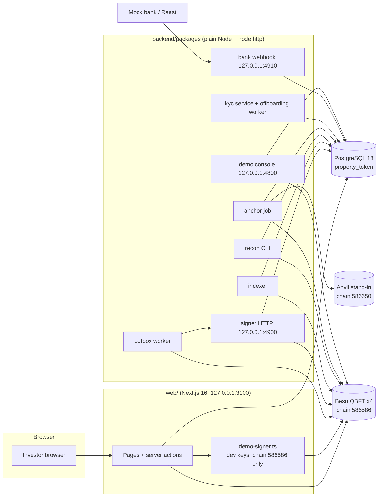
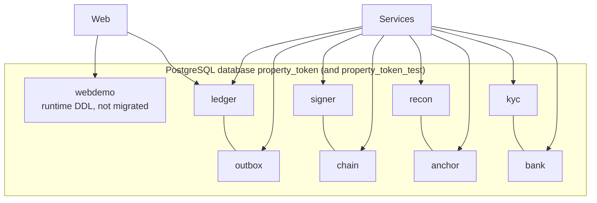
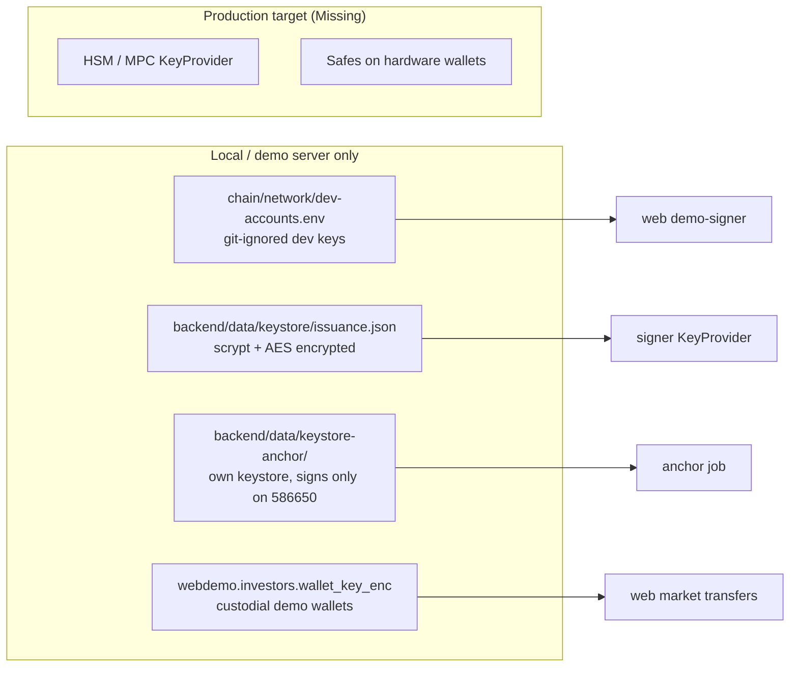

# Architecture

- Audited commit: `main` @ `41241b3` (2026-10-13). Everything below is **Verified** against code unless marked otherwise.
- Decisions behind this design: [DECISIONS.md](DECISIONS.md). Flows: [FLOW_DIAGRAMS.md](FLOW_DIAGRAMS.md). Tables: [DATABASE_DESIGN.md](DATABASE_DESIGN.md).

## 1. Components

Note: on `main` the website does **not** use the outbox, signer or read model; it signs with `demo-signer.ts` and reads the chain directly. Moving it onto the backend path is Step 5h (in progress on a branch).

| Component | Location | Responsibility | Runs as |
|---|---|---|---|
| Contracts | `contracts/src` | ERC-3643 suite + guards (only token agents) + registries + StateAnchor | Deployed by `contracts/script/DeployLib.sol` |
| Private chain | `chain/net.py` | 4 Besu QBFT validators, 2 s blocks, immediate finality, RPC 127.0.0.1:8545-8548 | Local processes (JDK 25) |
| Anchor chain | `chain/anchor.py` | Anvil stand-in for the public L2 (127.0.0.1:8650, chain 586650) | Local process |
| `@pt/config` | `B/config` | zod-validated settings; refuses dev chain and non-TLS DB in production | library |
| `@pt/logger` | `B/logger` | pino with redaction | library |
| `@pt/db` | `B/db` | pool, migration runner (`npm run migrate`) | library + CLI |
| `@pt/contracts` | `B/contracts` | typed ABIs (`npm run gen:abis`) | library |
| `@pt/ledger` | `B/ledger` | typed calls to `ledger.*` SQL functions | library |
| `@pt/outbox` | `B/outbox` | `enqueue`, `OutboxWorker`, `Executor` interface | library |
| `@pt/signer` | `B/signer` | KeyProvider (encrypted keystore), policy, maker-checker, nonces, audit, HMAC HTTP API, `signerExecutor` | `npm run signer` |
| `@pt/indexer` | `B/indexer` | chain events into schema `chain`; `verify` | `npm run indexer` |
| `@pt/recon` | `B/recon` | three-way reconciliation, payout gate | `npm run recon` (one run per call; no scheduler) |
| `@pt/anchor` | `B/anchor` | hourly anchor, `verify` | `npm run anchor` |
| `@pt/kyc` | `B/kyc` | onboarding with provider mocks, rescreen, clearances, offboarding worker | library + CLI |
| `@pt/bank` | `B/bank` | webhook server, payment intents, payees, payout batches, `MockBank` | `npm run bank` |
| `@pt/demo-console` | `B/demo-console` | presentation console (validators, token, ledger, scenario buttons) | `npm run demo` |
| Website | `web/` | investor prototype; own `webdemo` schema, own ledger client, demo signer | `npm run dev` / `next start` |
| Demo server | `deploy/demo-server` | one VPS: Besu x4, PostgreSQL, web behind nginx :80, console | systemd units |

`B/` = `backend/packages/`. ADR 0001 named NestJS on Fastify and Redis/BullMQ; neither is used (see DECISIONS.md, task T-010).

## 2. Data boundaries

- One schema per concern; each service gets a NOLOGIN role with only the functions it needs (`REVOKE ALL ... FROM PUBLIC` in `0001_schemas.sql`). Writes go through `SECURITY DEFINER` functions; tables are append-only where it matters. Details: [DATABASE_DESIGN.md](DATABASE_DESIGN.md).
- The website connects as the PostgreSQL **admin** user (`PG_ADMIN_USER`, default `pt_admin`, `web/src/lib/server/db.ts`) and writes `webdemo.*` plus `ledger.*` through `ledger.post_journal` (`web/src/lib/server/ledger.ts`). It does not use the per-service roles (task T-012).
- Personal data: backend KYC stores keyed hashes, last four digits and an AES-256-GCM sealed name (Y-1). The web prototype stores CNIC last 4 + HMAC and phone last 3 (`webdemo.investors`).

## 3. Key boundaries

- Only the signer holds issuance keys in the backend path; it signs but never broadcasts (outbox records first). Verified: `backend/packages/signer/src/http.ts`, ADR 0005.
- The `KeyProvider` interface (`backend/packages/signer/src/keystore.ts`) is the seam for HSM/MPC; no production implementation exists.
- Secrets live in git-ignored `backend/.env.local` and `web/.env.local`, created by `npm run signer:setup`, `kyc:setup`, `bank:setup`, `anchor:setup`, `setup:demo`.

## 4. Network exposure

| Port | Process | Binding |
|---|---|---|
| 8545-8548 | Besu RPC | 127.0.0.1 |
| 8650 | Anvil anchor stand-in | 127.0.0.1 |
| 5433 | PostgreSQL (local cluster) | 127.0.0.1 |
| 3100 / 3101 | web dev / e2e | 127.0.0.1 |
| 4800 | demo console | 127.0.0.1 (Host and Origin checks) |
| 4900 | signer (`SIGNER_PORT`) | 127.0.0.1 |
| 4910 | bank webhook (`BANK_PORT`) | 127.0.0.1 |
| 80 | nginx on the demo server | public |

## 5. Deployment

CI on `main` gates a GitHub Actions deploy to the private IP demo server (flow: [FLOW_DIAGRAMS.md §9](FLOW_DIAGRAMS.md#9-deploy-pipeline)). Services on the demo server: `pt-stack` (PostgreSQL + Besu), `pt-web` (Next.js on 127.0.0.1:3100 behind nginx :80), `pt-console`. The indexer, recon, anchor, signer and bank services are not deployed there. See [deploy/demo-server/README.md](../deploy/demo-server/README.md).
