# Flow Diagrams

- Audited commit: `main` @ `41241b3` (2026-10-13). One diagram per flow. Each flow names the code that implements it; all are **Verified** against that code unless marked.
- Components: [ARCHITECTURE.md](ARCHITECTURE.md). Tables and rule IDs (L-, O-, S-, C-, R-, A-, Y-, B-, H-, I-): [DATABASE_DESIGN.md](DATABASE_DESIGN.md).

## 1. Investor onboarding and KYC

### 1a. Web prototype (what the website does today)

Code: `web/src/app/actions/auth.ts` `signUp`, `web/src/lib/server/onboarding.ts`.

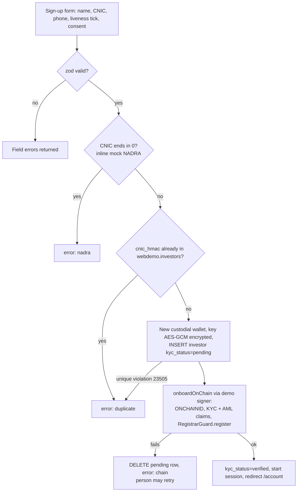

### 1b. Backend KYC service (not yet used by the website)

Code: `backend/packages/kyc/src/service.ts` `KycService.onboard`, migration `0009_kyc_bank.sql`.

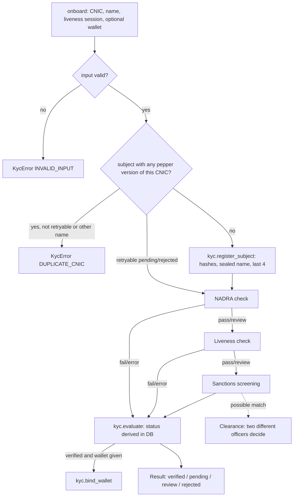

Provider errors are recorded as `error` and never pass (fail-closed).

## 2. Sign-in and session (web)

Code: `web/src/app/actions/auth.ts`, `web/src/lib/server/session.ts`, `web/src/lib/server/rate-limit.ts`.

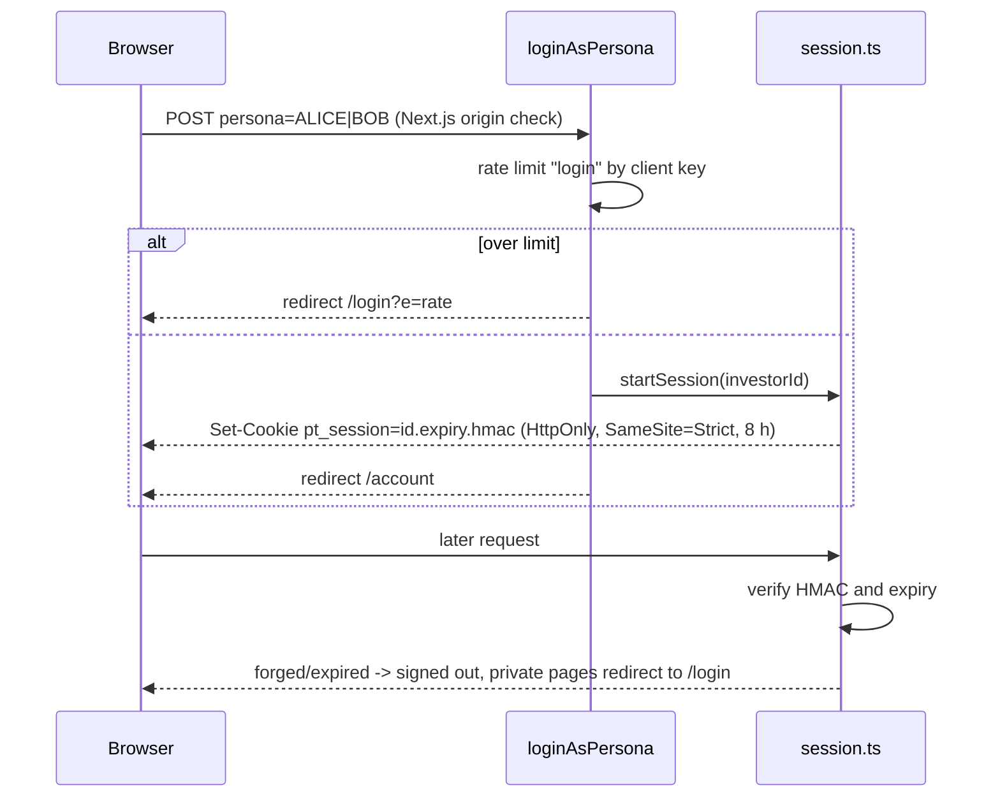

No passwords; passkeys are planned (task T-030).

## 3. Invest, payment, ledger, mint

### 3a. Current path on `main` (web demo signer)

Code: `web/src/lib/server/invest.ts`, `web/src/lib/server/demo-signer.ts`.

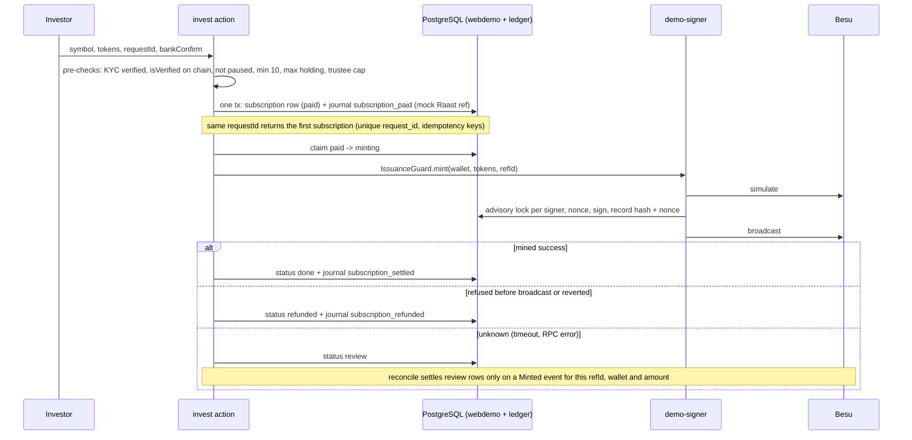

### 3b. Target path (Step 5h, in progress on a branch)

Code on `main`: `backend/packages/outbox/src/index.ts`, `backend/packages/signer/src/executor.ts`, `service.ts`. The web wiring is not on `main` (Incomplete).

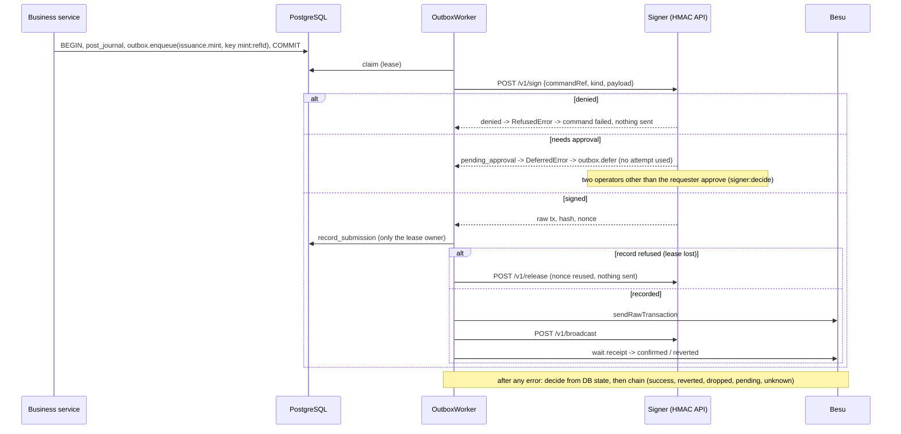

## 4. Market delivery versus payment (demo only)

Code: `web/src/lib/server/market.ts`.

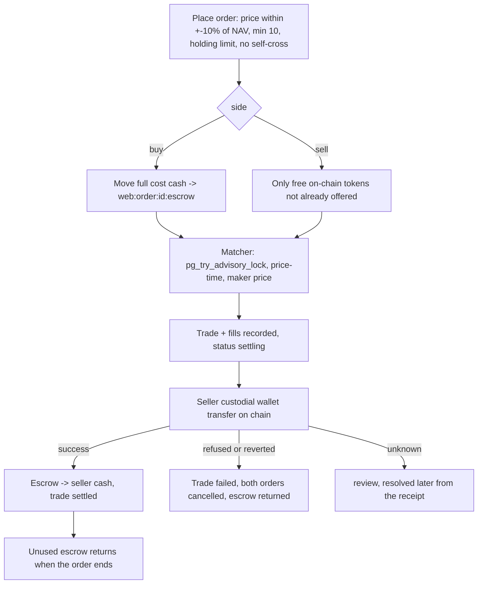

## 5. Rent distribution, Merkle verify, payout batches, held payouts

Code: `chain/rent.py`, `contracts/src/registries/DistributionRegistry.sol`, `web/src/lib/server/rent.ts`, `backend/packages/bank/src/service.ts`, migrations `0009`, `0010`, `0011`.

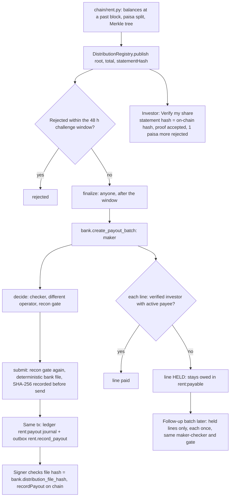

Gap: publish/finalize are done only by the dev script `chain/rent.py`; no backend command kind exists (task T-022). No producer books `rent:distribution:*` journals yet, so reconciliation reports `rent.missing_ledger` on the local chain.

## 6. Reconciliation, payout freeze and unfreeze

Code: `backend/packages/recon/src/run.ts`, `0006_recon.sql`, `backend/packages/signer/src/service.ts` `payoutGateDenial`.

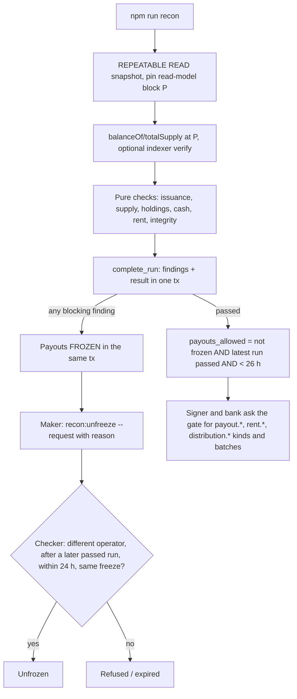

## 7. Public anchoring

Code: `backend/packages/anchor/src/anchorer.ts`, `0007_anchor.sql`, `contracts/src/anchor/StateAnchor.sol`.

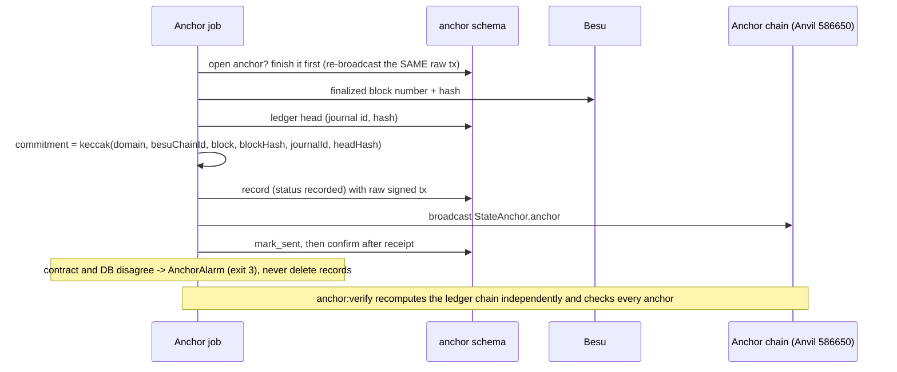

## 8. Offboarding and freeze

Code: `0011_integration.sql` `kyc.enqueue_offboarding`, `backend/packages/kyc/src/offboarding.ts`, `backend/packages/signer/src/policy.ts`.

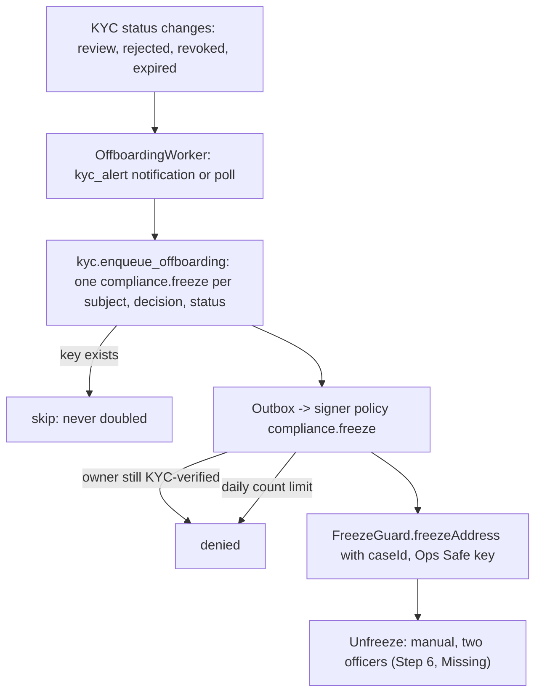

Per finding F-01/F-02 the full order is freeze, then move or redeem tokens, then delete identity via timelock; only the freeze is automated.

## 9. Deploy pipeline

Code: `.github/workflows/ci.yml`, `deploy-demo.yml`, `deploy/demo-server/ci-entry.sh`, `update.sh`.

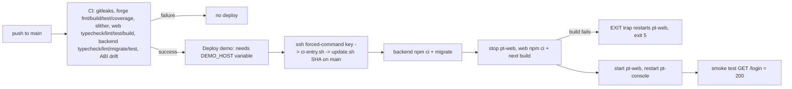

The chain is not touched by updates. Playwright e2e does not run in CI (task T-011).
