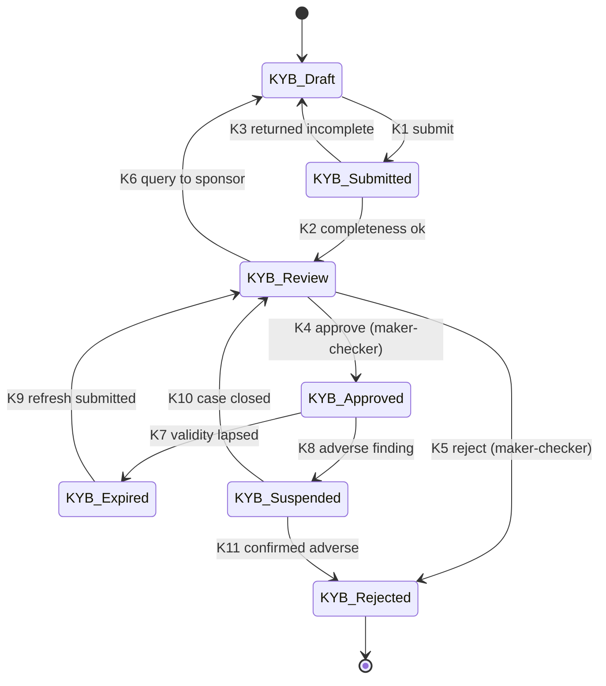
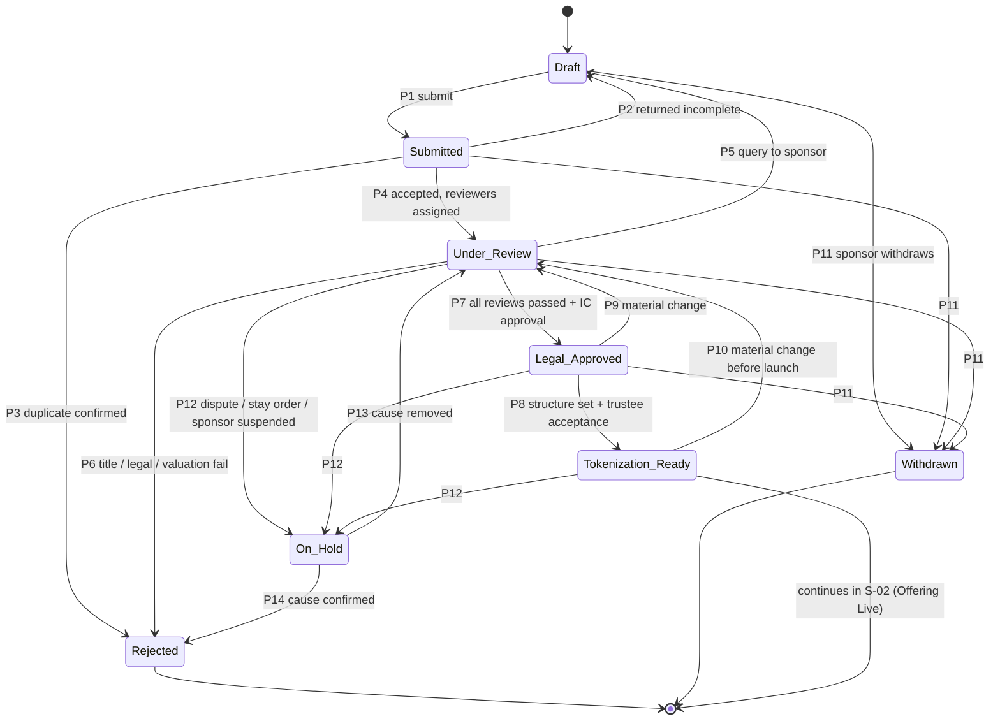

# S-01: Owner onboarding, property submission and due diligence

- Status: Draft for owner review (functional specification; no code yet)
- Date: 2026-10-13
- Lifecycle stages: 1 (platform setup, the parts that concern a property), 2 (owner onboarding), 3 (property submission), 4 (legal and financial due diligence), and the entry to 5 (legal structuring)
- Exceptions covered: rejected title, duplicate property
- Builds on: [contract-spec](../contract-spec.md) §6.2 (DocumentRegistry), [threat model](../threat-model.md) T-1..T-3, KYC-1, KYC-2, D-2, [ADR 0009](../decisions/0009-kyc-and-bank.md) (KYC subjects, sanctions review, retention)

Conventions used in every spec of this folder (roles, ID prefixes, "LEGAL TO CONFIRM") are in [README.md](README.md).

## 1. Purpose and scope

Decide, with evidence, whether a property and its owner (the **sponsor**) may be tokenized. The output is a property in state **Tokenization Ready**: title verified, encumbrances known, independently valued, a legal opinion on file, a legal structure chosen (trust/REIT or SPV, conventional or Shariah), and every document stored with its SHA-256 hash.

In scope: sponsor KYB, sponsor representatives' KYC, property submission, document intake and hashing, duplicate detection, title and encumbrance review, valuation, legal opinion, reviewer decisions, investment-committee and trustee acceptance.

Out of scope: offering terms and the token deployment (S-02), operations (S-03). Nothing in this spec touches the chain except the later anchoring of document hashes (§7).

## 2. Actors and roles

| Role | Who | Does |
|---|---|---|
| Sponsor representative | Authorised person of the owner company (or the individual owner) | Submits KYB, the property and documents; answers queries |
| Onboarding officer | Platform operations | Checks completeness, runs duplicate detection, assigns reviewers |
| Compliance officer | Platform compliance | KYB decision, beneficial-owner and sanctions/PEP screening, FMU reporting |
| Legal reviewer | Independent counsel engaged by the platform (not the sponsor's lawyer) | Title chain, encumbrances, litigation search, legal opinion |
| Valuation reviewer | Platform finance | Commissions two independent valuers, reviews reports |
| Independent valuer (x2) | Valuers on the approved panel (threat T-3) | Valuation reports |
| Technical reviewer | Engineer engaged by the platform | Building condition, approvals, completion certificate, insurance |
| Investment committee | At least three members, at least one independent | Approves the property for structuring |
| Trustee officer | Trustee (e.g. CDC) | Accepts the property and the structure; nothing proceeds without it |

**Separation of duties (SoD).**

- OB-SOD-1: The person who submits or completes a file never decides it. The onboarding officer who assigns reviewers is not one of them.
- OB-SOD-2: The KYB decision needs a compliance maker and a different compliance checker. A possible sanctions/PEP match follows ADR 0009 Y-4 (two different officers).
- OB-SOD-3: The legal reviewer, the valuation reviewer and the technical reviewer are three different people. Neither valuer may be related to the sponsor, the other valuer or the platform's staff; each signs an independence declaration.
- OB-SOD-4: No member of the investment committee who has a conflict (declared or found) may vote; a conflict is recorded.
- OB-SOD-5: The trustee's acceptance is independent of every platform decision and is recorded under the trustee officer's own identity (Step 6 trustee portal, SSO and hardware key).

## 3. State machines

### 3.1 Sponsor (KYB)

| # | Guard | Actor | Maker-checker | Audit event |
|---|---|---|---|---|
| K1 | Mandatory fields and documents present; every representative started KYC | Sponsor representative | No | `sponsor.submitted` |
| K2 | Documents readable, hashes recorded | Onboarding officer | No | `sponsor.accepted_for_review` |
| K3 | Reason (10–500 chars) | Onboarding officer | No | `sponsor.returned` |
| K4 | Registration verified with SECP; every beneficial owner ≥ threshold (OB-4) and every representative is KYC `verified` (`kyc.is_verified`); screening clear; no open query | Compliance maker + checker | **Yes** | `sponsor.kyb_approved` |
| K5 | Reason; FMU assessment recorded (OB-9) | Compliance maker + checker | **Yes** | `sponsor.kyb_rejected` |
| K6 | Query text | Compliance officer | No | `sponsor.query_raised` |
| K7 | Scheduled: 365 days after approval, or a representative or beneficial owner loses `verified` | System | No | `sponsor.kyb_expired` |
| K8 | Re-screening hit, adverse media, court order, insolvency | Compliance officer | No (protective) | `sponsor.suspended` |
| K9 | Updated documents | Sponsor representative | No | `sponsor.refresh_submitted` |
| K10 | Case closed with reason | Compliance maker + checker | **Yes** | `sponsor.reinstated` |
| K11 | Reason | Compliance maker + checker | **Yes** | `sponsor.kyb_rejected` |

### 3.2 Property (up to Tokenization Ready)

| # | Guard | Actor | Maker-checker | Audit event |
|---|---|---|---|---|
| P1 | Sponsor `KYB_Approved`; identifiers complete (OB-10); every mandatory document uploaded and hashed (OB-12); duplicate check run with no exact match (OB-14) | Sponsor representative | No | `property.submitted` |
| P2 | Reason | Onboarding officer | No | `property.returned` |
| P3 | Exact or confirmed duplicate (OB-15) | Onboarding officer + compliance officer | **Yes** | `property.rejected_duplicate` |
| P4 | Possible duplicates cleared (OB-15); three different reviewers assigned (OB-SOD-3) | Onboarding officer | No | `property.review_started` |
| P5 | Query text; review clocks pause | Any reviewer | No | `property.query_raised` |
| P6 | Reviewer finding with reason; confirmed by a second reviewer of the same discipline or the legal head | Reviewer + checker | **Yes** | `property.rejected` |
| P7 | Title review passed (OB-20); encumbrances cleared or accepted with conditions (OB-22); two valuations within tolerance (OB-26); legal opinion unqualified or with accepted qualifications (OB-28); technical review passed (OB-30); sponsor still `KYB_Approved`; IC approval by quorum (OB-33) | IC chair records, IC members vote | **Yes** (quorum) | `property.legal_approved` |
| P8 | Structure decision recorded (OB-35); trust deed / SPV documents final and hashed; trustee acceptance (OB-37); property-level SoD respected | Trustee officer (acceptance) after platform legal head (structure) | **Yes** | `property.tokenization_ready` |
| P9, P10 | Material change (OB-39): new encumbrance, new litigation, valuation older than its validity, change in owner or title | Any reviewer or system | No (protective) | `property.reopened` |
| P11 | Before Tokenization Ready, or before the offering goes live; reason | Sponsor representative | No | `property.withdrawn` |
| P12 | Stay order, lis pendens, sponsor suspended, fraud indicator | Legal reviewer or compliance officer | No (protective) | `property.on_hold` |
| P13 | Cause removed, evidence hashed | Legal reviewer + legal head | **Yes** | `property.resumed` |
| P14 | Cause confirmed | Legal reviewer + legal head | **Yes** | `property.rejected` |

Every audit event is appended to a hash-chained, append-only audit log with UTC timestamps (same pattern as `kyc`, `bank`, `recon`; finding F-04).

## 4. Business rules

### Sponsor KYB

- **OB-1** A sponsor is a company registered with SECP or an individual owner. A company provides: certificate of incorporation, CUIN, memorandum and articles, latest annual return, list of directors, NTN and sales-tax registration where applicable, board resolution naming the authorised representatives and their powers. LEGAL TO CONFIRM the exact list.
- **OB-2** The company's registration is verified against SECP's records (eServices or a provider); a manual check records who checked, when, and the evidence hash.
- **OB-3** Every director, authorised representative and beneficial owner is a KYC subject in `@pt/kyc` (NADRA, liveness, sanctions; ADR 0009 Y-1..Y-6). No separate identity store is created. Individual owners go through the same subject flow.
- **OB-4** Beneficial owners: every natural person who owns or controls, directly or indirectly, at least the threshold of shares or voting rights, or otherwise exercises control, is identified down the ownership chain. Default threshold 25 %; LEGAL TO CONFIRM against the SECP beneficial-ownership rules and the AML/CFT regulations (possibly 10 % for higher risk).
- **OB-5** Screening covers the company, its directors, representatives and beneficial owners against the sanctions lists (UN consolidated list, NACTA proscribed persons) and PEP lists. A hit on any of them stops onboarding (K5 or K8).
- **OB-6** Risk rating (low, medium, high) with reasons; high risk needs enhanced due diligence (source of wealth of the beneficial owners, source of the property) and a senior compliance approver as checker.
- **OB-7** KYB is valid for 365 days and is refreshed before any new property submission or offering launch if older.
- **OB-8** A representative acts only within the powers in the board resolution; every submission records which representative acted.
- **OB-9** If anything gives grounds to suspect money laundering or terrorist financing, the compliance officer assesses an STR to FMU. The sponsor is never told (tipping-off). LEGAL TO CONFIRM the reporting channel and deadline.

### Property submission

- **OB-10** Identifiers recorded for every property (all that apply): province, district, tehsil, revenue estate (mauza) or housing society/authority; khewat, khatooni and khasra numbers or plot/building/unit number; Sub-Registrar office, registered deed number, volume, page, date; land-record reference (e.g. PLRA fard or the province's equivalent); development-authority file number; property-tax (Excise and Taxation) number; covered and land area with units; GPS coordinates of the main entrance; floor and unit numbers for a part of a building.
- **OB-11** A normalised **property key** is derived from the identifiers: province + district + (mauza or society) + (khasra/khewat or plot) + unit, uppercased, punctuation and spaces removed, Urdu numerals converted. It is stored with the identifiers.
- **OB-12** Every uploaded file is stored once in the encrypted document store; the record keeps the SHA-256 of the exact bytes, size, media type, uploader, upload time (UTC) and the document type. Re-uploading changes nothing; a corrected document is a new document that supersedes the old one (never overwritten, mirroring DocumentRegistry's `supersede`).
- **OB-13** Mandatory documents before P1: title deed (registered sale deed, lease or transfer letter), current land-record extract, approved building plan, completion or occupancy certificate (for built property), property-tax receipts for the last three years, utility bills, existing leases and rent rolls, existing mortgages or charges and their bank letters, insurance policy, and the sponsor's authority to sell. LEGAL TO CONFIRM per province.

### Duplicate detection

- **OB-14** At submission, the property key, the registered deed number + Sub-Registrar office, the land-record reference, the GPS point (within 30 m) and the SHA-256 of every document are compared with every other property in **any** state, including rejected and withdrawn ones.
- **OB-15** Outcomes: *exact match* (same property key, or the same deed number at the same office, or an identical document hash on a title document) blocks submission and opens a case; *possible match* (GPS within 30 m, same society and plot with a different unit, address similarity) requires the onboarding officer and a compliance officer to clear or confirm it with reasons (P3 or P4). A cleared possible match is recorded with both decisions.
- **OB-16** The same property may be resubmitted after a rejection only by the same sponsor, only as a new file that links to the rejected one, and only if the rejection reason is marked as curable.
- **OB-17** A property already tokenized (any state from Offering Live onwards) can never be submitted again; an exact match on such a property is a fraud indicator and goes to compliance.

### Due diligence

- **OB-20** Title review covers the chain of ownership back to the original grant or allotment, or at least the default period of 30 years, whichever is shorter (LEGAL TO CONFIRM), with every link supported by a registered instrument or a land-record mutation. Breaks, unregistered links or mismatched areas fail the review unless cured.
- **OB-21** The legal reviewer verifies the title documents directly with the issuing office (Sub-Registrar, land-record authority, society, development authority) and records the verification method, the officer or system, date and evidence hash. A document that cannot be verified at its source fails.
- **OB-22** Encumbrance search: registered mortgages and charges (including SECP's register of charges for a company owner), bank liens, court attachments and stay orders, pending litigation (civil courts, High Court, revenue courts), government acquisition notices, unpaid property tax and dues. Each encumbrance is either discharged before the offering closes (a condition precedent recorded on the property) or the property is rejected. No encumbrance passes to the trustee.
- **OB-23** Physical possession and occupancy are confirmed by a site visit with dated photographs (hashed), including tenants in occupation and their leases.
- **OB-25** Two independent valuers (threat T-3) value the property on the same basis (market value, stated assumptions) within 60 days of each other. Each report is hashed and records the valuer's licence and independence declaration.
- **OB-26** The two values must be within 10 % of the lower one. Otherwise a third valuation is commissioned and the investment committee sees all three. The **offering value** may not exceed the lower of the accepted valuations (S-02 OF-3). A valuation is valid for 6 months for an offering launch. LEGAL TO CONFIRM the valuer panel (e.g. PBA panel) and any SECP REIT valuation rule.
- **OB-28** The independent legal opinion covers: title and its marketability, encumbrances, the sponsor's capacity and authority, transferability to the trustee, stamp duty and registration costs, permitted use, and the enforceability of the chosen structure. Qualifications are listed one by one; each needs an explicit acceptance by the IC or makes the property fail.
- **OB-30** Technical review: structural soundness, approvals versus as-built, fire and safety, environment where relevant, insurance adequacy (reinstatement value). Findings with a cost are carried into S-02 as a capital expense or a reserve.
- **OB-31** Every review records: reviewer, scope, method, findings, conditions, decision, date and the hashes of all documents relied on. A review relies only on documents whose current hash it lists; a superseded document reopens the review (P9).

### Decisions and structuring

- **OB-33** Investment committee: quorum of three, at least one independent member, majority with no independent member voting against; votes and minutes recorded and hashed.
- **OB-35** Structure decision: (a) REIT scheme under the SECP REIT Regulations with the trustee, or (b) SPV whose shares are held by the trustee for unitholders, under the SECP regulatory sandbox; conventional or Shariah-compliant (Ijarah-based rent, Shariah adviser and certificate, no interest-bearing debt or deposits). LEGAL TO CONFIRM which structure the sandbox approval covers. The decision records the rights attached to one unit (income share, exit proceeds share, voting on sale, information rights); S-02 and S-05 read these rights from here.
- **OB-36** The structure fixes the **planned register size** (units) and therefore `trusteeCap` and the `MaxBalanceModule` limit (10 % of the register, contract-spec §4.3). These numbers are approved here and cannot change after token deployment without a timelock operation.
- **OB-37** The trustee accepts the property, the structure, the documents and the planned register size. The trustee's acceptance is the last step before Tokenization Ready and is recorded with the trustee's own identity.
- **OB-38** Tokenization Ready means only "eligible to be offered". It does not move money, deploy anything or create any investor right.
- **OB-39** Material changes (P9, P10) reopen the affected review; the property cannot go live while any review is reopened.

## 5. Data to record (conceptual)

| Entity | Main fields |
|---|---|
| Sponsor | id, type (company, individual), legal name, CUIN or CNIC subject id, NTN, registered address, risk rating and reasons, KYB status, approved/expiry dates |
| Sponsor person | sponsor id, KYC subject id (`kyc.subjects`), roles (director, representative, beneficial owner), ownership % and chain, powers (from the board resolution), valid from/to |
| Property | id, sponsor id, property key, identifiers (OB-10), areas, GPS, use (commercial, residential, mixed), state, structure decision, planned register size, conditions precedent |
| Document | id, owner entity (sponsor or property), type (catalogue §7.2), SHA-256, size, media type, store reference (no personal data in the reference), uploader, uploaded at, superseded by, source verification (method, date, evidence hash), on-chain record id once anchored |
| Duplicate check | property id, run at, candidates with match kind and score, decision per candidate (who, reason) |
| Review | property id, discipline (title, encumbrance, valuation, legal opinion, technical), reviewer, scope, findings, conditions, decision, relied-on document hashes, dates |
| Valuation | property id, valuer, licence, basis, value (paisa), date, report hash, independence declaration hash |
| Committee decision | property id, members, conflicts, votes, minutes hash, decision, date |
| Trustee acceptance | property id, trustee officer, decision, conditions, date |
| Audit log | append-only, hash-chained entries `{actor, action, entity, detail, at (UTC)}` |

Personal data stays in `@pt/kyc` (keyed hashes, sealed names) and in the encrypted document vault (ADR 0009 decision 3); the property records refer to KYC subject ids only.

## 6. Ledger journal conventions

None of these stages moves investor money. Fees the sponsor pays for due diligence (if the commercial model has them) are not trust money: they go to the platform's own accounts, outside the trustee escrow and outside this ledger's `bank:trustee-escrow`. LEGAL TO CONFIRM; open question Q-3.

## 7. On-chain actions and reconciliation

### 7.1 Document anchoring

`DocumentRegistry.add(token, docType, sha256, uri)` needs the token address, which exists only after deployment (S-02, stage 7). Therefore:

- **OB-40** Before deployment, document hashes live in the document records and the hash-chained audit log only.
- **OB-41** Right after the token is deployed (S-02 transition L3), every *current* accepted document of the property and the trust deed is anchored: outbox command kind `document.add` (proposed name), signed by the Ops Safe path, idempotency key `doc:<token>:<documentId>`, `uri = pt-doc://<documentId>` (no personal data, contract-spec §6.2). Superseded documents are anchored first and then marked with `document.supersede` (key `doc:<token>:<oldId>:superseded`), so the on-chain history matches the off-chain history.
- **OB-42** S-02 refuses to launch an offering until every mandatory document has an on-chain record whose SHA-256 equals the stored hash.

### 7.2 Document type mapping

| Our document type | `DocType` |
|---|---|
| Title deed, sale deed, lease from authority | `TitleDeed` |
| Land-record extract (fard etc.) | `LandRecord` |
| Valuation report | `Valuation` |
| Insurance policy | `Insurance` |
| Trust deed, SPV constitutive documents | `TrustDeed` |
| Audited financial statements | `AuditReport` |
| Shariah certificate | `ShariahCertificate` |
| Court order | `CourtOrder` |
| IC minutes (sale votes go to S-05) | `Other` |
| Legal opinion, technical report, offering document, register attestation | `Other` (typed in the off-chain catalogue) |

The enum has no `LegalOpinion` or `OfferingDocument`. Using `Other` with a typed off-chain catalogue needs no contract change; extending the enum means deploying a new DocumentRegistry version through the timelock. Open question Q-5.

### 7.3 Reconciliation checks to add

| Check | Severity | Rule |
|---|---|---|
| `documents.hash_mismatch` | blocking | An on-chain document record whose SHA-256 differs from the off-chain record it claims to be (`uri`) |
| `documents.unanchored` | warning, blocking once an offering is live | A mandatory current document of a deployed property without an on-chain record |
| `documents.unknown_onchain` | blocking | An on-chain record with no off-chain document (someone used the Ops Safe outside the platform) |

These need the indexer to keep DocumentRegistry events in the read model (it already checks document invariants, C-5).

## 8. Exceptions and alternative paths

| Case | Handling |
|---|---|
| Rejected title (break in chain, forged instrument, unverifiable at source) | P6 with reasons; a forged or tampered document is also a compliance case (OB-9) and may be reported to the police by legal. Curable reasons allow a new linked file (OB-16) |
| Duplicate property | OB-14..OB-17. Exact match blocks; possible match needs two decisions; a match on an already tokenized property is a fraud case |
| Sponsor loses KYB during review | Property goes On_Hold (P12); resumes only after K10 |
| Representative's KYC lapses | Their submissions are blocked; another authorised representative continues |
| Valuations diverge > 10 % | Third valuation; IC sees all three; offering value capped at the lowest accepted |
| Encumbrance cannot be discharged before close | Recorded as a condition precedent; S-02 will not complete without it (OF-41) |
| Stay order or litigation appears late | P12 On_Hold at any stage up to Tokenization Ready; if the offering is live, S-02 suspension applies |
| Sponsor withdraws | P11; documents and decisions are kept (retention §11) |

## 9. Notifications

| Event | To |
|---|---|
| Submission received, returned, query raised, rejected, approved | Sponsor representatives |
| Possible duplicate, fraud indicator, sanctions/PEP match | Compliance (never the sponsor for AML matters) |
| Review assigned, reopened, overdue (SLA per discipline, default 10 business days) | Assigned reviewer, onboarding officer |
| Ready for IC, ready for trustee acceptance | IC members, trustee officers |
| KYB expiring in 30 days | Sponsor representatives, onboarding officer |

## 10. Disclosures (carried into the offering, S-02)

The summary of the title review, the encumbrances found and how each was cleared, both valuations (value, basis, date, valuer), the legal opinion's qualifications, the technical findings with their cost, the structure and unit rights, and any related-party relationship between the sponsor, valuers, property manager and platform.

## 11. Regulatory assumptions (LEGAL TO CONFIRM)

1. KYB document list, beneficial-owner threshold and verification method (OB-1, OB-2, OB-4).
2. Title search period and the verification channels per province (OB-20, OB-21).
3. Valuer panel and valuation rules for a REIT or sandbox offering (OB-25, OB-26).
4. Which structure (REIT scheme or SPV) the SECP sandbox will accept, and whether the trustee must hold the title directly or the SPV's shares (OB-35).
5. Record retention: sponsor and property files kept at least 10 years after the property is closed (consistent with ADR 0009 decision 3).
6. STR channel, threshold and deadline; tipping-off rules (OB-9).
7. Stamp duty, capital value tax and registration fees on transfer to the trustee, and who bears them.

## 12. Acceptance criteria

1. A property cannot reach Submitted without an approved sponsor, complete identifiers and hashed mandatory documents.
2. An exact duplicate (same key, same deed number, or an identical title-document hash) is refused at submission, across all states including rejected and withdrawn.
3. Every decision in the tables of §3 that is marked maker-checker is refused when maker and checker are the same person, and when the requester decides their own request.
4. Legal Approved is impossible unless all five reviews have passed, two valuations are within tolerance (or a third was considered), and the IC quorum rule holds.
5. Tokenization Ready is impossible without the trustee's acceptance under a trustee identity.
6. A superseded document reopens every review that relied on it.
7. Every transition writes exactly one audit entry; the audit verification detects an edited, deleted or inserted entry.
8. No sponsor or property table contains a CNIC, a name of a natural person or an IBAN in readable form.

## 13. Test plan

- **Unit:** property-key normalisation (Urdu and Western digits, spacing, punctuation); valuation tolerance at exactly 10 %; quorum rule; transition guards one by one.
- **Property-based:** random sequences of transitions with random actors never reach Legal Approved or Tokenization Ready without the guards; random duplicates (permuted identifiers, re-encoded documents with the same bytes) are always caught; the audit chain verifies after any valid sequence and fails after any single-row edit.
- **Integration (PostgreSQL):** roles and grants (sponsor role cannot read reviews; reviewers cannot approve their own review); append-only enforcement; concurrent submissions of the same property by two sponsors → one succeeds, one is blocked; KYB expiry when a representative's KYC expires.
- **Integration (chain):** anchoring of all documents after a local deployment through `DeployLib`; supersede order; `documents.*` reconciliation checks on a tampered record.
- **E2E (Step 6 portals):** sponsor submits → officer assigns → three reviewers → IC → trustee acceptance; duplicate refused; query round-trip.

## 14. Open questions for the owner

- Q-1 Is the sponsor portal (product map #9, "Later") needed for the pilot, or does operations enter the pilot property on the sponsor's behalf? Recommendation: operations enters it for the pilot, under the same maker-checker; the sponsor portal comes later.
- Q-2 Default title search period (30 years proposed) and encumbrance search sources, with counsel.
- Q-3 Who pays for due diligence (sponsor fee, deducted at completion, or platform cost)?
- Q-4 Third valuation trigger: 10 % proposed.
- Q-5 DocType: `Other` plus an off-chain catalogue now (recommended), or a new DocumentRegistry version with more types before the pilot.

## 15. Implementation notes (T-021, migration 0014)

Refinements made while building the backend; each is stricter than, or fills a gap in, the text above. For owner review; none changes a maker-checker rule.

1. **OB-11 normalisation:** a run of separators (`-`, `/`, dashes, with spaces) *between two digits* is kept as `/`, so khasra `123/4` and `1234` stay different parcels; everything else is removed as written. Leading zeros of a number are dropped (`Plot 012` = `Plot 12`); Arabic yeh, kaf and heh are folded into their Urdu forms. The key joins its parts with separators that normalisation never produces. LEGAL TO CONFIRM with the land-record conventions per province.
2. **OB-15 deed match:** "same deed number at the same office" is an exact match when the deed year is also the same (offices restart numbering); the same office and number in another year is a possible match.
3. **OB-14 scope:** "every other property in any state" is read as every property that was ever submitted (P1), in any state including rejected and withdrawn. A draft that was never submitted does not block anyone (otherwise two concurrent first submissions would block each other, and anyone could squat a property key with a draft).
4. **OB-17:** until S-02 adds Offering Live, an exact match on a Tokenization Ready property is already treated as a fraud indicator.
5. **K4 / K7:** directors must be KYC-verified as well as representatives and beneficial owners (OB-3 makes them KYC subjects; OB-5 screens them).
6. **People** are added to a KYB file only while it is a draft (after K6 the file is a draft again); ending a person is allowed at any time (protective).
7. **P7 not approved:** a committee that does not approve closes the meeting without a transition; the file stays Under Review (P5, P6, or a new meeting follow).
8. **P11** is not available from Tokenization Ready (as in the diagram; the table's "before the offering goes live" belongs to S-02).
9. **OB-39:** in Legal Approved or Tokenization Ready, superseding *any* property document moves the file back to Under Review (P9/P10), not only documents a review relied on.
10. **Duties** (onboarding, compliance, senior compliance, legal, legal head, valuation, technical, IC member, independent IC member, trustee) are granted in `property.staff_duties` by two different administrators. When the Step 6a officer registry is merged, a duty should require an active officer with the matching portal role (trustee duty only for `trustee_officer`).
