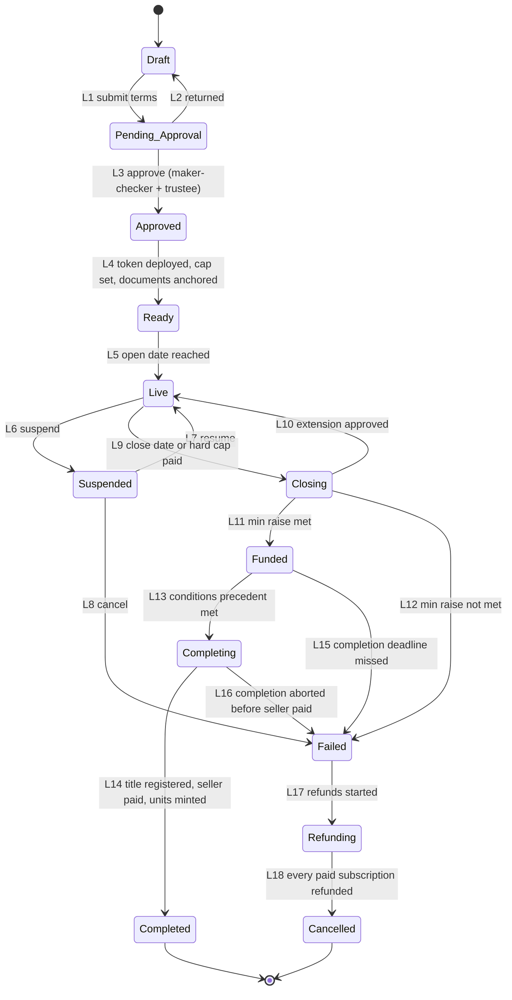
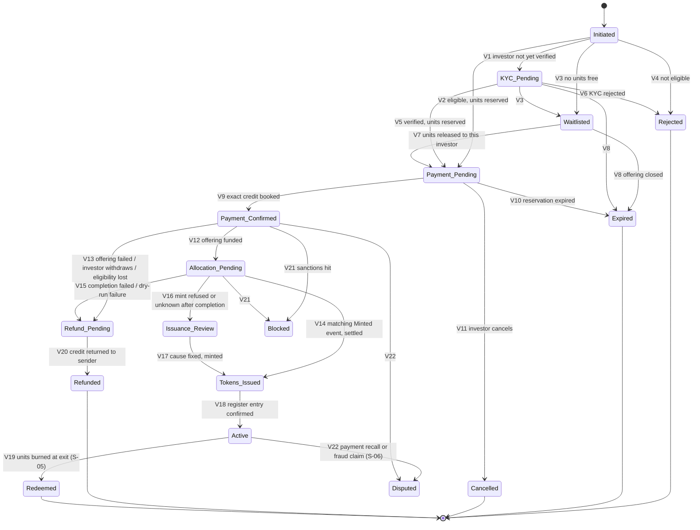

# S-02: Offering lifecycle (configuration, deployment, subscriptions, allocation, closing)

- Status: Draft for owner review; backend built (T-020, migration 0015, see §16); investor website screens on a branch (T-044, migration 0018: offerings list and detail, reserve, my subscriptions, cancel); portal screens not yet built
- Date: 2026-10-13
- Lifecycle stages: 5 (legal structuring and investor rights, the offering side), 6 (token issuance configuration), 7 (deploy and mint), 8 (offering launch), 9 (investor KYC and eligibility), 10 (subscription and payment), 11 (allocation and reconciliation)
- Exceptions covered: failed KYC or sanctioned wallet at subscription, payment received but allocation fails, offering fails
- Builds on: contract-spec §4–§5.1, §9 (deployed paused, trustee cap via timelock), invariant I-11, [ADR 0004](../decisions/0004-outbox.md), [ADR 0005](../decisions/0005-signing-service.md), [ADR 0007](../decisions/0007-reconciliation.md), [ADR 0009](../decisions/0009-kyc-and-bank.md), threat M-6, web prototype W3 rules (`web/README.md`)

## 1. Purpose and scope

Turn a property in state **Tokenization Ready** (S-01) into a funded, completed property whose units are on the trustee register and mirrored by tokens, or into a cancelled offering whose investors have been refunded in full.

In scope: offering terms, token deployment and configuration, offering documents and their acceptance, eligibility, reservations, payment codes and matching, oversubscription, closing outcomes, extension, cancellation and refunds, completion (title to the trustee, seller paid), minting, the investment state machine.

Out of scope: rent and operations (S-03), transfers after issuance (S-04), exit (S-05), reversals and recovery after issuance (S-06).

## 2. Why we mint only after payment, and only at completion

The owner's lifecycle brief places "deploy and mint" before the offering. We keep a different, deliberate order: **the token contract is deployed before the offering, but a token is minted only for a subscription whose payment is already booked in the ledger, with a single-use `refId` (invariant I-11), and only once the property is completed.** Reasons:

1. **Contracts never hold money** (contract-spec §1). Delivery versus payment cannot be enforced on chain, so the only proof of payment is the bank credit booked in the ledger with its Raast reference (ADR 0009 B-2). Minting first would create units without consideration.
2. **One payment, one mint.** `refId = keccak256("property-token:subscription:<subscriptionId>")` links each mint to exactly one paid subscription; IssuanceGuard refuses a second use (I-11); reconciliation blocks payouts on any mint without a paid subscription (`issuance.orphan_mint`) and any paid subscription without a mint after the SLA (ADR 0007).
3. **Pre-minting into a treasury wallet does not work here and is unsafe.** `MaxBalanceModule` limits any identity to 10 % of the register, so a treasury could not hold the units; a treasury key would be the most valuable key on the platform; and units in a treasury are not units on the trustee register, which breaks "token mirrors register".
4. **Refunds stay simple and safe.** A refund is allowed only when the mint provably never happened (W3 rule, M-6). Minting at completion means a failed offering refunds money without burning anything.
5. **The register is truthful.** The trustee enters units on the register when the trust owns the property and the money has been applied; minting at that moment keeps chain, register and ledger equal at every point.

Consequence: between payment and completion an investor holds a **paid allocation** (a ledger liability `investor:<subjectId>:subscriptions` and an allocation record), not a token. The portal shows it as "Allocation pending", with the money held in the trustee's escrow account.

## 3. Actors and roles

| Role | Does |
|---|---|
| Offering maker (operations) | Drafts terms, documents, use of proceeds; prepares the issuance batch |
| Offering checker (operations, different person) | Approves terms and the issuance batch |
| Compliance officer | Approves eligibility rules and disclosures; handles KYC failures, sanctions, STRs |
| Legal head | Approves the offering documents |
| Trustee officer | Approves the offering, the extension, the outcome, completion payments and the register entries; co-signs issuance (Issuance Safe includes a trustee signer, contract-spec §3) |
| Admin Safe signers | Timelock proposals (trustee cap), unpause for the issuance window |
| Issuance Safe signers | Mint (through the signing service and outbox) |
| Ops Safe signers | Document anchoring, pause after the window |
| Investor | Reserves, accepts documents, pays, may cancel or withdraw where allowed |
| System | Expiries, matching, close evaluation, notifications |

**SoD.**
- OF-SOD-1 Offering maker ≠ offering checker; neither may be the S-01 reviewer of the same property.
- OF-SOD-2 The person who prepares the issuance batch never approves it and never signs a mint as a Safe signer.
- OF-SOD-3 Refunds and completion payments are bank batches: maker-checker with different operators, plus the reconciliation gate (ADR 0007 R-4, ADR 0009 B-5).
- OF-SOD-4 The trustee's approvals are recorded under trustee identities only.

## 4. State machines

### 4.1 Offering

Property state follows the offering: Live → property **Offering Live**; Funded/Completing → **Funded**; Completed → **Operating**; Cancelled → back to **Tokenization Ready** (a new offering needs fresh valuations if older than 6 months, S-01 OB-26) or **Withdrawn**.

| # | Guard | Actor | Maker-checker | Audit event |
|---|---|---|---|---|
| L1 | Property Tokenization Ready; terms complete (OF-1..OF-12) | Offering maker | No | `offering.submitted` |
| L2 | Reason | Checker, legal or compliance | No | `offering.returned` |
| L3 | Checker ≠ maker; legal approves documents; compliance approves eligibility and disclosures; trustee approves | Checker + legal head + compliance + trustee | **Yes** | `offering.approved` |
| L4 | Token deployed through `DeployLib` with the approved register size; `DeployLib.checkHandover` passed; `trusteeCap` set through the timelock (72 h) to the planned register size; `maxBalance` = 10 % of it; every mandatory document anchored and matching (S-01 OB-42); offering document hash anchored; token paused (OF-30) | Admin Safe (timelock), Ops Safe (documents), system checks | Safe thresholds | `offering.ready` |
| L5 | Open time reached; property not On_Hold; sponsor still KYB_Approved; valuations within validity | System | No | `offering.opened` |
| L6 | Material adverse event (S-01 P12 cause, incident, regulator instruction) | Compliance or trustee | No (protective) | `offering.suspended` |
| L7 | Cause cleared, updated disclosure published if material, investors notified | Offering checker + trustee | **Yes** | `offering.resumed` |
| L8 | Cause confirmed | Offering checker + trustee | **Yes** | `offering.cancelled` |
| L9 | Close time + payment grace (OF-16) passed, or paid units = hard cap with early close allowed by the documents | System | No | `offering.closing` |
| L10 | Extension rules OF-20..OF-22; not used before | Offering maker + checker + trustee | **Yes** | `offering.extended` |
| L11 | Paid units ≥ min raise (paid = `sub:<refId>:paid` booked and not refunded) | System proposes, trustee confirms | **Yes** (trustee) | `offering.funded` |
| L12 | Paid units < min raise and no extension | System proposes, trustee confirms | **Yes** (trustee) | `offering.failed` |
| L13 | Every condition precedent (S-01 conditions, OF-41) evidenced and hashed; issuance dry run clean (OF-43) | Offering maker + checker + trustee | **Yes** | `offering.completing` |
| L14 | Sale deed in the trustee's (or SPV's) name registered and hashed; completion payments submitted (OF-45); every allocation minted and settled (OF-47); register entries confirmed by the trustee | System + trustee | **Yes** (batches) | `offering.completed` |
| L15 | Completion deadline (OF-42) passed without L13 | System proposes, trustee confirms | **Yes** | `offering.failed` |
| L16 | Before any completion payment is submitted | Trustee + offering checker | **Yes** | `offering.failed` |
| L17 | Refund batches created for every paid subscription (OF-50) | System | No | `offering.refunding` |
| L18 | Every `sub:<refId>:paid` has a `sub:<refId>:refunded`; held refunds resolved | System | No | `offering.cancelled` |

### 4.2 Investment (one subscription)

`Blocked` and `Disputed` continue in S-06. Transfers after issuance (S-04, S-06) change holdings, not the subscription record.

| # | Guard | Actor | Maker-checker | Audit event |
|---|---|---|---|---|
| V1 | `kyc.subject_status` ≠ verified | Investor | No | `subscription.kyc_pending` |
| V2, V5, V7 | Offering Live; eligibility OF-13; documents accepted (OF-10); units ≤ free units; holding headroom OF-14; payment intent created (OF-15) | Investor / system | No | `subscription.reserved` |
| V3 | Free units = 0 | System | No | `subscription.waitlisted` |
| V4, V6 | Reason recorded; sanctions-related reasons are never shown to the investor (tipping-off) | System / compliance | No | `subscription.rejected` |
| V8 | Offering left Live | System | No | `subscription.expired` |
| V9 | Bank service booked `sub:<refId>:paid` on an exact match (B-2: code, amount, verified investor, registered payer account) | Bank service | No | `subscription.paid` |
| V10 | Reservation expiry passed with no matched credit; units released | System | No | `subscription.expired` |
| V11 | Before payment | Investor | No | `subscription.cancelled` |
| V12 | Offering L11 | System | No | `subscription.allocated` |
| V13 | Offering L12/L8, or withdrawal right OF-22/OF-23, or verification lost before close (OF-44) | System / investor | No | `subscription.refund_pending` |
| V14 | `Minted(to, amount, refId)` in the read model with wallet **and** amount equal to the allocation; journal `sub:<refId>:settled` posted in the same transaction as the status change | System | No (batch approved in L13/L14) | `subscription.minted` |
| V15 | Offering L15/L16, or dry-run failure before completion (OF-43) | System | No | `subscription.refund_pending` |
| V16 | Mint refused, reverted or unknown after the seller was paid | System | No | `subscription.issuance_review` |
| V17 | Cause fixed (KYC renewed, wallet recovered); new mint with the **same** refId if it was never used on chain, or settlement against the existing `Minted` event | Operations maker + checker | **Yes** | `subscription.minted` |
| V18 | Trustee register shows the units for this investor | Trustee officer | No (trustee act) | `subscription.active` |
| V19 | S-05 | — | — | `subscription.redeemed` |
| V20 | Refund return submitted (record before send) and `sub:<refId>:refunded` posted | Bank operator maker + checker | **Yes** | `subscription.refunded` |
| V21 | Sanctions hit (ADR 0009 Y-3/Y-4) | System / compliance | No (protective) | `subscription.blocked` |
| V22 | Bank recall, chargeback-like claim, court order | Compliance | No (protective) | `subscription.disputed` |

## 5. Business rules

### Terms (stage 6)

- **OF-1** Units are whole numbers (token decimals 0). Price per unit is an integer number of paisa, fixed for the offering.
- **OF-2** `min raise ≤ target ≤ hard cap ≤ trusteeCap − units already issued`, all in units. **Recommendation for the pilot: all-or-nothing, min raise = target = hard cap** (open question Q-1).
- **OF-3** Hard cap × price ≤ lower accepted valuation + disclosed transaction costs and initial reserve (S-01 OB-26). The use-of-proceeds table (purchase price, stamp duty and registration, legal and due-diligence costs, platform fee, initial reserve) sums exactly to hard cap × price.
- **OF-4** Minimum investment per subscription: configurable, default 10 units (W3 rule). Maximum per investor: the lower of the retail limit (open decision #4 in MEMORY) and the MaxBalance headroom (OF-14).
- **OF-5** Open and close times are in PKT; the offering is open at least the minimum period required by the offering document. LEGAL TO CONFIRM.
- **OF-6** Fees are inside the use of proceeds; the investor pays exactly units × price (keeps payment matching exact, B-2). Any different fee model is open question Q-4.
- **OF-7** Terms, documents and eligibility are immutable once Approved. A change needs a new version, re-approval (L1–L3) and, if Live, a supplementary disclosure with the withdrawal right OF-23.

### Documents and eligibility (stages 5, 8, 9)

- **OF-10** Before reserving, the investor accepts the exact offering document version (English or Urdu; both are hashed and anchored) and the risk disclosure. The acceptance records document hash, language, time (UTC), session and device identifiers; it is append-only.
- **OF-11** The offering document states the unit rights from S-01 OB-35 (income, exit proceeds, voting on sale, information, transfer restrictions of S-04), all fees, the use of proceeds, the reservation and refund rules, the oversubscription rule, the completion conditions and deadline, and the risks (illiquidity, title, vacancy, tax, platform and technology).
- **OF-12** The offering document's SHA-256 is anchored in DocumentRegistry (`Other`, typed "offering document" off chain) before L5.
- **OF-13** Eligible investor: KYC `verified` (`kyc.is_verified`) with validity extending at least 30 days past the scheduled completion deadline (else the investor is asked to refresh first); wallet registered on chain through RegistrarGuard and `isVerified`; country allowed (586 only); a registered bank account (B-4), because only a registered account can fund (B-2); investor category allowed by the offering (retail or sophisticated, LEGAL TO CONFIRM); not Blocked or Disputed elsewhere.
- **OF-14** Holding headroom per identity: on-chain balance of all its wallets + units of its open reservations and paid allocations in all offerings of this token + requested units ≤ `maxBalance`. Checked at reservation and again in the issuance dry run.

### Reservations and payment (stage 10)

- **OF-15** A reservation holds units for one subscription and creates one payment intent (`bank.payment_intents`, purpose `subscription`, `ledger_key = sub:<refId>:paid`, credit account `investor:<subjectId>:subscriptions`) for exactly units × price. The payment code `PT-XXXX-XXXX` goes into the Raast narration.
- **OF-16** Reservation expiry = min(creation + TTL, close time + payment grace). Default TTL 24 h, configurable 1–72 h, never beyond the payment intent's own maximum (7 days, DB constraint). Default payment grace 2 h, so a Raast payment made just before close can arrive.
- **OF-17** One open reservation per investor per offering. Requests carry an idempotency key; a repeated request returns the same reservation (W3 rule).
- **OF-18** A credit that is not an exact match (wrong amount, expired code, unregistered payer, investor not verified) goes to `bank:suspense` (B-2) and never becomes a subscription. Suspense money returns to its sender only through the gate (B-5). The investor is told how to retry.
- **OF-19** **Oversubscription: first come, first served with time-limited reservations** (recommended; alternatives in §11). Free units = hard cap − reserved − paid. When a reservation expires or is cancelled, its units go to the oldest waitlisted investor, who gets a new reservation and payment code. Nobody can pay for units they have not reserved, so the platform never collects more money than the hard cap.

### Extension (stage 8)

- **OF-20** At most one extension, of at most 30 days, decided before the close time (L10 can only be reached from Closing if requested before close; the system holds the offering in Closing until the decision or 2 business days).
- **OF-21** Requires maker-checker, trustee approval, and a supplementary disclosure with the reason.
- **OF-22** Every investor with a paid subscription is notified and may withdraw within 5 business days for a full refund (V13).
- **OF-23** Any supplementary disclosure for a material change (OF-7) gives the same withdrawal right.

### Closing and completion (stage 11)

- **OF-40** Close evaluation counts only paid units (`sub:<refId>:paid` booked, not refunded). Reservations still unpaid at evaluation expire.
- **OF-41** Conditions precedent for completion: every encumbrance discharged (S-01 OB-22), sale deed to the trustee/SPV ready for registration, approvals and consents, insurance in the trustee's name, the trust deed or SPV documents executed, and the trustee's register ready.
- **OF-42** Completion deadline: configurable, default 60 days after Funded. Missed → Failed (L15) and full refunds.
- **OF-43** **Issuance dry run** before L13: for every allocation, `kyc.is_verified`, `IdentityRegistry.isVerified(wallet)`, `ModularCompliance.canTransfer(0x0, wallet, units)` (country and MaxBalance), `IssuanceGuard.refUsed(refId) == false`, Σ allocations ≤ `trusteeCap − totalSupply`, wallet not frozen. These are view calls and work while the token is paused. Any failure is resolved **before** any money leaves escrow: the investor fixes it within 5 business days or the subscription is refunded (V15).
- **OF-44** An investor who loses verification before close is refunded (V13), except a sanctions hit, which blocks (V21, S-06).
- **OF-45** Completion payments (seller, government duties, costs, platform fee) are paid out of escrow as a bank batch of kind `completion` (new, §8): maker-checker, trustee approval, reconciliation gate, record before send, each line to an account registered and title-matched to the payee (the seller's account title must match the sponsor's KYB name). The seller is paid only against the registered sale deed (hash recorded): the property-level delivery versus payment.
- **OF-46** Issuance batch: the offering maker builds the list of (refId, wallet, units) from the allocations; its digest is approved by the checker and the trustee. The signing service accepts an `issuance.mint` only for a refId in an approved batch (new policy fact, §8).
- **OF-47** Mint window (if the token is kept paused, S-04 TR-1): Admin Safe unpauses through PauseGuard → outbox executes `issuance.mint` for every allocation (key `mint:<refId>`) → Ops Safe pauses with reason `transfer-closed` once every mint is confirmed or in review. Settlement `sub:<refId>:settled` is posted when the matching `Minted` event is in the read model (wallet and amount must match, M-6).
- **OF-48** After completion, `trusteeCap` is reduced through the timelock to the units actually issued, so supply = cap = register (open question Q-6). Allowed because the cap may not go below `totalSupply` but may equal it.
- **OF-49** The trustee confirms the register entries (V18); `supply.register_mismatch` (S-07) compares the trustee's attested total with `totalSupply`.

### Refunds

- **OF-50** A refund returns the matched credit **to the account it came from**, under its original Raast reference, for the full amount (the same mechanism as a suspense return, B-5): maker-checker, reconciliation gate, recorded before it is sent. Partial refunds do not exist in this design (FCFS needs none).
- **OF-51** A refund is allowed only while no mint for that refId exists or can still be mined (W3 rule, M-6): the subscription is not Allocation Pending of a Completing/Completed offering, and the outbox has no `issuance.mint` for that refId in `claimed`, `submitted` or `review`.
- **OF-52** A refund returned by the beneficiary bank (account closed) stays owed in `investor:<subjectId>:subscriptions`; the investor registers a new account (72 h cooling-off) and a refund payout is made through a bank batch of kind `refund` (new) under the same rules.
- **OF-53** Refunds of a failed offering start within 2 business days of L12/L15 (SLA, monitored by `offering.refund_overdue`).
- **OF-54** Profit or interest on escrow balances, if any, is not distributed through this flow (open question Q-5).

## 6. Data to record (conceptual)

| Entity | Main fields |
|---|---|
| Offering | id, property id, token address (after L4), version, price (paisa), units: min raise, target, hard cap, min/max per investor; open, close, payment grace, reservation TTL, completion deadline; early close allowed; extension used/until; eligibility rule set; use-of-proceeds lines; document hashes (EN, UR, risk disclosure); state; approvals |
| Document acceptance | subscription id or investor id, offering id, document hash, language, accepted at, session and device ids |
| Subscription | id (UUID), refId, offering id, KYC subject id, wallet, units, amount (paisa), state, reservation expiry, payment code, Raast reference (when paid), mint tx (when minted), refund reference, reasons, request idempotency key |
| Waitlist entry | offering id, subject id, units requested, queued at, state |
| Issuance batch | offering id, items (refId, wallet, units), digest, maker, checker, trustee approval, state |
| Completion record | offering id, conditions precedent with evidence hashes, sale deed hash and registration details, completion batch reference |
| Register attestation | offering/token, units per investor (by subject id), total, attested by, at, hash |

## 7. Ledger journal conventions

Consistent with ADR 0007 and ADR 0009. Amounts in paisa; postings use the ledger's signed convention (debit positive).

| Journal key | When | Postings | `external_ref` |
|---|---|---|---|
| `sub:<refId>:paid` (exists) | Exact credit matched (V9), by the bank service | Dr `bank:trustee-escrow`, Cr `investor:<subjectId>:subscriptions` | Raast reference |
| `sub:<refId>:refunded` | Refund return submitted (V20) | Dr `investor:<subjectId>:subscriptions`, Cr `bank:trustee-escrow` | the **same** Raast reference (other direction, ADR 0007) |
| `sub:<refId>:refund-returned:<returnRef>` | The refund came back (OF-52) | Dr `bank:trustee-escrow`, Cr `investor:<subjectId>:subscriptions` | bank return reference |
| `sub:<refId>:refund-paid:<batchRef>` | Refund payout after a return (OF-52) | Dr `investor:<subjectId>:subscriptions`, Cr `bank:trustee-escrow` | refund batch reference |
| `sub:<refId>:settled` | Matching `Minted` event (V14) | Dr `investor:<subjectId>:subscriptions`, Cr `property:<token>:capital` (new, equity) | mint transaction hash |
| `completion:<token>:<batchRef>` | Completion batch submitted (OF-45) | Dr `property:<token>:acquisition` (new, asset) for the purchase price, duties and capitalised costs; Dr `property:<token>:capital` for the platform fee if expensed (Q-4); Cr `bank:trustee-escrow` | completion batch reference |
| `reserve:<token>:initial` | At completion | Dr `property:<token>:capital`, Cr `reserve:<token>` (new, liability) | completion batch reference |

- The idempotency key is the journal key; posting the same key with other content is refused (ledger rule), so every retry is safe.
- The status change of the subscription and its journal are in **one** database transaction (W3 rule: the status update gates the journal).
- Escrow is one `bank:trustee-escrow` account per trust; for more than one property per trust, open question Q-7.

## 8. On-chain actions, signing and reconciliation

| Action | Contract / function | Signer path | Outbox kind and key |
|---|---|---|---|
| Deploy suite | `DeployLib` (contract-spec §9); `checkHandover` | Deployer (destroyed after) | not via outbox |
| Set cap | `IssuanceGuard.setTrusteeCap` via TimelockController (72 h) | Admin Safe proposes/executes; Trustee Safe can cancel | not via outbox (Safe console) |
| Anchor documents | `DocumentRegistry.add` / `supersede` | Ops Safe | `document.add` / `document.supersede` (proposed), `doc:<token>:<documentId>` |
| Open mint window | `PauseGuard.unpause` | Admin Safe only (I-10) | not via outbox (Safe console) |
| Mint | `IssuanceGuard.mint(wallet, units, refId)` | Issuance Safe (2-of-3 incl. trustee) | `issuance.mint` (exists), `mint:<refId>` |
| Close mint window | `PauseGuard.pause("transfer-closed")` | Ops Safe | `token.pause` (proposed), `pause:<token>:<offeringId>` |
| Reduce cap | `setTrusteeCap(totalSupply)` via timelock | Admin Safe | not via outbox |

Signing changes (amend ADR 0005 by a new ADR before building): the `issuance.mint` policy gets a fact "refId belongs to an approved issuance batch of an offering in Completing" (OF-46), and its daily maximum must cover the batch. How the signing service's key relates to the 2-of-3 Issuance Safe in production (signer as one Safe owner, trustee co-signs in the Safe console, MultiSend batching) is open question Q-8.

Bank changes (amend ADR 0009 by a new ADR): **subscription refund** (return of a matched credit) with the same maker-checker and gate as suspense returns; new batch kinds **`completion`** and **`refund`** with maker-checker, gate, record before send and title-matched payees.

**Reconciliation checks to add or change.**

| Check | Severity | Rule |
|---|---|---|
| `issuance.paid_not_minted` (change) | blocking | SLA starts when the offering is Completing, not at payment; before that a paid subscription is an allocation, not a finding |
| `offering.over_hard_cap` | blocking | Paid, unrefunded units of an offering > hard cap |
| `offering.paid_after_failure` / `offering.refund_overdue` | warning, blocking after the SLA (OF-53) | A paid subscription of a Failed or Cancelled offering without a refund |
| `offering.mint_outside_window` | blocking | A `Minted` refId whose subscription is not Allocation Pending of a Completing/Completed offering |
| `offering.allocation_mismatch` | blocking | Units minted per offering ≠ units in its approved issuance batch |
| `offering.cap_headroom` | blocking | At Completing: `trusteeCap − totalSupply` < units still to mint |
| `supply.register_mismatch` | blocking | `totalSupply` ≠ the trustee's latest register attestation (S-07) |

## 9. Exceptions and alternative paths

| Case | Handling |
|---|---|
| KYC fails during the offering | V6 Rejected; no reservation; if already paid (verification lost later), refund (OF-44) |
| Sanctions hit (subscriber or the paying account) | V21 Blocked; funds stay in escrow, not refunded; compliance case, STR, freeze rules in S-06 |
| Wrong amount, expired code, third-party payer | Suspense (OF-18), returned to sender via the gate; investor asked to pay again with a new code |
| Payment arrives after the reservation expired | Code expired → suspense → return; units were already released |
| Payment confirmed, allocation fails before completion | Dry run failure (OF-43) → investor fixes or refund (V15); seller not yet paid, so money is in escrow |
| Payment confirmed, mint fails after completion | V16 Issuance Review; the investor's units are on the trustee register (legal truth) and the token follows when fixed (V17), same refId; reconciliation keeps it visible (`paid_not_minted`) and payouts stay frozen until resolved or accepted by two approvers |
| Unknown mint outcome (timeout) | Outbox `review`; settle only against a matching `Minted` event (M-6); never refund while a mint could still be mined (OF-51) |
| Offering fails (min raise not met) or completion fails | L12/L15/L16 → Refunding; full refunds to source accounts |
| Chain outage during the mint window | Outbox retries; no money moves; the window stays open (token unpaused) only as long as needed; if the incident needs a pause, the remaining mints wait |
| Investor dies before completion | S-06 succession: allocation passes to heirs or is refunded to the estate per the succession certificate |
| Refund account closed | OF-52 |

## 10. Notifications

Reservation created (with payment code, exact amount, expiry); reservation about to expire (2 h before); payment received or sent to suspense (with reason category, never sanctions details); offering suspended, resumed, extended (with withdrawal right), funded, failed; completion; tokens issued; register entry confirmed; refund sent; refund returned. Operations: suspense credit, dry-run failure, issuance review, refund overdue. Trustee: approvals due.

## 11. Disclosures

Offering document (OF-11) in English and Urdu, risk disclosure, use of proceeds, valuations and due-diligence summary (S-01 §10), oversubscription rule, refund and withdrawal rights, the fact that tokens are minted only at completion and what the investor holds before that, transfer restrictions (S-04), fees, tax treatment summary (S-03), Shariah certificate if applicable.

**Oversubscription options considered.**

| Option | For | Against |
|---|---|---|
| **FCFS with time-limited reservations (recommended)** | Never collects more than the hard cap; refunds are whole credits returned under their own reference (no partial refunds, simple reconciliation); investors know their allocation when they pay; works with exact payment matching | Speed advantage for fast investors; mitigated by per-investor caps, one reservation per investor, rate limits, and announced open times |
| Pro-rata at close | Perceived fairness | Collects more than needed; every investor gets a partial refund (thousands of outgoing payments, cost, M-1 exposure, reconciliation of partial amounts); allocation unknown until close; rounding of whole units |
| Ballot | Fair for very hot offerings | Same refund load as pro-rata; harder to explain |

## 12. Regulatory assumptions (LEGAL TO CONFIRM)

1. SECP approval of the offering document and the sandbox limits (investor count, amount, retail limits).
2. Minimum offer period, cooling-off or withdrawal rights, and supplementary disclosure rules.
3. Whether units may be issued only at completion (our design) and whether the trustee may hold subscription money in escrow until then; treatment of any profit on escrow (Shariah).
4. Advertising and communication rules for the offering.
5. Stamp duty, CVT and registration fees at completion; withholding on payments to the seller.
6. FMU reporting for suspicious subscriptions; no tipping-off.

## 13. Acceptance criteria

1. No `issuance.mint` can be enqueued or signed for a refId without a booked `sub:<refId>:paid` and an approved issuance batch; the signer refuses it.
2. Paid units of an offering never exceed the hard cap, including under concurrent reservations and payments (FCFS rule, tested with racing investors).
3. A failed offering ends with every paid subscription refunded to its source account under its own Raast reference; the ledger's `investor:*:subscriptions` balances for that offering are zero.
4. A refund is never possible while a mint for the same refId exists or could still be mined.
5. A completed offering has supply = cap = trustee register, and every `sub:<refId>:paid` of it is settled, refunded, or in Issuance Review.
6. Every transition is audited; every money transition is in one transaction with its journal.
7. Reconciliation is clean after a funded, completed offering and after a failed, refunded one.

## 14. Test plan

- **Unit:** price × units in paisa (no floats); OF-2/OF-3 constraints; reservation expiry computation at boundaries (TTL vs close + grace vs 7-day intent maximum); headroom OF-14 across wallets of one identity; waitlist ordering.
- **Property-based:** random streams of reservations, cancellations, expiries, exact and inexact payments, redeliveries and close events: paid ≤ hard cap always; each subscription ends in exactly one terminal state; Σ refunds + Σ settled = Σ paid per offering; no refund coexists with a mint (mutation check: allow refund in Allocation Pending → must fail).
- **Integration (PostgreSQL):** bank credit → `sub:<refId>:paid` → allocation; refund return with the original reference; refund batch after a returned refund; maker-checker refusals (same person); gate closed → refunds and completion batch refused.
- **Integration (Besu):** deploy through `DeployLib`, cap via local timelock (60 s on 586586), documents anchored, dry run with view calls while paused, unpause → mint batch through outbox + signer → pause, cap reduced; a mint refused for a wallet that lost verification lands in Issuance Review.
- **E2E (portal + mock bank):** investor reserves, pays by mock Raast, sees "Allocation pending", completion, tokens, register confirmed; failed offering with refunds; extension with withdrawal; oversubscription with waitlist.

## 15. Open questions for the owner

- Q-1 Pilot offering all-or-nothing (min raise = target = hard cap)? Recommended. If not, who holds unsold units (sponsor retention in kind needs an in-kind subscription convention that this spec does not yet define)?
- Q-2 Oversubscription: FCFS with reservations (recommended) or pro-rata?
- Q-3 Reservation TTL (24 h proposed), payment grace (2 h), completion deadline (60 days), extension (one, 30 days).
- Q-4 Fee model: fees inside the use of proceeds (recommended) or a separate subscription fee.
- Q-5 Profit on escrow balances (Shariah-compliant account?) and who receives it.
- Q-6 Reduce the trustee cap to issued units after completion (recommended) or keep headroom for a later tranche.
- Q-7 One escrow account per trust/property (recommended) or one shared trustee account with sub-ledgers.
- Q-8 Production signing for Safe-held functions (needs an ADR): signer service as one Safe owner with trustee co-signing in the Safe console.

## 16. Implementation notes (T-020, migration 0015, backend only)

Built: `backend/packages/db/migrations/0015_offering.sql` (schema `offering`, rules OFR-1..OFR-9, plus an additive bank amendment, [ADR 0009](../decisions/0009-kyc-and-bank.md) amendment) and `@pt/offering` (`backend/packages/offering`: service, CLI `offering:*`). Reconciliation and the signer were amended ([ADR 0007](../decisions/0007-reconciliation.md), [ADR 0005](../decisions/0005-signing-service.md) amendments). The investor UI and the portal screens come later. The adopted working defaults of [specs README §8](README.md) are applied; every LEGAL TO CONFIRM value is a row in `offering.settings`.

What the database enforces: both state machines (§4.1 L1..L18, §4.2 V1..V22) as an allowed-transition table re-checked by a trigger on every event; maker-checker requests (`offering.request_rules`); FCFS units under a lock on the offering row; the payment → subscription link in the same transaction as the bank booking; mint commands only at completion; refunds only to the sender, with two bank operators and the gate, never while a mint exists or could still be mined; settlement only against a matching `Minted` event; a hash-chained audit that replays every state.

Refinements and deviations (for owner review; each is safer than or fills a gap in the text above):

1. **Property state.** `property.properties` is not changed (0014 is immutable): the property stays Tokenization Ready and "Offering Live / Funded / Operating" is read from the offering (`offering.overview`). One offering per property at a time (a new one may follow a cancelled one). Reservations pause if the property leaves Tokenization Ready (S-01 P10 reopening); L5 also checks the sponsor's KYB and valid valuations.
2. **L4** is recorded by the offering maker and checked against the indexer's read model, not taken from the caller: token known, paused, supply 0, trustee cap ≥ hard cap, IssuanceGuard and IdentityRegistry known, English and Urdu offering documents anchored (OF-12). The Safe and timelock actions themselves stay in the Safe console.
3. **L3** needs four different approvers (offering checker, legal head, compliance, trustee); a party to the property's S-01 file cannot approve (OF-SOD-1); one rejection is final and the file returns to Draft through L2 by another officer.
4. **Mint window.** L13 (conditions precedent OF-41 as SHA-256 evidence, approved issuance batch still equal to the allocations, clean dry run) moves to Completing. Mints are enqueued only by `start_minting`, after a separate **completion record** (code `CMP`: registered deed hash and registration, completion payment batch reference and file hash; trustee approval). L16 (abort) is possible until minting starts. The mint command is enqueued in the same transaction that checks `sub:<refId>:paid` exists and no `refunded` journal does; the spec defines no ledger entry at enqueue, so none is posted (settlement `sub:<refId>:settled` follows the `Minted` event).
5. **Not built:** completion payments as a bank batch of kind `completion` (OF-45) with the `completion:*` and `reserve:*:initial` journals (the money stays in `bank:trustee-escrow` against `property:<token>:capital` until that batch kind exists); OF-52 (refund returned by the beneficiary bank, kind `refund`, `refund-returned` / `refund-paid` journals); one escrow account per trust (decision 14; one `bank:trustee-escrow` today, money per offering is tracked by its subscription journals and `offering.escrow_mismatch`); the trustee-cap reduction (OF-48), `token.pause` and `document.add` kinds; `supply.register_mismatch`; notifications (only `pg_notify('offering_alert')` for anomalies and issuance review); investor UI and portals.
6. **Dry run (OF-43)** runs on the read model: KYC, identity registry registration and country, freeze, refId unused, MaxBalance against holdings, cap headroom, payment booked and not refunded. The `ModularCompliance.canTransfer` view call is not made (no chain call in SQL); a TypeScript chain dry run before `start_minting` is future work.
7. **Waitlist** is strict FIFO: the oldest entry is served first and blocks smaller later requests; a new request joins the queue whenever anyone is waiting. A waitlisted investor who is no longer eligible when units free up is rejected (added transition V4 waitlisted → rejected). Investors may also leave the KYC queue or the waitlist (V11 from kyc_pending and waitlisted).
8. **Reservation expiry** equals the payment code's own expiry (one timestamp, from `bank.create_intent`), rounded down to whole minutes; with less than 5 minutes left before close + grace the request waitlists instead. Cancelling a reservation cancels its code (bank amendment B-8), so a later payment goes to suspense.
9. **KYC.** Expired verification reads as KYC Pending (the investor is asked to renew), not Rejected. Rejections never reveal a sanctions reason (`public_reason`); blocked subscriptions read "under review".
10. **Investor category** (OF-13) is declared at reservation (retail by default) and checked against the offering's list; evidence for "sophisticated" is LEGAL TO CONFIRM and not collected.
11. **Suspension (L6)** ends every unpaid reservation and cancels its payment code, so no money arrives while the offering is suspended.
12. **Extension (L10)** approved while still Live extends the close without a state change; approved after the close (Closing) it is the L10 transition back to Live. The withdrawal window is `withdrawal_days` calendar days (7 for "5 business days"; no business-day calendar yet). A supplementary disclosure (OF-23) is request `SD` (compliance + trustee) and opens the same window; acceptance of the supplementary disclosure by each investor is not tracked yet.
13. **Refunds (V20)** are opened by the system (L17, all paid subscriptions) or by a withdrawal / an officer (V13, V15) and approved by **two** bank operators, then sent by `executeRefund`: the journal and the bank's refund record are written first (gate checked), then the bank is told to return the credit under its own reference. Blocked and disputed subscriptions do not hold up L18; they continue in S-06 and their money stays in escrow.
14. **Register (V18)** is confirmed for all issued units at once by the trustee's L14 attestation (total units and register hash, equal to the units issued).
15. **Reconciliation (ADR 0007 amendment).** The paid → minted SLA of an offering subscription starts at `mint_started_at`, not at L13, so waiting for the deed registration is not a finding. `offering.refund_overdue` is a warning, not blocking: a freeze would stop the refunds that cure it.
16. **Signer (ADR 0005 amendment).** `requireOfferingBatch` on the `issuance.mint` policy (default off for the web prototype; production must turn it on).
17. **Concurrency.** A deadlock between a payment and a cancellation was found by the race test; the fix is one lock order for all offering and bank writes and `FOR NO KEY UPDATE` row locks (ADR 0009 amendment).

Tests (`backend/packages/offering/test`, `recon/test/offering-checks.test.ts`, one signer policy test): lifecycle (approval, FCFS and waitlist, payment edge cases, funded → minted → completed, all-or-nothing failure with refunds, extension with withdrawal, L15/L16, mint retry), database rules and roles, concurrency races, a fast-check property test against a reference model (mutation-checked), reconciliation before/during/after, CLI smoke test.

## 17. Amendment 2026-10-13: the trustee in the portal (Step 6d, T-006, migration 0023)

Changed before the behaviour (CLAUDE.md), together with ADR 0005 and ADR 0011 section 12.

1. **Signing (section 8).** Every `issuance.mint` that needs maker-checker under the signer policy (amount above `approvalAbove`) needs a trustee officer's co-signature in addition to the platform approvals (OF-SOD-4: under a trustee identity). The database decides this on insert (`signer.trustee_cosign_kinds`), so the signing service cannot sign such a mint without it. Mints of an offering's issuance batch keep the batch rule (OF-46: IB approved by the offering checker and the trustee) and `requireOfferingBatch`.
2. **Trustee votes (section 4, OFR-2).** For an officer of the admin portal the `trustee` duty is the `trustee_officer` role while active; such an officer holds no other offering duty (OF-SOD-4, enforced by a trigger on `offering.duties`). Portal votes need a session, a step-up and the digest of the request as shown; command-line votes under an officer's handle are not bound yet (break-glass, used by the demo catalogue seed; ADR 0011 open item 13). The trustee portal lists every open request whose rule still needs the trustee: L3, L7, L8, L10..L16, SD, the issuance batch (IB) and the completion record (CMP: registered sale deed and the completion payment batch file hash, OF-45).
3. **Register (OF-49, V18).** When the trustee confirms the register entries (V18: subscription `active`) the trustee's own register in the database (`trustee.register_entries`) records the units for the wallet in the same transaction; a redemption (`redeemed`) removes them. Corrections are two-officer adjustments with evidence. The portal compares this register with the read model.
