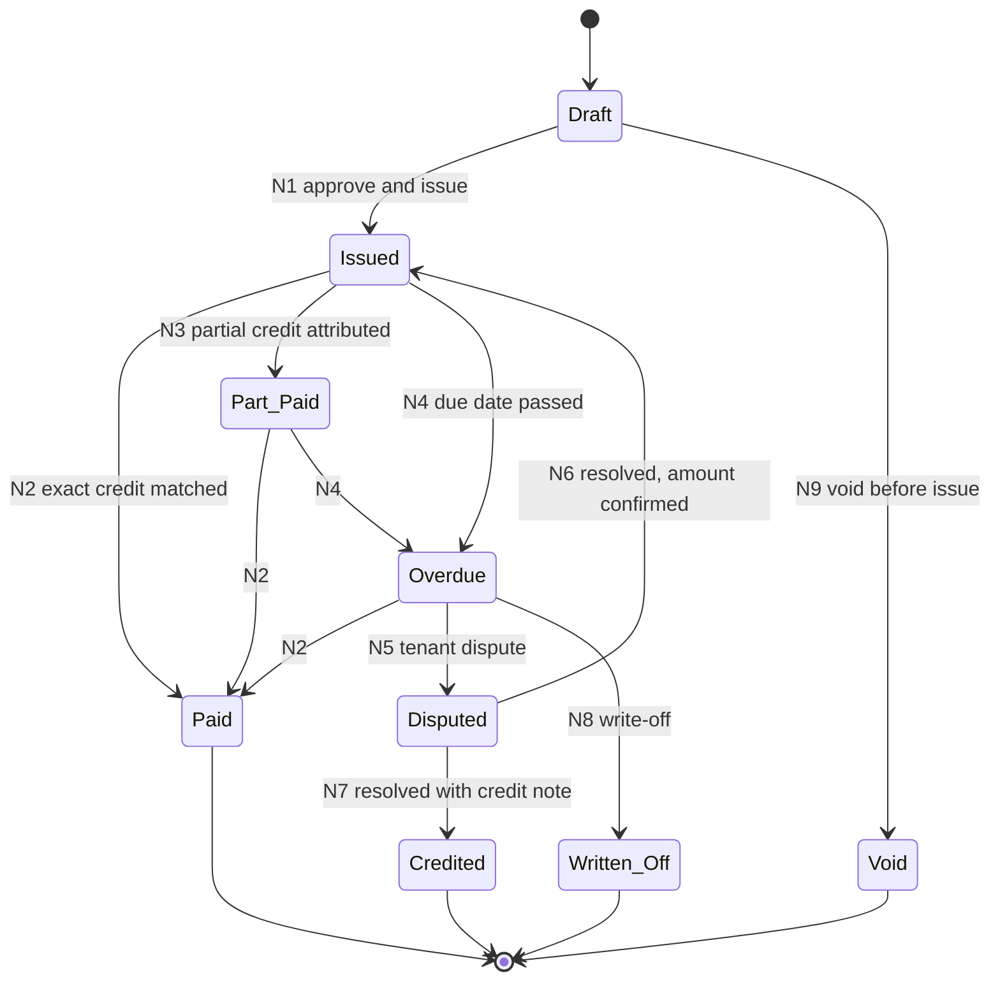
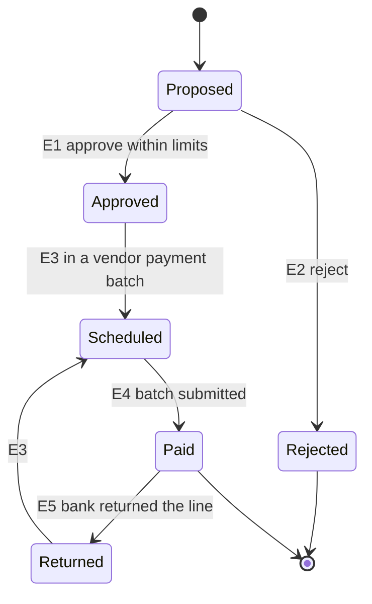
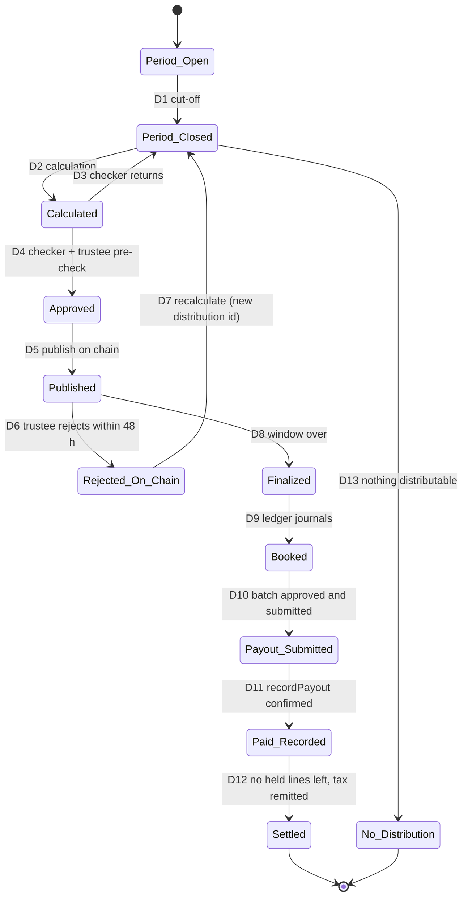

# S-03: Property operations, income and distributions

- Status: Draft for owner review; partly implemented on branch `s-03-operations-tax` (section 16)
- Date: 2026-10-13
- Lifecycle stages: 12 (property operations and rent), 13 (income calculation and distribution)
- Exceptions covered: rent shortfall, tenant dispute, distribution rejected by the trustee, payout returned, investor without a payout account
- Builds on: contract-spec §6.1 (DistributionRegistry), I-14, [ADR 0007](../decisions/0007-reconciliation.md) (rent checks, payout gate), [ADR 0009](../decisions/0009-kyc-and-bank.md) (rent collection codes, payout accounts, payout batches, held payouts H-1..H-4), migrations `0010_held_payouts.sql`, `0011_integration.sql` (`rent.record_payout`), `chain/rent.py` (leaf format, largest remainder), threats M-1, M-2, M-3, M-5, M-7

## 1. Purpose and scope

Run a completed property (state **Operating**) so that every rupee of rent is invoiced, collected into the trustee's escrow, used only for approved purposes, and the remainder is distributed to the holders at a record date, net of withholding tax, with proofs every investor can verify.

In scope: leases and tenants, invoices and collection, arrears, expenses and fees with maker-checker, reserves, the net distributable calculation, record date and record block, FBR withholding per investor, the DistributionRegistry flow, payout batches including held payouts, statements and annual tax certificates, rent shortfall and disputes.

Out of scope: final distribution of sale proceeds (S-05, which reuses this machinery), transfers (S-04).

## 2. Actors and roles

| Role | Does |
|---|---|
| Property manager (external, appointed by the trustee) | Manages leases and tenants, raises invoices, proposes expenses with vendor invoices |
| Operations maker | Records leases, approves invoices for issue, prepares expense approvals, period close, the distribution calculation and payout batches |
| Operations checker (different person) | Approves each of the above |
| Finance officer | Fees, reserves, tax computation and remittance |
| Tax officer (may be the finance officer's checker) | Filer status snapshots, exemption certificates, tax certificates, FBR statements |
| Trustee officer | Approves expenses above the threshold, reserve releases, the distribution before publication; recomputes and may reject on chain within 48 h |
| Ops Safe | Publishes distributions, records payouts |
| Trustee Safe | Rejects a distribution within the challenge window |
| Investor | Receives statements, verifies the Merkle proof, keeps a payout account current |

**SoD.**
- OP-SOD-1 The property manager can propose but never approve an expense, a write-off, or a change of a vendor's or tenant's bank details.
- OP-SOD-2 Calculation maker ≠ checker; the trustee's recomputation is independent (from chain events and the statement, not from the maker's spreadsheet).
- OP-SOD-3 Payout batch maker ≠ approver (ADR 0009 B-5); nobody who changed a payee account in the last 72 h may approve a batch that pays it.
- OP-SOD-4 Vendor and tenant bank accounts are registered by a maker and approved by a checker, with title match and 72 h cooling-off (same rule as investor payout accounts, M-1).

## 3. State machines

### 3.1 Rent invoice

| # | Guard | Actor | Maker-checker | Audit event |
|---|---|---|---|---|
| N1 | Active lease; amount = lease rent for the period with escalation; payment code created (OP-11) | Ops maker + checker | **Yes** | `rent.invoice_issued` |
| N2 | Credit matched to the invoice's code and amount, or a suspense credit re-attributed (OP-12) | Bank service / ops maker + checker | Only for re-attribution | `rent.invoice_paid` |
| N3 | Suspense credit re-attributed for less than the invoice | Ops maker + checker | **Yes** | `rent.invoice_part_paid` |
| N4 | Due date + grace (lease) passed | System | No | `rent.invoice_overdue` |
| N5 | Tenant's written dispute, hashed | Property manager | No | `rent.invoice_disputed` |
| N6, N7 | Resolution document hashed | Ops maker + checker (+ trustee above threshold) | **Yes** | `rent.invoice_resolved` |
| N8 | Recovery exhausted per OP-16; legal opinion | Ops maker + finance + trustee | **Yes** | `rent.invoice_written_off` |
| N9 | Never issued | Ops maker | No | `rent.invoice_voided` |

### 3.2 Expense

| # | Guard | Actor | Maker-checker | Audit event |
|---|---|---|---|---|
| E1 | Vendor invoice hashed; within budget line; amount ≤ ops limit, else trustee approval (OP-21); vendor account active (OP-SOD-4) | Ops checker (+ trustee) | **Yes** | `expense.approved` |
| E2 | Reason | Ops checker | No | `expense.rejected` |
| E3 | Gate open (`recon.payouts_allowed()`) | Ops maker | No | `expense.scheduled` |
| E4 | Vendor batch approved and submitted (record before send) | Bank operator maker + checker | **Yes** | `expense.paid` |
| E5 | `payout.returned` event | Bank service | No | `expense.returned` |

### 3.3 Distribution (one period)

| # | Guard | Actor | Maker-checker | Audit event |
|---|---|---|---|---|
| D1 | Period end + close days (default 10 days); all invoices, credits and expenses of the period recorded; bank statements imported to the period end | Ops maker | No | `distribution.period_closed` |
| D2 | Calculation per OP-30..OP-38 from ledger balances and the read model at the record block | Ops maker | No | `distribution.calculated` |
| D3 | Reason | Ops checker | No | `distribution.returned` |
| D4 | Checker ≠ maker; trustee's independent recomputation matches root, totals and statement hash; filer snapshot complete (OP-41) | Ops checker + trustee | **Yes** | `distribution.approved` |
| D5 | Gate open; record block in the past and final; statement hash and tax schedule hash stored | Ops Safe via outbox `rent.publish` (proposed) | Safe threshold | `distribution.published` |
| D6 | Trustee finds a difference | Trustee Safe (`reject(id, reason)`) | Safe threshold | `distribution.rejected` |
| D7 | Rejection reason addressed | Ops maker | No | `distribution.recalculation_started` |
| D8 | `CHALLENGE_WINDOW` (48 h) passed and not rejected | Anyone (outbox `rent.finalize`, proposed) | No | `distribution.finalized` |
| D9 | `rent:wht:<token>:<id>` and `rent:distribution:<token>:<id>` posted in one transaction | System | No | `distribution.booked` |
| D10 | Payout batch per ADR 0009 B-5/B-6 and H-1..H-4: maker-checker, gate at approval and submission, paid + held = on-chain total | Bank operator maker + checker | **Yes** | `distribution.payout_submitted` |
| D11 | `recordPayout(id, 0x + SHA-256 of the bank file)` confirmed (0011 I-1) | Ops Safe via outbox `rent.record_payout` (exists) | Safe threshold | `distribution.payout_recorded` |
| D12 | Every held line paid by a follow-up batch or carried as unclaimed (OP-55); WHT remitted (OP-46) | System | No | `distribution.settled` |
| D13 | Distributable ≤ 0 or below the minimum payout threshold; disclosed | Ops maker + checker + trustee | **Yes** | `distribution.none` |

## 4. Business rules

### Leases and tenants

- **OP-1** A lease records: tenant (individual: a KYC subject; company: a KYB record as in S-01, LEGAL TO CONFIRM whether tenants need full KYC), unit(s), start, end, rent per period, escalation rule, security deposit, due day, grace days, late fee, permitted use, tax treatment (whether the tenant withholds tax on rent), the signed lease's hash.
- **OP-2** Lease creation, amendment, renewal and termination are maker-checker; leases above the trustee threshold (term or value) need trustee approval. Every lease document is hashed; signed leases may be anchored (`Other`, typed "lease") without personal data in the uri.
- **OP-3** Security deposits are trust liabilities, kept in escrow, never distributable: account `tenant:<leaseId>:deposit` (new). Collecting a deposit needs a new payment-intent purpose `tenant_deposit` (bank change).
- **OP-4** A rent roll (lease, unit, rent, status, arrears) is produced at each period close and hashed into the statement (OP-50).

### Invoices and collection

- **OP-10** One invoice per lease per period, numbered per property.
- **OP-11** Each invoice has a payment code (purpose `rent_collection`, `ledger_key = rent:collected:<token>:<period>-<invoiceNo>`, credit account `rent:pool:<token>`), which fits the existing key pattern `rent:collected:0x…:[a-z0-9-]{1,40}`. Codes expire after at most 7 days (DB constraint), so a code is issued 7 days before the due date and reissued weekly while unpaid; the tenant always sees the current code.
- **OP-12** A tenant credit that does not match exactly (old code, partial amount, no code) goes to `bank:suspense` (B-2). New function (bank change): **re-attribute a suspense credit to a rent invoice**, maker-checker, only to `rent:pool:<token>` (never to an investor), journal `rent:collected:<token>:<period>-<invoiceNo>-<n>` with the same Raast reference, so the cash check still matches the bank line.
- **OP-13** Tenant withholding: if the tenant withholds income tax on rent, the invoice is settled by the cash received plus the tax deduction certificate (hashed, with its CPR number). The certificate is a tax credit of the trust, recorded in operations (not a ledger cash movement). LEGAL TO CONFIRM the rent withholding regime for the trust or SPV.

### Arrears

- **OP-15** Ageing buckets 1–30, 31–60, 61–90, > 90 days; reminders at due + 1, + 7, + 30 days; late fee per lease.
- **OP-16** Escalation: > 30 days notice; > 60 days deposit adjustment proposal (maker-checker); > 90 days legal action proposal to the trustee; write-off only after legal advice (N8).
- **OP-17** Distributions use **cash received only**. Arrears are never distributed in advance; arrears collected later fall into the period in which they are received.

### Expenses, fees and reserves

- **OP-20** Annual budget per property approved by the trustee before the year starts; expenses are tagged to budget lines.
- **OP-21** Approval limits (configurable): ops checker up to the per-expense limit and within budget; above it, or outside budget, trustee approval. Capital expenses are paid from the reserve, operating expenses from the rent pool.
- **OP-22** Vendors are registered with KYB-light (name, NTN, sales-tax registration) and a title-matched account with 72 h cooling-off (OP-SOD-4). Payments go through a bank batch of kind `vendor` (new; same maker-checker, gate, record before send as B-5/B-6).
- **OP-23** Fees per the offering document: property manager (e.g. % of rent collected), trustee (fixed or % of NAV), platform (e.g. % of rent collected). Fees are computed by the system from the formula, accrued per period, and paid through vendor batches. Sales tax on services is added where applicable (LEGAL TO CONFIRM).
- **OP-24** Reserve: contribution per period = the offering document's rule (e.g. 10 % of net operating cash until the reserve reaches its target, e.g. 6 months of operating expenses). Releases (capex, shortfall cover, exit) need maker-checker + trustee.

### Net distributable and record date

- **OP-30** Net operating cash for the period = rent collected (cash) − operating expenses approved for the period − fees accrued for the period.
- **OP-31** Distributable gross = net operating cash − reserve contribution + reserve release approved for distribution ± adjustments from previous periods (each adjustment documented and approved). Must be ≥ 0; a negative result means no distribution (D13) and the shortfall is carried forward or covered from the reserve per OP-24.
- **OP-32** If the structure requires a minimum distribution ratio (for example a REIT distributing at least 90 % of distributable income), the calculation checks it. LEGAL TO CONFIRM.
- **OP-33** Record date: announced to investors at least 5 business days before. **Record block** = the highest finalized block whose timestamp ≤ record date 23:59:59 PKT. Deterministic, recomputable by the trustee from the chain.
- **OP-34** Entitlement basis = each wallet's balance at the record block from the read model (`holders` at block), cross-checked with `balanceOf` at that block (as `indexer:verify` does). Frozen wallets are entitled like any other; their payout may be held (OP-53).
- **OP-35** Gross per wallet by the **largest remainder** method in paisa (as `chain/rent.py`): floor of exact share, then the remaining paisa one each to the largest fractional remainders, ties by wallet address ascending. Σ gross = distributable gross exactly.
- **OP-36** WHT per wallet line = round half up (gross × rate of the wallet's identity) to the paisa; net = gross − WHT. Rounding unit LEGAL TO CONFIRM (FBR may require rupees).
- **OP-37** **Merkle leaf = (wallet, net paisa)** in the existing DistributionRegistry format `keccak256(bytes.concat(keccak256(abi.encode(wallet, netPaisa))))`, sorted-pair hashing. `totalPaisa` on chain = Σ net. This keeps ADR 0009 B-5 (batch total = on-chain total) and the existing reconciliation checks unchanged. Open question Q-1.
- **OP-38** Statement (`pt-rent-statement-v2`, canonical JSON, sorted keys, no spaces; hash = keccak256 of the bytes as in `chain/rent.py`): token, period, record date, record block, totals (collected, expenses, fees by type, reserve contribution and release, adjustments, distributable gross, WHT, net), entitlements `[{wallet, units, netPaisa}]`, rent-roll hash, and **tax schedule hash**. The tax schedule (per line: wallet, subject reference, gross, rate, WHT, net, filer status evidence) is private; its hash in the statement binds it to the on-chain `statementHash` without publishing tax status.

### Withholding tax

- **OP-40** Rates are configuration with effective dates (they change with each Finance Act, usually 1 July): per income type (REIT dividend, rent, other), per status (filer on the Active Taxpayers List, non-filer, exempt with certificate). Each rate change is maker-checker by finance + tax. LEGAL TO CONFIRM the income type of a unit distribution for each structure (REIT scheme dividend vs SPV dividend vs rent pass-through) and the applicable sections and rates.
- **OP-41** **Filer status snapshot** per identity at the record date: source = the FBR Active Taxpayers List, checked by the tax service with the investor's CNIC/NTN; the result, check date, and evidence hash are recorded per distribution. A failed check (FBR unavailable) uses the last result not older than 30 days, else the non-filer rate, and is flagged for review. Today the KYC schema keeps only keyed CNIC hashes (ADR 0009 Y-1), so the CNIC is not available for the check: open question Q-2.
- **OP-42** Exemption or reduced-rate certificates (e.g. an FBR exemption certificate) are uploaded by the investor, verified by the tax officer (maker-checker), hashed, and valid for their stated period only.
- **OP-43** Zakat deduction at source, where it applies to the distribution type and the investor has not filed a valid exemption declaration: LEGAL TO CONFIRM; if it applies it is computed like WHT, as its own line and journal.
- **OP-45** WHT is booked when the distribution is booked (D9) into `tax:wht-payable:<token>` and remitted to FBR by the legal due date through the trustee bank; the CPR number is recorded and is the bank reference of the remittance.
- **OP-46** Withholding statements to FBR are filed for each period required by law (LEGAL TO CONFIRM), generated from the tax schedules; filing evidence is hashed.

### Statements and certificates

- **OP-50** Per distribution, each investor gets a statement: units at the record block, gross, WHT rate and amount, net, payout status (paid, held with reason), the Merkle proof, the on-chain distribution id and the statement hash, and the property-level totals.
- **OP-51** Annual tax certificate per investor per fiscal year (July–June): every distribution's gross, WHT, net, and the CPR numbers of the remittances. Issued within 30 days after the year end and on request; a corrected certificate supersedes the old one (both kept). LEGAL TO CONFIRM content requirements.
- **OP-52** The trustee receives the full statement and tax schedule for each distribution.

### Payouts

- **OP-53** Held payouts exactly as built in 5h (H-1..H-4): a line is held when the investor has no active payout account, is in cooling-off, had a return, or is not KYC-verified (including sanctions: a blocked investor's line stays held until S-06 resolves it). Paid + held = on-chain total.
- **OP-54** Follow-up batches pay held lines once the cause is cleared, journal `rent:payout:<token>:<id>:followup:<batch>`, nothing changes on chain.
- **OP-55** Unclaimed held amounts are reported monthly; after the period required by law they follow the unclaimed-dividend rules (LEGAL TO CONFIRM, e.g. transfer to the government after notices); until then they remain owed in `rent:payable:<subjectId>`.
- **OP-56** Only one live batch per distribution (B-6); returned lines go back to the payable and retire that account (ADR 0009).

## 5. Worked example (illustrative numbers; rates are NOT legal advice)

Property with **1,000,000 units** issued. Period: November 2026.

| Line | PKR |
|---|---|
| Rent invoiced | 2,500,000.00 |
| Rent collected in cash (one tenant 200,000 in arrears) | 2,300,000.00 |
| Operating expenses (maintenance 150,000; insurance 1/12 25,000) | − 175,000.00 |
| Property manager fee 5 % of collected | − 115,000.00 |
| Trustee fee (fixed) | − 40,000.00 |
| Platform fee 1 % of collected | − 23,000.00 |
| **Net operating cash** | **1,947,000.00** |
| Reserve contribution 10 % | − 194,700.00 |
| **Distributable gross** | **1,752,300.00** (= 175,230,000 paisa; 175.23 paisa per unit) |

Per investor (WHT rates assumed for illustration only: filer 15 %, non-filer 30 %):

| Investor | Units | Gross | WHT | Net (Merkle leaf) |
|---|---|---|---|---|
| A, filer | 100,000 | 175,230.00 | 26,284.50 | 148,945.50 |
| B, non-filer | 2,500 | 4,380.75 | 1,314.23 (1,314.225 rounded half up) | 3,066.52 |
| C, filer | 7 | exact share 12.2661 → 12.26 or 12.27 by largest remainder | on 12.27: 1.84 | 10.43 |

On chain: `totalPaisa` = Σ net of all wallets. Ledger for the period:

| Journal key | Postings (PKR) |
|---|---|
| `rent:collected:<token>:2026-11-<invoiceNo>` (one per invoice) | Dr `bank:trustee-escrow` 2,300,000 total, Cr `rent:pool:<token>` |
| `expense:<token>:<expenseId>:approved` | Dr `rent:pool:<token>` 175,000, Cr `vendor:payable:<vendorId>` |
| `fee:<token>:2026-11:property-manager` / `:trustee` / `:platform` | Dr `rent:pool:<token>` 178,000 total, Cr `fees:payable:<payeeId>` |
| `reserve:<token>:2026-11` | Dr `rent:pool:<token>` 194,700, Cr `reserve:<token>` |
| `rent:wht:<token>:<id>` | Dr `rent:pool:<token>` Σ WHT, Cr `tax:wht-payable:<token>` |
| `rent:distribution:<token>:<id>` (exists) | Dr `rent:pool:<token>` Σ net, Cr `rent:payable:<subjectId>` per investor |

After these, the November part of `rent:pool:<token>` is zero (OP-39 check below).

- **OP-39** After D9, the rent pool balance equals only amounts received after the period cut-off (next period) and documented carry-forwards. Anything else is a finding (`ops.pool_residual`).

## 6. Data to record (conceptual)

| Entity | Main fields |
|---|---|
| Tenant | id, type, KYC subject id or KYB id, NTN, withholding agent flag, bank account (registered, title-matched) |
| Lease | id, token, units, tenant, dates, rent, escalation, deposit, due day, grace, late fee, use, document hash, state, approvals |
| Invoice | id, lease, period, amount, due date, payment codes issued (with expiry), credits applied, tenant WHT certificate hash and CPR, state |
| Vendor | id, KYB-light data, account (registered, cooling-off) |
| Expense | id, token, vendor, budget line, invoice hash, amount, opex/capex, approvals, batch reference, state |
| Fee accrual | token, period, fee type, base, rate, amount, payee |
| Reserve movement | token, period, contribution or release, reason, approvals |
| Period close | token, period, cut-off, bank statements included (hashes), rent roll hash |
| Distribution calculation | token, period, record date, record block, totals, entitlement lines, statement (canonical bytes and hash), tax schedule hash, maker, checker, trustee pre-check, on-chain id, state |
| Filer snapshot | subject id, record date, status, source, checked at, evidence hash, exemption certificate reference |
| Tax remittance | token, period, amount, CPR number, date, bank reference |
| Investor statement / tax certificate | subject id, distribution or fiscal year, content hash, issued at, superseded by |

## 7. Ledger journal conventions (summary)

| Journal key | Meaning | `external_ref` | Status |
|---|---|---|---|
| `rent:collected:<token>:<period>-<invoiceNo>[-<n>]` | rent received (bank → `rent:pool:<token>`) | Raast reference | exists (pattern); suffix `-<n>` for re-attributed part payments is new |
| `expense:<token>:<expenseId>:approved` | pool → `vendor:payable:<vendorId>` | invoice hash | new |
| `expense:<token>:<expenseId>:paid` | `vendor:payable:<vendorId>` → bank | vendor batch reference | new |
| `fee:<token>:<period>:<feeType>` | pool → `fees:payable:<payeeId>` | calculation id | new |
| `fee:<token>:<period>:<feeType>:paid` | `fees:payable:<payeeId>` → bank | vendor batch reference | new |
| `reserve:<token>:<period>` / `reserve:<token>:release:<id>` | pool ↔ `reserve:<token>` | approval id | new |
| `tenant:<leaseId>:deposit[:refund]` | bank ↔ `tenant:<leaseId>:deposit` | Raast / batch reference | new |
| `rent:wht:<token>:<id>` | pool → `tax:wht-payable:<token>` | statement hash | new |
| `tax:remit:<token>:<cpr>` | `tax:wht-payable:<token>` → bank | CPR number | new |
| `rent:distribution:<token>:<id>` | pool → `rent:payable:<subjectId>` (Σ net) | statement hash | exists |
| `rent:payout:<token>:<id>` / `…:followup:<batch>` | payables → bank (paid lines only) | `PTPAY-…` reference | exists |
| `bank:payout-return:<reference>:<line>` | bank → payable | return reference | exists |

All keys are idempotency keys; every money-out journal is posted in the same transaction as its bank batch submission (record before send, B-6).

## 8. On-chain actions and reconciliation

| Action | Contract | Signer path | Outbox kind / key |
|---|---|---|---|
| Publish | `DistributionRegistry.publish(token, recordBlock, root, totalPaisa, statementHash)` | Ops Safe | `rent.publish` (proposed; covered by the payout gate because it matches `rent.*`), `rent:publish:<token>:<calculationId>` |
| Reject | `reject(id, reason)` | Trustee Safe | not via outbox (trustee's Safe console) |
| Finalize | `finalize(id)` | anyone | `rent.finalize` (proposed), `rent:finalize:<token>:<id>` |
| Record payout | `recordPayout(id, 0x + SHA-256 of the bank file)` | Ops Safe | `rent.record_payout` (exists, 0011 I-1), enqueued in the batch submission transaction |

**Reconciliation checks.** Existing `rent.*` checks stay (missing_ledger, statement_hash_mismatch, total_mismatch, booked_after_reject, orphan_ledger, payout_premature, payout_missing, payout_batch_mismatch, payout_amount_mismatch with paid = total − held, payout_held warning, payout_not_recorded). Add:

| Check | Severity | Rule |
|---|---|---|
| `rent.wht_mismatch` | blocking | `rent:wht:<token>:<id>` amount ≠ the WHT total in the statement whose hash is on chain |
| `rent.statement_totals` | blocking | Statement totals inconsistent: distributable gross ≠ net + WHT, or Σ entitlements ≠ on-chain total |
| `rent.record_block_rule` | blocking | On-chain `recordBlock` ≠ the OP-33 rule applied to the calculation's record date |
| `tax.wht_unremitted` | warning, blocking after the legal due date | `tax:wht-payable:<token>` balance older than the due date |
| `ops.expense_unapproved` | blocking | An `expense:*` or `fee:*` journal without an approved expense or fee record |
| `ops.pool_residual` | warning | OP-39 |
| `ops.collection_in_suspense` | warning | A tenant credit in suspense older than 5 business days |

## 9. Exceptions and alternative paths

| Case | Handling |
|---|---|
| Rent shortfall (tenant default, vacancy) | Distribute only cash received (OP-17); a lower or zero distribution is disclosed with reasons; reserve release to cover operating expenses needs trustee approval; reserve is not used to smooth distributions unless the offering document allows it |
| Tenant dispute | Invoice Disputed (N5); legal per OP-16; deposit adjustment maker-checker; if the dispute concerns title or possession, property On_Hold and disclosure (S-01 P12 cause), and S-05/S-06 as needed |
| Trustee rejects the distribution | D6; nothing was booked (`rent.booked_after_reject` guards it); recalculate and publish a new id |
| Error found after finalization | Never change the finalized distribution; correct in the next one as a documented adjustment line (OP-31), disclosed to affected investors |
| Investor without an active payout account, in cooling-off, returned, unverified, blocked | Held line (OP-53), follow-up later |
| Payout line returned | Back to payable, account retired, follow-up after a new account (ADR 0009) |
| Reconciliation frozen | No publish, no payout, no vendor payment (gate); operations resolve findings; unfreeze by two operators (R-3) |
| FBR ATL unavailable on the record date | OP-41 fallback, flagged for review before D4 |
| Chain outage | Publication waits; the period timetable is shifted and announced; nothing is paid without a finalized distribution |

## 10. Notifications

Investors: record date announcement; distribution published (with link to verify during the window); finalized; paid or held (with what to do); statement and annual certificate available; payout account change alerts (existing). Operations: overdue invoices, suspense credits, budget overruns, reserve below target, WHT due dates, held lines older than 30 days. Trustee: approvals due, distribution published (window start), reconciliation findings.

## 11. Disclosures

Periodic property report (occupancy, rent roll summary, arrears, expenses against budget, reserve balance, valuation updates), distribution policy, fee formulas, tax treatment with the filer/non-filer difference, how to verify an entitlement (S-07), how held payouts and unclaimed amounts work.

## 12. Regulatory assumptions (LEGAL TO CONFIRM)

1. Income type and WHT sections and rates for unit distributions under the chosen structure; filer/non-filer rates; rounding; due dates; withholding statements.
2. Whether the trust/SPV is itself taxed and on what conditions (e.g. minimum distribution ratio).
3. Tenant withholding on rent paid to the trust; sales tax on services for fees.
4. Zakat deduction.
5. Unclaimed distributions.
6. Tenant KYC requirements.
7. Lawful basis to use an investor's CNIC for ATL checks (data protection).

## 13. Acceptance criteria

1. A distribution cannot be published while the gate is closed, without the checker's approval and the trustee's pre-check, or with a record block that does not follow OP-33.
2. Σ gross = distributable gross exactly; for each line net = gross − WHT; Σ net = on-chain total; the statement hashes to the on-chain `statementHash`; the tax schedule hashes to the statement's `taxScheduleHash`.
3. Every investor can verify their leaf with `DistributionRegistry.verify` and the statement; 1 paisa more fails.
4. Every rupee in `rent:pool:<token>` for a closed period ends in an approved expense, fee, reserve, WHT or investor payable.
5. No vendor, fee, or investor payment leaves escrow without maker-checker, the gate, record before send and an account in good standing.
6. Reconciliation is clean after a full period (collection, expenses, fees, reserve, distribution with held lines, follow-up, WHT remittance) against the mock bank's own statement.

## 14. Test plan

- **Unit:** OP-30/31 arithmetic; largest remainder (sum exact, ties by address, single holder, all equal); WHT rounding at .5 paisa; record-block rule at exact timestamps and around PKT midnight; rate selection by effective date.
- **Property-based:** random holders, balances and tax statuses: Σ gross exact, Σ net + Σ WHT = distributable, every proof verifies, any 1-paisa change fails; random periods with returns and held lines: paid + held = total always (mutation check: drop a held line → must fail).
- **Integration (PostgreSQL + mock bank):** invoice → code → credit → pool; part payment via suspense re-attribution; vendor batch with cooling-off; gate frozen blocks publish and payouts; WHT remittance with CPR as bank reference; reconciled business day with zero cash findings.
- **Integration (Besu):** publish → trustee reject → republish; finalize refused inside the window (as `chain/flow.py` does); the 48 h `CHALLENGE_WINDOW` is a contract constant, so finalize-after-window is covered by Foundry tests with time warp and by a staging run, not by the fast suite; `recordPayout` with the file hash; reconciliation `rent.*` checks clean.
- **E2E:** tenant pays by mock Raast; investor sees statement, verifies proof, receives payout; held line paid after registering an account; annual certificate download.

## 15. Open questions for the owner

- Q-1 Merkle leaf = net amount (recommended; no contract or recon change; per-wallet net hints at tax status, so the full statement is shared only with investors (own line) and the trustee) or gross amount (needs B-5 and recon changes).
- Q-2 Filer status needs the CNIC: (a) keep a sealed CNIC under a separate KMS key readable only by the tax service (recommended; changes ADR 0009 Y-1 by a new ADR), or (b) ask investors to provide ATL proof each year (manual, error-prone).
- Q-3 Distribution frequency: monthly (as in the example), quarterly (fewer payouts, lower bank cost), or as the offering document says.
- Q-4 Reserve rule and target (10 % / 6 months proposed); may the reserve smooth distributions?
- Q-5 Expense approval limits for ops and trustee.
- Q-6 Accounting basis: the ledger stays a cash mirror of the trustee bank; accrual accounts (receivables, prepaid) live in operations and the audited financial statements (recommended).

## 16. Implementation status (2026-10-14, branch `s-03-operations-tax`, migration 0021)

Built (Partial; details in docs/TASKS.md T-023/T-024 and docs/DATABASE_DESIGN.md 0021):

- **OP-37 (Q-1 adopted default): Merkle leaf = (wallet, NET paisa)**, leaf format v1 unchanged (`keccak256(bytes.concat(keccak256(abi.encode(wallet, netPaisa))))`, sorted pairs, tree shape as `chain/rent.py`). `/verify`, `web/src/lib/merkle.ts` and the contract need no change; the statement names the leaf format in its `leaf` field. Lines with a net of 0 (possible only for a 1-paisa gross at a rate >= 50 %) have no leaf.
- **OP-36 rounding rule as built:** WHT = floor((gross x rate_ppm + 500,000) / 1,000,000): the exact amount rounded half up to the paisa; rates are integers in parts per million (150,000 = 15 %). Rounding unit still LEGAL/TAX TO CONFIRM (rupees would be a new rule version).
- **OP-38 statement as built** (`pt-rent-statement-v2`, canonical JSON, keys sorted, every integer a decimal string): `kind, calculation, token, period, recordDate, recordBlock, incomeType, leaf, totals {collected, expenses, fees, reserveContribution, reserveRelease, distributableGross, wht, net}, entitlements [{wallet, units, netPaisa}], taxScheduleHash`. Tax schedule `pt-tax-schedule-v1`: `kind, calculation, token, period, recordDate, incomeType, rounding: half-up-paisa, rateScale: 1000000, lines [{wallet, subject, units, grossPaisa, status, filerCheck, filerAsOf, flagged, rateId, ratePpm, whtPaisa, netPaisa}]`. Both hashes keccak256. Not in v2 yet: per-fee-type totals, rent-roll hash (no leases).
- **Q-2 resolved by [ADR 0014](../decisions/0014-sealed-cnic-for-tax.md) (Proposed):** sealed CNIC under a tax-only key, ATL checks by the tax service, two-officer one-time FBR filing export.
- **Roles:** finance and tax officer of §2 are one portal role `tax_officer` (rates proposed and approved by two different tax officers; exports likewise). Distribution approval is the operations checker; the trustee pre-check (D4) is not built (6d).

Deviations from this spec (to confirm):

1. OP-21: the per-expense limit is a setting (placeholder Rs 1,000,000); above it approval is refused instead of routed to the trustee (no trustee portal yet).
2. OP-23 fees are entered as charges with an evidence hash, not computed from the offering document's formula.
3. OP-33 record block: the operator supplies it; the database checks it is indexed, not the timestamp rule (`rent.record_block_rule` not built).
4. `tax.wht_unremitted` is a warning only (spec: blocking after the due date): freezing payouts would not speed up the remittance; due date (15 days after booking) is a placeholder.
5. The rent pool is one ledger account per token: an approved expense of a later period uses the same cash; booking an earlier distribution then fails on the ledger's overdraft check rather than spending money twice (safe, but operations must sequence periods).
6. Rate changes take effect today or later only; past periods are corrected by adjustments, never by a retroactive rate.
