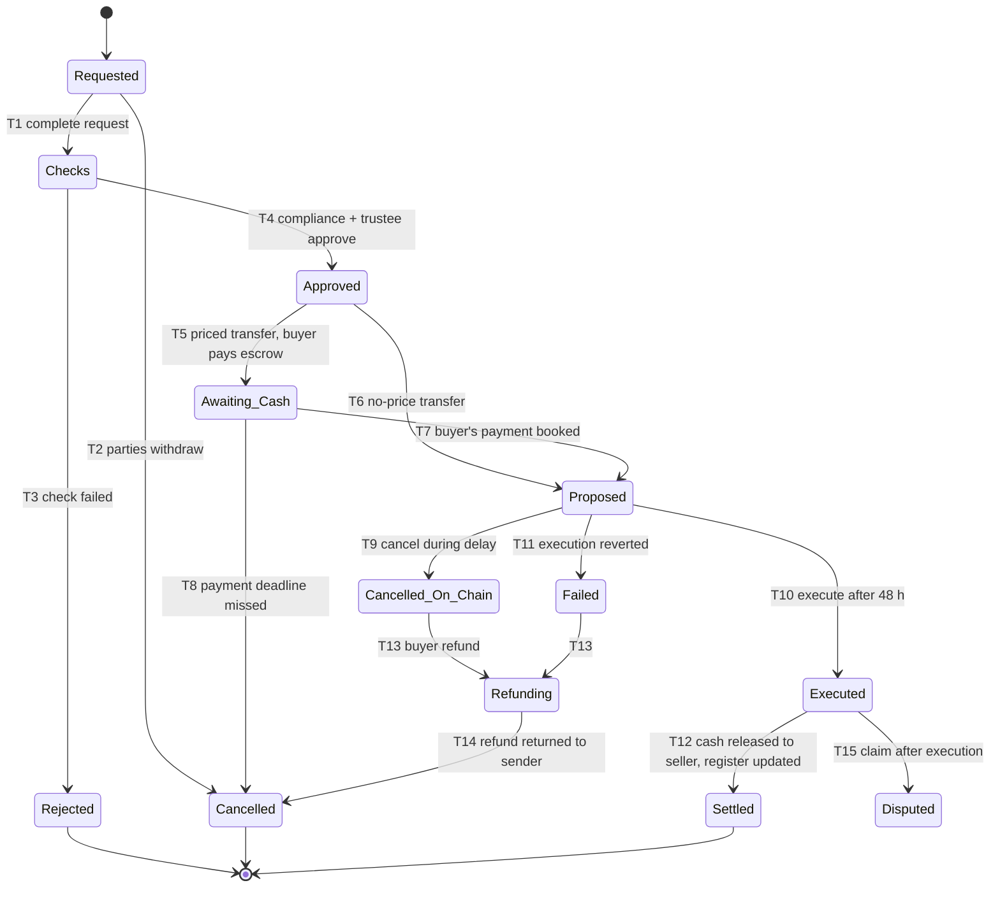

# S-04: Permitted secondary transfers

- Status: Draft for owner review (functional specification; no code yet)
- Date: 2026-10-13
- Lifecycle stage: 14 (permitted secondary transfers)
- Exceptions covered: failed, cancelled and disputed transfers; sanctioned or frozen counterparty
- Builds on: contract-spec §4.2–§5.4 (identity, CountryAllow and MaxBalance modules, PauseGuard, FreezeGuard, RecoveryGuard), I-3..I-6, I-17, findings F-01/F-02, threat M-8 (demo market DvP), web W4 (`web/README.md`), [ADR 0009](../decisions/0009-kyc-and-bank.md)

## 1. Purpose and scope

Define which transfers of units between investors are allowed, how each is approved and settled (delivery versus payment where money is involved), and how the token always stays equal to the trustee register.

Two phases:

- **Phase 0 (pilot, before regulatory approval of secondary trading):** no open market. Only individually approved **off-market transfers** (private sale between two verified investors, gift, transfer to a family member, transfers ordered by a court). Inheritance and wallet recovery are in S-06.
- **Phase 1 (after SECP approval):** transfers through a **licensed intermediary** (broker or a bulletin board operated under licence), still between verified investors only, with the same on-chain checks.

The demo market (W4) is neither phase; §9 maps it.

## 2. Transfer control model (key decision)

ERC-3643 lets any verified holder call `transfer` while the token is unpaused. The compliance modules check country and the 10 % max balance, but there is **no lock-up or per-transfer approval module** in our deployment. Options:

| Option | How | Contract change | Assessment |
|---|---|---|---|
| **A. Transfer-closed mode (recommended for Phase 0)** | Token stays **paused** outside issuance windows (S-02 OF-47, pause reason `transfer-closed`). Ordinary `transfer` is impossible (I-6). An approved off-market transfer is executed by the trustee as `RecoveryGuard.propose(ForcedTransfer, from, to, …, evidenceHash)` → 48 h → `execute`. Forced transfers work while paused (verified in Step 3) and still respect MaxBalance and identity verification | None | Uses audited, existing guards; every transfer has trustee approval, a delay, an evidence hash and a cancellation path. Cost: 48 h per transfer, trustee workload; the pause flag is no longer only an incident signal (the reason string distinguishes them on the verification page, S-07) |
| B. ConditionalTransferModule (T-REX 4.1.6) | Each transfer pre-approved in the module | Add a module through the timelock | `approveTransfer` is callable only by the compliance owner, which is the 72 h timelock (I-9): one timelock operation per transfer. Not practical |
| C. New lock-up / approval guard or module | Our own small contract with an approver role | New contract, spec change, audit scope | Best long-term for Phase 1 if the intermediary needs faster settlement; needs a new ADR and audit |

Rules below assume A for Phase 0. Phase 1 chooses between unpausing (relying on KYC + modules, with the intermediary enforcing lock-ups) and C; open question Q-1.

## 3. Actors and roles

| Role | Does |
|---|---|
| Seller (transferor), buyer (transferee) | Request, sign the transfer agreement, pay or receive the price |
| Transfer desk maker (operations) | Checks completeness, runs checks, prepares the case |
| Compliance checker | Approves KYC/AML aspects, price reasonableness for AML, sanctions |
| Trustee officer | Approves and executes through the Trustee Safe; updates the register |
| Admin Safe / Trustee Safe | Can cancel a pending request during the delay |
| Licensed intermediary (Phase 1) | Matches orders, collects instructions, reports to the regulator |

**SoD.** TR-SOD-1 maker ≠ compliance checker ≠ trustee approver. TR-SOD-2 nobody approves a transfer to or from themselves, a relative or a related company (declared). TR-SOD-3 the person who confirms the cash leg (bank operator) is not the maker of the case.

## 4. State machine (Phase 0 off-market transfer)

| # | Guard | Actor | Maker-checker | Audit event |
|---|---|---|---|---|
| T1 | Signed agreement hashed; parties identified; units, price (or "no consideration" with reason) | Transfer desk maker | No | `transfer.requested` |
| T2 | Before T7 | Either party | No | `transfer.withdrawn` |
| T3 | Any TR-10 check fails; sanctions reasons never disclosed | Compliance | No | `transfer.rejected` |
| T4 | All TR-10 checks pass; lock-up over (TR-12); max balance headroom | Compliance checker + trustee | **Yes** | `transfer.approved` |
| T5 | Payment intent for the buyer (new purpose `transfer`, bank change) | System | No | `transfer.awaiting_cash` |
| T6 | Gift, family, court-ordered | System | No | `transfer.ready` |
| T7 | Exact credit booked `xfer:<transferId>:paid` | Bank service | No | `transfer.paid` |
| T8 | Deadline (default 3 business days) | System | No | `transfer.cancelled` |
| T9 | Any party, compliance or trustee asks; `RecoveryGuard.cancel` | Admin or Trustee Safe | Safe threshold | `transfer.cancelled_onchain` |
| T10 | 48 h passed; checks re-run just before (TR-11) | Trustee Safe | Safe threshold | `transfer.executed` |
| T11 | Revert (e.g. buyer no longer verified, max balance) | System | No | `transfer.failed` |
| T12 | `ForcedTransfer` event in the read model matches from, to, units; seller payout batch (maker-checker, gate) | Bank operator maker + checker; trustee | **Yes** | `transfer.settled` |
| T13 | No execution happened and none can happen (request cancelled or reverted) | Bank operator maker + checker | **Yes** | `transfer.refunding` |
| T14 | Credit returned under its own Raast reference | Bank service | No | `transfer.cancelled` |
| T15 | Claim with evidence | Compliance | No | `transfer.disputed` (handled as S-06) |

## 5. Business rules

- **TR-1** Phase 0: the token is paused (`transfer-closed`) at all times except S-02 mint windows; any `Transfer` event that is not a mint, a burn or a RecoveryGuard execution is a blocking finding (`transfer.unapproved`).
- **TR-10** Checks for every transfer: both parties KYC `verified` (`kyc.is_verified`) and `isVerified` on chain; sanctions/PEP screening of both on the day of approval and again before execution; neither wallet frozen (FreezeGuard) nor Blocked/Disputed; country allowed; buyer's identity headroom under `maxBalance` (all its wallets); seller's free (unfrozen) balance ≥ units; no open S-05 exit record date between approval and execution; price within ±20 % of the latest NAV per unit or a written explanation reviewed by compliance (AML: value transfer).
- **TR-11** Checks are repeated immediately before `execute`; any failure → cancel (T9) rather than letting it revert.
- **TR-12** Lock-up: no transfer before the offering document's lock-up ends (default: 6 months after completion; court-ordered transfers excepted). Enforced off chain by the desk in Phase 0 (all transfers go through it).
- **TR-13** Units are whole numbers; minimum transfer = 1 unit; a transfer that would leave the seller below the offering's minimum holding needs an explicit reason.
- **TR-20** **DvP:** the buyer pays into trustee escrow first (exact match, registered account, B-2); the units move on chain; only after the `ForcedTransfer`/`Transfer` event is in the read model is the seller paid (bank batch, maker-checker, gate, record before send). If the units never move, the buyer's credit is returned to its sender under its own reference.
- **TR-21** Distributions follow the holding at the record block (S-03). A transfer executed after the record block does not change that distribution; the agreement says so.
- **TR-22** Fees and taxes on transfers (platform fee, capital gains withholding, stamp duty if any) are computed from configuration and deducted from the seller's proceeds as separate journals. LEGAL TO CONFIRM.
- **TR-23** STR assessment for unusual transfers (price far from NAV, rapid round trips, third parties); no tipping-off.
- **TR-30** Phase 1: orders are taken only by the licensed intermediary; settlement is DvP as TR-20 (or the intermediary's licensed settlement if approved); the on-chain checks (identity, country, max balance, freeze, pause) are unchanged; circuit breaker ±10 % of NAV (owner choice for the demo, to be confirmed for production).

## 6. Data to record

Transfer case: id, token, seller and buyer subject ids and wallets, units, price per unit and total (paisa), consideration type (sale, gift, family, court order), agreement hash, checks with results and time, approvals, payment code and Raast reference, RecoveryGuard request id, evidence hash, execution tx, seller payout reference, refund reference, state, reasons.

## 7. Ledger journal conventions

| Journal key | Postings | `external_ref` |
|---|---|---|
| `xfer:<transferId>:paid` | Dr `bank:trustee-escrow`, Cr `transfer:<transferId>:escrow` (new, liability) | buyer's Raast reference |
| `xfer:<transferId>:fee` / `:tax` | Dr `transfer:<transferId>:escrow`, Cr `fees:payable:platform` / `tax:cgt-payable:<token>` | transfer id |
| `xfer:<transferId>:settled` | Dr `transfer:<transferId>:escrow`, Cr `bank:trustee-escrow` (seller paid) | seller batch reference |
| `xfer:<transferId>:refunded` | Dr `transfer:<transferId>:escrow`, Cr `bank:trustee-escrow` | the buyer's original Raast reference |

The escrow account of a transfer is zero at the end, always (check `transfer.escrow_residual`).

## 8. On-chain actions and reconciliation

| Action | Contract | Signer path | Outbox kind / key |
|---|---|---|---|
| Propose | `RecoveryGuard.propose(ForcedTransfer, from, to, onchainId, units, evidenceHash)`; evidence = hash of the approved case file, anchored (`Other`) | Trustee Safe | `recovery.propose` (proposed), `xfer:<transferId>:propose` |
| Execute | `RecoveryGuard.execute(id)` | Trustee Safe | `recovery.execute` (proposed), `xfer:<transferId>:execute` |
| Cancel | `RecoveryGuard.cancel(id)` | Admin or Trustee Safe | `recovery.cancel` (proposed) |

Reconciliation to add: `transfer.unapproved` (blocking: any holder-to-holder movement without an approved case), `transfer.settlement_mismatch` (blocking: units on chain ≠ case, or seller paid without a matching on-chain movement), `transfer.escrow_residual` (blocking after SLA), `transfer.paid_not_executed` (warning, blocking after SLA). The indexer must keep RecoveryGuard events (it already checks the recovery state machine, C-5).

## 9. How the demo market (W4) maps to this

| Demo market | Phase 0 | Phase 1 |
|---|---|---|
| Open order book, anyone verified can trade | Not allowed | Only through the licensed intermediary |
| Token unpaused; seller's custodial wallet calls `transfer` | Token paused; trustee `ForcedTransfer` after 48 h | Intermediary-driven; unpaused or option C |
| Demo cash top-ups, per-order escrow `web:order:<id>:escrow` | Real Raast payment into trustee escrow per case | Same, or the intermediary's licensed settlement |
| DvP: tokens first, then cash from escrow | Same principle (TR-20) | Same |
| ±10 % NAV band, single matcher, SSE feed | Not applicable | Reused if approved |

The demo stays labelled "DEMO" and runs only on the demo network; its code is a reference for DvP, not a production path.

## 10. Exceptions

Seller frozen or blocked after approval → cancel (T9), refund buyer. Buyer loses verification → cancel. Execution reverted → refund. Unknown execution outcome → outbox `review`; never refund while the request can still execute (RecoveryGuard request still Pending). Dispute after execution (fraud, mistaken transfer) → S-06 (reverse only by a new approved forced transfer or court order). Chain outage → the 48 h clock is on chain; execution waits.

## 11. Notifications and disclosures

Both parties: received, approved/rejected, payment due, proposed on chain (with the cancellation window), executed, settled, refunded. The seller's old contact details get an alert on every transfer request (account-takeover defence). Disclosure: no market and no liquidity promise in Phase 0; lock-up; fees and taxes; price is agreed between parties; the trustee may refuse.

## 12. Regulatory assumptions (LEGAL TO CONFIRM)

1. Whether Phase 0 off-market transfers are allowed under the sandbox without a licensed intermediary.
2. Capital gains tax and withholding on disposal of units; stamp duty on transfer instruments.
3. Licence type needed for Phase 1 (broker, bulletin board) and reporting.
4. Gifts and family transfers: documentation and tax.

## 13. Acceptance criteria

1. In Phase 0, no ordinary `transfer` can succeed (token paused) and every unit movement other than mint and burn has an approved case.
2. A transfer that fails any TR-10 check before execution is cancelled, and the buyer's money returns to its sender under its own reference.
3. The seller is never paid before the on-chain movement is in the read model; the buyer is never refunded while the request can still execute.
4. The transfer escrow ends at zero for every case.

## 14. Test plan

- **Unit:** TR-10 checks one by one; price band; lock-up dates.
- **Property-based:** random cases with random failures and cancellations: units moved ⇔ seller paid; refunds only without movement; escrow zero (mutation: pay seller before execution → must fail).
- **Integration (Besu):** paused token refuses `transfer`; `ForcedTransfer` via RecoveryGuard works while paused, respects MaxBalance and identity; cancel during delay.
- **E2E:** two investors complete a priced off-market transfer through the portals and the mock bank.

## 15. Open questions

- Q-1 Phase 0 control: transfer-closed mode with trustee forced transfers (recommended), or build option C now.
- Q-2 Lock-up length (6 months proposed) and price band (±20 % of NAV for AML review).
- Q-3 Platform fee on transfers.
- Q-4 Should gifts and family transfers be allowed in the pilot at all?
