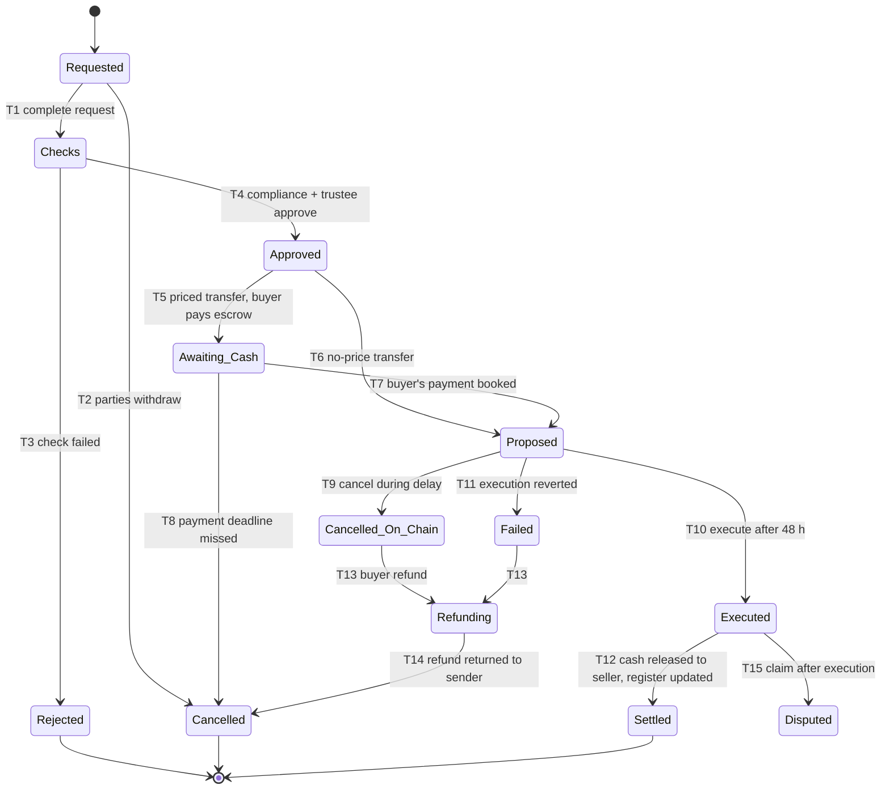

# S-04: Permitted secondary transfers

- Status: Phase 0 built (2026-10-22, migration 0028, section 16); phase 1 not started
- Date: 2026-10-13
- Lifecycle stage: 14 (permitted secondary transfers)
- Exceptions covered: failed, cancelled and disputed transfers; sanctioned or frozen counterparty
- Builds on: contract-spec §4.2–§5.4 (identity, CountryAllow and MaxBalance modules, PauseGuard, FreezeGuard, RecoveryGuard), I-3..I-6, I-17, findings F-01/F-02, threat M-8 (demo market DvP), web W4 (`web/README.md`), [ADR 0009](../decisions/0009-kyc-and-bank.md)

## 1. Purpose and scope

Define which transfers of units between investors are allowed, how each is approved and settled (delivery versus payment where money is involved), and how the token always stays equal to the trustee register.

Two phases:

- **Phase 0 (pilot, before regulatory approval of secondary trading):** no open market. Only individually approved **off-market transfers** (private sale between two verified investors, gift, transfer to a family member, transfers ordered by a court). Inheritance and wallet recovery are in S-06.
- **Phase 1 (after SECP approval):** transfers through a **licensed intermediary** (broker or a bulletin board operated under licence), still between verified investors only, with the same on-chain checks.

The demo market (W4) is neither phase; §9 maps it.

## 2. Transfer control model (key decision)

ERC-3643 lets any verified holder call `transfer` while the token is unpaused. The compliance modules check country and the 10 % max balance, but there is **no lock-up or per-transfer approval module** in our deployment. Options:

| Option | How | Contract change | Assessment |
|---|---|---|---|
| **A. Transfer-closed mode (recommended for Phase 0)** | Token stays **paused** outside issuance windows (S-02 OF-47, pause reason `transfer-closed`). Ordinary `transfer` is impossible (I-6). An approved off-market transfer is executed by the trustee as `RecoveryGuard.propose(ForcedTransfer, from, to, …, evidenceHash)` → 48 h → `execute`. Forced transfers work while paused (verified in Step 3) and still respect MaxBalance and identity verification | None | Uses audited, existing guards; every transfer has trustee approval, a delay, an evidence hash and a cancellation path. Cost: 48 h per transfer, trustee workload; the pause flag is no longer only an incident signal (the reason string distinguishes them on the verification page, S-07) |
| B. ConditionalTransferModule (T-REX 4.1.6) | Each transfer pre-approved in the module | Add a module through the timelock | `approveTransfer` is callable only by the compliance owner, which is the 72 h timelock (I-9): one timelock operation per transfer. Not practical |
| C. New lock-up / approval guard or module | Our own small contract with an approver role | New contract, spec change, audit scope | Best long-term for Phase 1 if the intermediary needs faster settlement; needs a new ADR and audit |

Rules below assume A for Phase 0. Phase 1 chooses between unpausing (relying on KYC + modules, with the intermediary enforcing lock-ups) and C; open question Q-1.

## 3. Actors and roles

| Role | Does |
|---|---|
| Seller (transferor), buyer (transferee) | Request, sign the transfer agreement, pay or receive the price |
| Transfer desk maker (operations) | Checks completeness, runs checks, prepares the case |
| Compliance checker | Approves KYC/AML aspects, price reasonableness for AML, sanctions |
| Trustee officer | Approves and executes through the Trustee Safe; updates the register |
| Admin Safe / Trustee Safe | Can cancel a pending request during the delay |
| Licensed intermediary (Phase 1) | Matches orders, collects instructions, reports to the regulator |

**SoD.** TR-SOD-1 maker ≠ compliance checker ≠ trustee approver. TR-SOD-2 nobody approves a transfer to or from themselves, a relative or a related company (declared). TR-SOD-3 the person who confirms the cash leg (bank operator) is not the maker of the case.

## 4. State machine (Phase 0 off-market transfer)

| # | Guard | Actor | Maker-checker | Audit event |
|---|---|---|---|---|
| T1 | Signed agreement hashed; parties identified; units, price (or "no consideration" with reason) | Transfer desk maker | No | `transfer.requested` |
| T2 | Before T7 | Either party | No | `transfer.withdrawn` |
| T3 | Any TR-10 check fails; sanctions reasons never disclosed | Compliance | No | `transfer.rejected` |
| T4 | All TR-10 checks pass; lock-up over (TR-12); max balance headroom | Compliance checker + trustee | **Yes** | `transfer.approved` |
| T5 | Payment intent for the buyer (new purpose `transfer`, bank change) | System | No | `transfer.awaiting_cash` |
| T6 | Gift, family, court-ordered | System | No | `transfer.ready` |
| T7 | Exact credit booked `xfer:<transferId>:paid` | Bank service | No | `transfer.paid` |
| T8 | Deadline (default 3 business days) | System | No | `transfer.cancelled` |
| T9 | Any party, compliance or trustee asks; `RecoveryGuard.cancel` | Admin or Trustee Safe | Safe threshold | `transfer.cancelled_onchain` |
| T10 | 48 h passed; checks re-run just before (TR-11) | Trustee Safe | Safe threshold | `transfer.executed` |
| T11 | Revert (e.g. buyer no longer verified, max balance) | System | No | `transfer.failed` |
| T12 | `ForcedTransfer` event in the read model matches from, to, units; seller payout batch (maker-checker, gate) | Bank operator maker + checker; trustee | **Yes** | `transfer.settled` |
| T13 | No execution happened and none can happen (request cancelled or reverted) | Bank operator maker + checker | **Yes** | `transfer.refunding` |
| T14 | Credit returned under its own Raast reference | Bank service | No | `transfer.cancelled` |
| T15 | Claim with evidence | Compliance | No | `transfer.disputed` (handled as S-06) |

## 5. Business rules

- **TR-1** Phase 0: the token is paused (`transfer-closed`) at all times except S-02 mint windows; any `Transfer` event that is not a mint, a burn or a RecoveryGuard execution is a blocking finding (`transfer.unapproved`).
- **TR-10** Checks for every transfer: both parties KYC `verified` (`kyc.is_verified`) and `isVerified` on chain; sanctions/PEP screening of both on the day of approval and again before execution; neither wallet frozen (FreezeGuard) nor Blocked/Disputed; country allowed; buyer's identity headroom under `maxBalance` (all its wallets); seller's free (unfrozen) balance ≥ units; no open S-05 exit record date between approval and execution; price within ±20 % of the latest NAV per unit or a written explanation reviewed by compliance (AML: value transfer).
- **TR-11** Checks are repeated immediately before `execute`; any failure → cancel (T9) rather than letting it revert.
- **TR-12** Lock-up: no transfer before the offering document's lock-up ends (default: 6 months after completion; court-ordered transfers excepted). Enforced off chain by the desk in Phase 0 (all transfers go through it).
- **TR-13** Units are whole numbers; minimum transfer = 1 unit; a transfer that would leave the seller below the offering's minimum holding needs an explicit reason.
- **TR-20** **DvP:** the buyer pays into trustee escrow first (exact match, registered account, B-2); the units move on chain; only after the `ForcedTransfer`/`Transfer` event is in the read model is the seller paid (bank batch, maker-checker, gate, record before send). If the units never move, the buyer's credit is returned to its sender under its own reference.
- **TR-21** Distributions follow the holding at the record block (S-03). A transfer executed after the record block does not change that distribution; the agreement says so.
- **TR-22** Fees and taxes on transfers (platform fee, capital gains withholding, stamp duty if any) are computed from configuration and deducted from the seller's proceeds as separate journals. LEGAL TO CONFIRM.
- **TR-23** STR assessment for unusual transfers (price far from NAV, rapid round trips, third parties); no tipping-off.
- **TR-30** Phase 1: orders are taken only by the licensed intermediary; settlement is DvP as TR-20 (or the intermediary's licensed settlement if approved); the on-chain checks (identity, country, max balance, freeze, pause) are unchanged; circuit breaker ±10 % of NAV (owner choice for the demo, to be confirmed for production).

## 6. Data to record

Transfer case: id, token, seller and buyer subject ids and wallets, units, price per unit and total (paisa), consideration type (sale, gift, family, court order), agreement hash, checks with results and time, approvals, payment code and Raast reference, RecoveryGuard request id, evidence hash, execution tx, seller payout reference, refund reference, state, reasons.

## 7. Ledger journal conventions

| Journal key | Postings | `external_ref` |
|---|---|---|
| `xfer:<transferId>:paid` | Dr `bank:trustee-escrow`, Cr `transfer:<transferId>:escrow` (new, liability) | buyer's Raast reference |
| `xfer:<transferId>:fee` / `:tax` | Dr `transfer:<transferId>:escrow`, Cr `fees:payable:platform` / `tax:cgt-payable:<token>` | transfer id |
| `xfer:<transferId>:settled` | Dr `transfer:<transferId>:escrow`, Cr `bank:trustee-escrow` (seller paid) | seller batch reference |
| `xfer:<transferId>:refunded` | Dr `transfer:<transferId>:escrow`, Cr `bank:trustee-escrow` | the buyer's original Raast reference |

The escrow account of a transfer is zero at the end, always (check `transfer.escrow_residual`).

## 8. On-chain actions and reconciliation

| Action | Contract | Signer path | Outbox kind / key |
|---|---|---|---|
| Propose | `RecoveryGuard.propose(ForcedTransfer, from, to, onchainId, units, evidenceHash)`; evidence = hash of the approved case file, anchored (`Other`) | Trustee Safe | `recovery.propose` (proposed), `xfer:<transferId>:propose` |
| Execute | `RecoveryGuard.execute(id)` | Trustee Safe | `recovery.execute` (proposed), `xfer:<transferId>:execute` |
| Cancel | `RecoveryGuard.cancel(id)` | Admin or Trustee Safe | `recovery.cancel` (proposed) |

Reconciliation to add: `transfer.unapproved` (blocking: any holder-to-holder movement without an approved case), `transfer.settlement_mismatch` (blocking: units on chain ≠ case, or seller paid without a matching on-chain movement), `transfer.escrow_residual` (blocking after SLA), `transfer.paid_not_executed` (warning, blocking after SLA). The indexer must keep RecoveryGuard events (it already checks the recovery state machine, C-5).

## 9. How the demo market (W4) maps to this

| Demo market | Phase 0 | Phase 1 |
|---|---|---|
| Open order book, anyone verified can trade | Not allowed | Only through the licensed intermediary |
| Token unpaused; seller's custodial wallet calls `transfer` | Token paused; trustee `ForcedTransfer` after 48 h | Intermediary-driven; unpaused or option C |
| Demo cash top-ups, per-order escrow `web:order:<id>:escrow` | Real Raast payment into trustee escrow per case | Same, or the intermediary's licensed settlement |
| DvP: tokens first, then cash from escrow | Same principle (TR-20) | Same |
| ±10 % NAV band, single matcher, SSE feed | Not applicable | Reused if approved |

The demo stays labelled "DEMO" and runs only on the demo network; its code is a reference for DvP, not a production path.

## 10. Exceptions

Seller frozen or blocked after approval → cancel (T9), refund buyer. Buyer loses verification → cancel. Execution reverted → refund. Unknown execution outcome → outbox `review`; never refund while the request can still execute (RecoveryGuard request still Pending). Dispute after execution (fraud, mistaken transfer) → S-06 (reverse only by a new approved forced transfer or court order). Chain outage → the 48 h clock is on chain; execution waits.

## 11. Notifications and disclosures

Both parties: received, approved/rejected, payment due, proposed on chain (with the cancellation window), executed, settled, refunded. The seller's old contact details get an alert on every transfer request (account-takeover defence). Disclosure: no market and no liquidity promise in Phase 0; lock-up; fees and taxes; price is agreed between parties; the trustee may refuse.

## 12. Regulatory assumptions (LEGAL TO CONFIRM)

1. Whether Phase 0 off-market transfers are allowed under the sandbox without a licensed intermediary.
2. Capital gains tax and withholding on disposal of units; stamp duty on transfer instruments.
3. Licence type needed for Phase 1 (broker, bulletin board) and reporting.
4. Gifts and family transfers: documentation and tax.

## 13. Acceptance criteria

1. In Phase 0, no ordinary `transfer` can succeed (token paused) and every unit movement other than mint and burn has an approved case.
2. A transfer that fails any TR-10 check before execution is cancelled, and the buyer's money returns to its sender under its own reference.
3. The seller is never paid before the on-chain movement is in the read model; the buyer is never refunded while the request can still execute.
4. The transfer escrow ends at zero for every case.

## 14. Test plan

- **Unit:** TR-10 checks one by one; price band; lock-up dates.
- **Property-based:** random cases with random failures and cancellations: units moved ⇔ seller paid; refunds only without movement; escrow zero (mutation: pay seller before execution → must fail).
- **Integration (Besu):** paused token refuses `transfer`; `ForcedTransfer` via RecoveryGuard works while paused, respects MaxBalance and identity; cancel during delay.
- **E2E:** two investors complete a priced off-market transfer through the portals and the mock bank.

## 15. Open questions

- Q-1 Phase 0 control: transfer-closed mode with trustee forced transfers (recommended), or build option C now.
- Q-2 Lock-up length (6 months proposed) and price band (±20 % of NAV for AML review).
- Q-3 Platform fee on transfers.
- Q-4 Should gifts and family transfers be allowed in the pilot at all?

## 16. Phase 0 build refinements (2026-10-22, migration 0028, ADR 0005 / 0007 / 0009 / 0010 / 0011 amendments)

The spec is silent or ambiguous on the points below; this section decides them for the phase 0 build. It refines sections 2 to 11 and wins where they differ. Phase 1 (TR-30, licensed intermediary) is **not** built. The W4 demo market stays as it is (section 9): demo network, unpaused demo token, never a phase 0 path.

### 16.1 Control model (Q-1 answered for the build: option A)

- **TR-B1** Phase 0 uses option A: the token stays paused (`transfer-closed`) and an approved transfer moves as `RecoveryGuard.propose(ForcedTransfer, from, to, 0x0, units, evidenceHash)` → 48 h → `execute`, signed with the Trustee key through the signing service. No contract change. The signing kind `token.transfer` is **not** used for phase 0: it is refused on a paused token and its policy requires a demo-market escrow.
- **TR-B2** Three new signing kinds, separate from the S-06 kinds so neither gate can approve the other's commands: `transfer.propose`, `transfer.execute`, `transfer.cancel` (rule shape of `recovery.propose|execute|cancel`). Each is denied unless `transfer.command_allowed(kind, payload)` confirms that an approved case enqueued exactly this payload and needs it now. Chain facts on top: ForcedTransfer only (`onchainId` zero, amount > 0); recipient `isVerified`; sender not address-frozen and its free balance (balance − frozen tokens) covers the amount plus every pending RecoveryGuard request from it; recipient stays ≤ `maxBalance`; for execute the request is pending, ForcedTransfer, with the case's from/to/amount, `eta` passed.

### 16.2 Case life cycle as built (refines section 4)

States: `requested` → `checks` → (`rejected` | `awaiting_cash` | `proposed`); `awaiting_cash` → (`proposed` | `cancelled` | `refunding`); `proposed` → (`executed` | `cancelling` | `failed`); `cancelling` / `failed` → (`refunding` | `cancelled`) once the read model shows the request cancelled (or it never reached the chain); `refunding` → `cancelled` (refund booked); `executed` → (`settled` | `disputed`); `settled` → `disputed`. Withdrawal (T2) from `requested`, `checks` and `awaiting_cash` while no payment is booked. `Approved` (T4) is not a resting state: the final approval moves the case to `awaiting_cash` (priced) or `proposed` (no consideration) in the same transaction. `Cancelled_On_Chain` is called `cancelling`. A trigger enforces the transitions; `transfer.events` records each one; parties, units, price and agreement hash never change after opening.

- **TR-B3** Opening (T1 in two steps): a case is opened by the **transfer desk** (operations maker in PT Control, any consideration) or by the **seller on the website** (sale, gift or family; court orders only through the desk). The seller names the buyer with the buyer's **receive code** (`TR-XXXX-XXXX`, made by the buyer on the website, valid 7 days, single use), so no investor sees another investor's identity. A website request waits for the **buyer's acceptance**, in which the buyer re-enters the SHA-256 of the signed agreement (it must equal the seller's). The desk then **completes** the request (T1: signed agreement checked against the hash, checks run and recorded, surveillance evaluated) → `checks`. The seller's contacts of record are notified when a case is opened (section 11).
- **TR-B4** Decisions (T3/T4, TR-SOD-1/2): one **compliance officer** and one **trustee officer**, different people, neither the opener nor the completer, neither with a declared conflict with a party (`transfer.conflicts`). Each decision needs a fresh step-up and the digest of the case reviewed, and is accepted only inside PT Control (officer binding as 0016 A-3). One rejection ends the case; the investor sees "not approved" only (tipping-off).
- **TR-B5** Cancellation (T9) by a compliance or trustee officer with a reason, in any state before `executed`; a proposed request is cancelled on chain first.

### 16.3 Checks (TR-10 to TR-13 as built)

`transfer.check_results(case, stage)` returns every check; approval, the payment step and the execution gate refuse while any fails; each run is stored in `transfer.checks`.

| Code | Rule |
|---|---|
| `seller_kyc`, `buyer_kyc` | `kyc.subject_status() = 'verified'` (a compliance hold reads `suspended`) |
| `seller_screened`, `buyer_screened` | a sanctions screening that passed within `screening_max_age_hours` (24); otherwise the desk requests a re-screen (6c) |
| `seller_case`, `buyer_case` | no open 6c KYC review case and no live S-06 case for the party |
| `wallets` | the bound wallets are unchanged since opening and registered with an identity in the read model |
| `country` | both registry countries in `allowed_countries` (586) |
| `seller_frozen` | seller wallet not address-frozen |
| `seller_balance` | free balance covers these units + other live outbound cases + pending RecoveryGuard requests |
| `register` | the seller's trustee register balance (6d) covers these units + other live outbound cases |
| `buyer_headroom` | units of every wallet of the buyer's identity + these + other live inbound cases ≤ cap (policy `maxBalance`, or the offering's `max_holding_units` if lower) |
| `lockup` | now ≥ offering `completed_at` + `lockup_months` (6); court orders exempt; no completed offering = refused |
| `exit` | no open block for the token (`transfer.blocks`, S-05 hook) |
| `price_band` | sale price within ±`price_band_ppm` (20 %) of the reference price, or an explanation recorded at opening (completion and approval only) |
| `min_holding` | seller keeps 0 or ≥ offering `min_units`, or a reason recorded at opening (completion and approval only) |
| `escrow` | sale: the case's escrow holds exactly the price (payment and execution only) |
| `policy` | active `transfer.*` policies for this token, RecoveryGuard and identity registry |

Reference price: the latest `transfer.reference_prices` row (operations checker, with the valuation's SHA-256), else the offering price. TR-11: the checks run again when the payment is booked and before each `transfer.execute`. A **hard** failure then cancels (refund if paid; on-chain cancel first if proposed) instead of executing; a stale screening or a missing policy only **waits** (`transfer.wait_codes()`) and queues a 6c re-screening (`compliance.request_rescreen`, also when an approval is refused for it). TR-1 (token paused) is a reconciliation rule (16.8), not a case check: a forced transfer works in either state and S-02 mint windows unpause the token.

### 16.4 Cash leg and settlement (TR-20, TR-22, section 7)

- **TR-B6** A priced case gets a payment code of the new bank purpose **`transfer`**: buyer's subject, exact `units × price`, ledger key `xfer:<caseUuid>:paid`, credit account `transfer:<caseUuid>:escrow` (liability), lifetime `payment_hours` (72 calendar hours). Existing bank rules apply unchanged (exact amount, registered account of the buyer, verified buyer; otherwise suspense).
- **TR-B7** Deadline missed (T8): `bank.cancel_intent` and the case is `cancelled`; a credit that won the race is booked and the case goes on.
- **TR-B8** Seller settlement (T12): an operations maker prepares it (gross, fee `fee_ppm`, withholding at the active rate of income type `unit_disposal` for the seller's ATL status, net to the seller's active payout account); an operations checker who is neither the preparer nor the case's opener or completer (TR-SOD-3) approves it. Placeholder rates are refused unless `ops.settings.allow_placeholder_rates`. Approval needs `bank.require_gate()`, posts `xfer:<id>:fee`, `xfer:<id>:tax`, `xfer:<id>:settled` (external reference `PTXFER-…`) and records the SHA-256 of the bank instruction before anything is sent. Only an `executed` case is settled; the escrow ends at zero.
- **TR-B9** Refund (T13/T14), maker-checker the same way, only when no execution happened and none can happen: `xfer:<id>:refunded` returns the credit under the buyer's original Raast reference.
- **TR-B10** Fees go to `fees:payable:platform`, withholding to `tax:cgt-payable:<token>`. Gift, family and court-ordered cases have no cash leg, fee or tax in phase 0 (LEGAL TO CONFIRM).

### 16.5 Token leg, execution and register

- **TR-B11** `transfer.tick` (`npm run transfer:tick`, or "Refresh from chain" in PT Control) links the proposal to `RecoveryProposed`, after `eta` re-runs the checks and enqueues `transfer.execute` (up to 3 attempts) or `transfer.cancel`, and marks the case `executed` only when the read model shows the request executed **and** a `Transfer` of the token in the same transaction moving exactly the case's units from seller to buyer.
- **TR-B12** A failed `transfer.execute` leaves the request pending on chain: the case becomes `failed`, `transfer.cancel` is enqueued, and nothing is refunded before the read model shows the request cancelled.
- **TR-B13** Register (6d): `executed` writes two trustee register entries (`source = 'transfer'`, −units seller, +units buyer) in the same transaction.

### 16.6 Surveillance (TR-23)

On completion the database evaluates `price_outside_band`, `round_trip` (opposite case between the same two investors within 30 days), `frequent` (a party in more than 3 cases in 30 days) and `linked_parties` (a sale between investors with a declared link in `transfer.party_links`). Each alert is stored in `transfer.alerts` and opens a 6c STR case under `system:transfer-surveillance`. Alerts never block, are visible to compliance officers and auditors only and never to investors.

### 16.7 Hooks

- **S-05 exit** (built in parallel, 0027): `transfer.blocks` with `transfer.open_block` / `transfer.close_block`; the `exit` check refuses approval, payment and execution while a block of the token is open. S-05 opens one when an exit record date is set.
- **S-06 disputes**: T15 marks an `executed` or `settled` case `disputed` (compliance officer); remedy through an S-06 case; never settled automatically.

### 16.8 Reconciliation (rules in `transfer.reconcile(token)`)

| Check | Severity | Rule |
|---|---|---|
| `transfer.unapproved` | blocking | while the token is paused in the read model (phase 0 mode; a movement during a mint window is reported once it is paused again), and from block `unapproved_from_block` on (the head when 0028 ran): a holder-to-holder `Transfer` neither in the transaction of an executed RecoveryGuard request linked to a transfer or recovery case nor in that of a confirmed `token.transfer` command (demo market) |
| `transfer.settlement_mismatch` | blocking | executed/settled case without its movement, `:settled` journal without an executed case, or settled ≠ gross − fee − tax |
| `transfer.register_mismatch` | blocking | executed case without exactly its two register entries |
| `transfer.escrow_residual` | blocking | final case with escrow ≠ 0, or executed case still holding escrow after `escrow_residual_hours` (72) |
| `transfer.paid_not_executed` | warning | paid case neither executed nor refunded |
| `transfer.paid_not_executed_overdue` | blocking | the same after `paid_not_executed_hours` (120) |

`recovery.unmatched` no longer reports requests that belong to a transfer case.

### 16.9 Website and portal

- Website `/transfers` (EN + Urdu, 375 px): my cases as seller or buyer, payment instructions with countdown for the buyer, receive code, request (seller), accept (buyer), withdraw; through session-bound `webauth.web_transfer_*` wrappers with step-up actions `transfer.request`, `transfer.accept`, `transfer.withdraw` (from PKR 0). Section 11 disclosures on the page.
- PT Control `/transfers`: queue, case detail (checks, decisions, commands, settlement, refund, digest), reference prices, conflict declarations, party links. Permissions `transfer.read`, `transfer.request`, `transfer.decide`, `transfer.cash`, `transfer.price`.

### 16.10 Owner questions raised by the build

- **TQ-1** 24 h screening freshness, or should approval trigger a screening automatically?
- **TQ-2** Payment deadline in calendar hours (72) until a business-day calendar exists?
- **TQ-3** Withholding on disposal: basis (gross vs gain), rates, gifts (placeholders seeded).
- **TQ-4** Lock-up for tokens without an offering record (refused) and court orders (exempt).
- **TQ-5** Trustee co-signature in the inbox for every `transfer.propose` as well?
- **TQ-6** Who records the reference price: operations checker (today) or the trustee?
