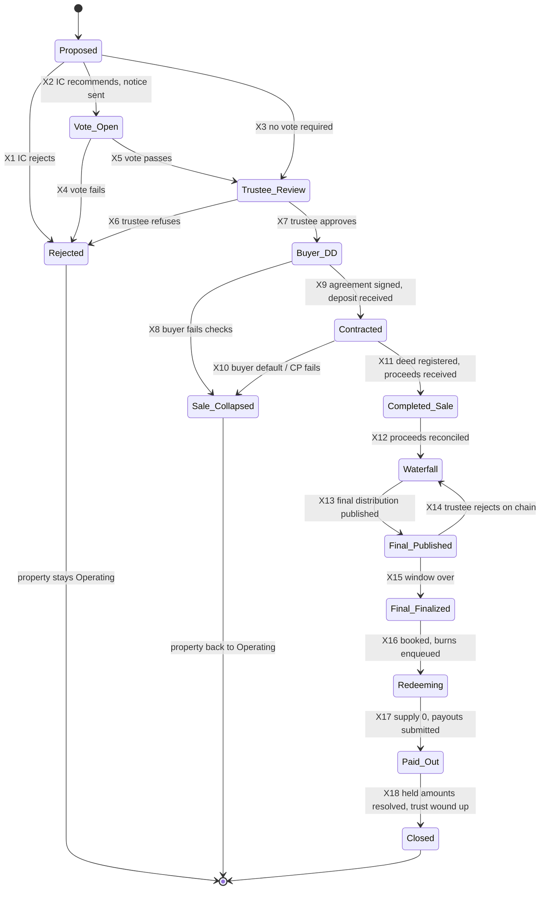

# S-05: Sale, exit, redemption and closure

- Status: Draft for owner review; build refinements §14-§15 and implementation status §16 (2026-10-22, branch `s-05-exit`, migration `0027_exit.sql`)
- Date: 2026-10-13
- Lifecycle stages: 15 (sale and exit), 16 (redemption, burn and closure)
- Exceptions covered: sale collapses, partial exit, buyer default, investor without payout account at the final distribution
- Builds on: contract-spec §5.1 (IssuanceGuard.burn with single-use refId, I-11), §6.1 (DistributionRegistry), §6.2 (DocumentRegistry, `InvestorVote`), §10 (sale vote off chain), threat T-2, S-03 (distribution machinery, held payouts), [ADR 0007](../decisions/0007-reconciliation.md) (`issuance.burn_not_reconciled` today a warning)

## 1. Purpose and scope

Sell the property (or part of it) only with the approvals the unit rights require, receive the proceeds into trustee escrow, pay what the trust owes, distribute the rest to holders at a record block, cancel the units by burning them through `IssuanceGuard.burn` with a single-use refId, and close the trust, keeping every record for the retention period.

## 2. Actors and roles

| Role | Does |
|---|---|
| Sponsor / property manager / operations | May propose a sale with a rationale |
| Investment committee | Recommends or rejects the proposal |
| Independent valuer(s) | Current valuation for the fairness check |
| Investors | Vote when the unit rights require (S-01 OB-35) |
| Scrutineer (independent, e.g. the auditor) | Counts the vote |
| Trustee officer | Approves the sale, signs the sale deed as owner, approves the waterfall and final distribution |
| Legal reviewer | Buyer due diligence, sale agreement, transfer of title |
| Compliance officer | Buyer KYB/KYC, sanctions, source of funds, STR |
| Operations / finance maker and checker | Waterfall, final distribution, burns |
| Issuance Safe | Burns |

**SoD.** EX-SOD-1 the proposer cannot count the vote or approve the waterfall. EX-SOD-2 anyone related to the buyer is excluded from IC and trustee decisions (declared conflicts). EX-SOD-3 waterfall maker ≠ checker ≠ trustee approver.

## 3. State machine (exit)

Property state: Operating → **Exit in Progress** from X7 to X17 → **Closed** at X18; back to Operating after X1/X4/X6/X8/X10.

| # | Guard | Actor | Maker-checker | Audit event |
|---|---|---|---|---|
| X1/X2/X3 | Proposal with offer, valuation, rationale, costs; X3 only if the unit rights need no vote | IC (quorum) | **Yes** | `exit.proposed` / `exit.ic_decided` |
| X4/X5 | Vote result per EX-3, counted by the scrutineer; result hash anchored as `InvestorVote` | Scrutineer + trustee | **Yes** | `exit.vote_result` |
| X6/X7 | Price ≥ EX-5; legal advice; conflicts cleared | Trustee | **Yes** | `exit.trustee_decided` |
| X8/X9 | Buyer KYB/KYC, sanctions, source of funds (EX-6); agreement hashed | Compliance + legal + trustee | **Yes** | `exit.buyer_checked` / `exit.contracted` |
| X10 | Default notice or CP deadline passed | Legal + trustee | **Yes** | `exit.collapsed` |
| X11 | Sale deed registered (hash); full price booked `exit:<token>:proceeds:<n>` | Legal + bank service | No | `exit.sale_completed` |
| X12 | Cash check clean for the proceeds; recon gate open | Finance | No | `exit.proceeds_reconciled` |
| X13 | Waterfall approved (EX-10); record date and block (EX-12); statement and tax schedule hashed; token paused | Finance maker + checker + trustee; Ops Safe publishes | **Yes** | `exit.final_published` |
| X14 | Trustee reject within 48 h | Trustee Safe | Safe threshold | `exit.final_rejected` |
| X15 | Window over | anyone | No | `exit.final_finalized` |
| X16 | Journals booked; one `issuance.burn` per holder wallet in an approved redemption batch | Ops maker + checker + trustee | **Yes** | `exit.redemption_started` |
| X17 | `totalSupply` = 0 in the read model; payout batch submitted; `recordPayout` confirmed | System | No | `exit.redeemed` |
| X18 | No held lines (or transferred per unclaimed rules); final accounts audited; trust wound up; archive sealed (EX-30) | Trustee + finance | **Yes** | `exit.closed` |

## 4. Business rules

- **EX-1** A sale needs: IC recommendation, investor approval if the unit rights require it, and trustee approval. The token never transfers title: title moves only by a registered sale deed signed by the trustee (or the SPV), threat T-2.
- **EX-3** Vote (off chain, contract-spec §10): eligible = holders at a vote record block announced in the notice; one unit one vote; quorum and majority per the trust deed (default proposal: 50 % quorum, 75 % of votes cast; LEGAL TO CONFIRM); voting through the portal with identity verification; notice period at least 21 days. The full result (per-wallet ballot list hashed, totals public) is anchored in DocumentRegistry as `InvestorVote`. Related parties (sponsor, buyer) do not vote, if the deed says so.
- **EX-5** Price not below the lower of two current independent valuations unless the vote approved a lower price explicitly.
- **EX-6** Buyer due diligence: KYB/KYC (as S-01), sanctions/PEP, source of funds, payment only from the buyer's own account (credit from any other account goes to suspense and is returned), STR assessment.
- **EX-7** Proceeds are paid by the buyer into trustee escrow (Raast/RTGS) against a payment code of new purpose `exit_proceeds` (bank change); a deposit is booked the same way and is refundable or forfeited per the agreement.
- **EX-10** **Waterfall** (order fixed by the trust deed, default): (1) secured debts and charges on the property; (2) transaction costs (brokerage, legal, duties, CVT, registration); (3) taxes payable by the trust on the sale (LEGAL TO CONFIRM capital gains treatment); (4) outstanding fees and vendor payables; (5) tenant deposits transferred to the buyer or refunded; (6) a closure reserve for wind-up costs and contingencies (released later as a final adjustment); (7) the remaining reserve released; (8) the remainder = distributable to holders, plus undistributed rent of the last period.
- **EX-11** The waterfall is maker-checker and trustee-approved; each line has evidence (invoice, tax computation, discharge letter hash).
- **EX-12** Final record date announced ≥ 10 business days before; the token is already paused (transfer-closed, S-04) so balances only change through RecoveryGuard; no transfer case may be executed after the record block (S-04 TR-10). Record block rule as S-03 OP-33.
- **EX-13** Entitlements: largest remainder on units at the record block (S-03 OP-35), WHT per S-03 OP-36/OP-40 with the income type of an exit distribution (LEGAL TO CONFIRM: capital gain vs dividend), Merkle leaf (wallet, net paisa), statement `pt-rent-statement-v2` with `kind: "final"`.
- **EX-14** **Burn after finalization, before or independent of payout (recommended).** Once the final distribution is finalized, each holder's entitlement is fixed on chain (root, total, proof) and in the ledger (`rent:payable:<subjectId>`). Every holder wallet's full balance at the record block is then burned: `IssuanceGuard.burn(wallet, balance, refId)` with `refId = keccak256("property-token:redemption:<token>:<distributionId>:<wallet>")`, outbox key `burn:<refId>`. Burns work while paused and on frozen balances (ERC-3643 `burn` unfreezes frozen amounts; verified in code, to be covered by a test). A held payout remains owed after the burn and is provable with the Merkle proof. LEGAL TO CONFIRM that units may be cancelled before every holder is paid (alternative: burn each wallet only after its line is paid; slower, keeps tokens alive for unclaimed lines).
- **EX-15** Burned units = balance at the record block for every wallet, exactly; Σ burns = `totalSupply` at the record block. After the last burn the trustee reduces `trusteeCap` to 0 through the timelock and records the register as closed.
- **EX-16** Partial exit (sale of part of the property, e.g. one floor): no burn; proceeds after the waterfall are distributed as a special distribution (S-03 machinery, `kind: "special"`); units stay outstanding with a reduced asset base; disclosed with an updated valuation. A partial **redemption** (cancelling a fraction of every holding) is not supported in v1 because units are whole numbers (open question Q-2).
- **EX-30** Closure: final audited accounts, final tax filings and certificates, trust deed termination or SPV wind-up, documents anchored (`AuditReport`, `Other`), the chain contracts left in place (paused, supply 0) as permanent evidence, read model and ledger archived; records kept at least 10 years (ADR 0009 decision 3, LEGAL TO CONFIRM).

## 5. Data to record

Exit case (proposal, valuations, IC decision, vote notice, ballots hash, result, trustee decision), buyer (KYB/KYC refs), sale agreement and deed hashes, proceeds receipts, waterfall lines with evidence, final record date/block, final statement and tax schedule hashes, on-chain distribution id, redemption batch (wallet, units, refId, outbox command, burn tx), payout batches, held lines, closure checklist with evidence.

## 6. Ledger journal conventions

| Journal key | Postings | `external_ref` |
|---|---|---|
| `exit:<token>:deposit` / `exit:<token>:proceeds:<n>` | Dr `bank:trustee-escrow`, Cr `exit:pool:<token>` (new, liability) | Raast/RTGS reference |
| `exit:<token>:waterfall:<line>` | Dr `exit:pool:<token>`, Cr the payable (`debt:payable:<lender>`, `vendor:payable:<id>`, `tax:payable:<token>`, `reserve:<token>:closure`) | evidence id |
| `exit:<token>:waterfall:<line>:paid` | Dr payable, Cr `bank:trustee-escrow` | batch reference |
| `exit:<token>:reserve-release` | Dr `reserve:<token>`, Cr `exit:pool:<token>` | approval id |
| `exit:<token>:capital-release` | Dr `property:<token>:capital`, Cr `property:<token>:acquisition` (asset derecognised; gain/loss to `property:<token>:capital`) | sale deed hash |
| `rent:wht:<token>:<id>` | Dr `exit:pool:<token>`, Cr `tax:wht-payable:<token>` | statement hash |
| `rent:distribution:<token>:<id>` | Dr `exit:pool:<token>`, Cr `rent:payable:<subjectId>` | statement hash |
| `rent:payout:<token>:<id>` (+ follow-ups) | payables → bank | `PTPAY-…` |

The final distribution deliberately keeps the `rent:` key family: reconciliation and the bank payout service match every DistributionRegistry distribution by `rent:distribution:<token>:<id>` and `rent:payable:<subjectId>`, so they work unchanged (open question Q-3).

Burns move no money; they are matched to the redemption batch (outbox `issuance.burn` payloads), not to a ledger journal.

## 7. On-chain actions and reconciliation

| Action | Contract | Signer path | Outbox kind / key |
|---|---|---|---|
| Anchor vote result, sale deed, final accounts | `DocumentRegistry.add` (`InvestorVote`, `TitleDeed`, `AuditReport`) | Ops Safe | `document.add` |
| Final distribution | `DistributionRegistry.publish / finalize / recordPayout` | Ops Safe | `rent.publish`, `rent.finalize`, `rent.record_payout` |
| Redemption | `IssuanceGuard.burn(wallet, units, refId)` | Issuance Safe | `issuance.burn` (policy new: only for a refId in an approved redemption batch of a finalized final distribution; recon gate required, open question Q-4) |
| Cap to 0 | `setTrusteeCap(0)` via timelock after supply = 0 | Admin Safe | not via outbox |

Reconciliation: replace the warning `issuance.burn_not_reconciled` with blocking checks `issuance.orphan_burn` (a `Burned` refId not in an approved redemption or reversal batch, S-06), `issuance.burn_amount_mismatch` (burned ≠ the wallet's balance at the final record block), `exit.supply_not_zero` (warning, blocking after the SLA once Redeeming), `exit.waterfall_mismatch` (exit pool not zero after the final distribution apart from the closure reserve).

## 8. Exceptions and alternative paths

| Case | Handling |
|---|---|
| Vote fails / trustee refuses | Property stays Operating; disclosure |
| Sale collapses (buyer fails checks, default, CP fails) | X8/X10; deposit forfeited or refunded per agreement; forfeited deposit to `exit:pool` then distributed as a special distribution or kept in reserve per the trust deed; costs incurred booked as expenses |
| Proceeds short or late | No final distribution until the full price is reconciled; partial receipts stay in `exit:pool` |
| Holder without payout account at the final distribution | Held line (S-03 OP-53), units still burned (EX-14); paid by follow-up; unclaimed rules after the legal period |
| Frozen or sanctioned holder | Entitlement computed; units burned (cancellation is required to close the register; LEGAL TO CONFIRM), payout held until S-06 releases it; funds of a designated person stay frozen |
| Deceased holder | Entitlement owed to the estate; paid to heirs per S-06 |
| Burn fails (unknown outcome) | Outbox review; never re-burn with another refId; resolve from chain |
| Error after finalization | Correct by an adjustment from the closure reserve before closing |

## 9. Notifications and disclosures

Sale proposal and rationale, vote notice (agenda, valuations, conflicts, how to vote), vote result, trustee decision, sale completion, waterfall summary, final record date (with "units will be cancelled after the final distribution"), statement and proof, payout or held status, final tax certificate, closure notice. Disclosure: exit is not guaranteed; illiquidity until exit; tax treatment of exit proceeds.

## 10. Regulatory assumptions (LEGAL TO CONFIRM)

1. Vote thresholds, notice periods and who votes (trust deed / REIT rules).
2. Tax on the sale (trust level) and on exit distributions (investor level), WHT sections and rates.
3. Whether units may be cancelled before all holders are paid (EX-14).
4. Unclaimed final distributions.
5. Retention period and the winding-up procedure for the trust or SPV.

## 11. Acceptance criteria

1. No burn without a finalized final distribution and an approved redemption batch; each refId burns once (I-11).
2. After redemption, `totalSupply` = 0, `trusteeCap` = 0, and every former holder's entitlement is either paid (bank line, `recordPayout`) or owed in `rent:payable:<subjectId>` and provable on chain.
3. Σ waterfall + Σ WHT + Σ net = proceeds + released reserves + undistributed rent, exactly.
4. Reconciliation clean through the whole exit, including the new burn checks.

## 12. Test plan

- **Unit:** waterfall order and arithmetic; vote quorum/majority at the boundaries; refId derivation.
- **Property-based:** random holders and frozen balances: Σ burns = supply at record block; entitlements exact; held lines owed after burn.
- **Integration (Besu):** paused token, final distribution, burns (including a fully frozen wallet and a partly frozen one) through outbox + signer; supply 0; `issuance.orphan_burn` on a burn outside the batch.
- **E2E (pilot rehearsal):** one property end to end on the local network: S-01 → S-02 → one S-03 period → S-05 exit, all reconciliation runs clean.

## 13. Open questions

- Q-1 Vote thresholds (50 % quorum, 75 % majority proposed) and notice (21 days).
- Q-2 Partial redemption (cancelling part of every holding) needed? Not supported in v1 (whole units).
- Q-3 Keep the `rent:` journal family for final distributions (recommended, no recon change) or introduce `dist:` with a recon change.
- Q-4 Should `issuance.burn` require the reconciliation gate like payout kinds? Recommended yes (signer change).
- Q-5 Burn timing: after finalization (recommended) or per wallet after payment.

## 14. Build refinements (2026-10-22, before code; migration `0027_exit.sql`, ADR 0005 / 0007 / 0011 amendments)

The spec was silent or open on the points below. These refinements are the working rules for the build (owner may override; questions in §16.4).

### 14.1 Decisions on the open questions

- **Q-3 (journal family):** the final distribution keeps the `rent:` family (`rent:wht:<token>:<id>`, `rent:distribution:<token>:<id>`, `rent:payout:<token>:<id>`), debiting `exit:pool:<token>` instead of `rent:pool:<token>`. Reconciliation, the bank payout path and the trustee's 48-hour review (0023 T-3) work unchanged.
- **Q-4 (gate on burns):** yes. `issuance.burn` needs the reconciliation gate (`recon.payout_gate()`) at request and at signing time, like the payout kinds.
- **Q-5 (burn timing):** a per-case **burn rule** fixed when the redemption batch is created: `after_payment` (**default**, task T-025 acceptance and the safer reading of EX-14 while LEGAL has not confirmed early cancellation) or `after_finalization` (EX-14 recommendation; only when the maker selects it, and only after LEGAL confirms). Under `after_payment` a holder's units are burned only once the holder's final line is paid: the line is in a SUBMITTED payout batch (distribution or follow-up) of the final distribution, not held, and not returned. A line with nothing to pay (net 0) is burnable at once. A held line (no payout account, not verified, no KYC binding) is burned only after a **held-line release** decided by an operations checker and a trustee officer (§8 "units still burned"); the payable stays owed and provable.
- **EX-3 thresholds** are settings (`exit.settings`: quorum 50 %, majority 75 % of votes cast, notice 21 days), LEGAL TO CONFIRM. The vote itself is held off chain (portal ballots are out of scope); the scrutineer's counted result is recorded and checked against the thresholds in SQL.
- **EX-12 notice:** "10 business days" is enforced as at least 14 calendar days between the record-date announcement and the record date (`record_notice_days`; no business-day calendar yet).
- **EX-13 income type:** a new income type `exit_distribution` with **PLACEHOLDER** rates (copies of the S-03 placeholders, LEGAL/TAX TO CONFIRM capital gain vs dividend). As in S-03, approval with placeholder rates is refused unless `ops.settings.allow_placeholder_rates` is on (local development only).

### 14.2 Who decides what (capacities)

Every transition that the table in §3 marks as maker-checker is a **decision**: one operations maker proposes it (with its evidence hashes) and every capacity listed below approves it, each a different officer, none the proposer (EX-SOD-1/3), none with a declared conflict on the case (EX-SOD-2). One rejection ends the decision; the case keeps its state. Votes are cast only in PT Control (officer session, security-key step-up, digest of what was shown).

| Decision | Capacities (one officer each) |
|---|---|
| X1 / X2 / X3 investment committee | operations checker + compliance officer (committee stand-in; the S-01 committee screens are not reused) |
| X4 / X5 vote result | operations checker (scrutineer's count checked) + trustee officer |
| X6 / X7 trustee decision | legal officer (legal advice) + trustee officer |
| X8 / X9 buyer checks and agreement | compliance officer + legal officer + trustee officer |
| X10 collapse | legal officer + trustee officer |
| X11 sale completed (deed) | legal officer |
| X12 proceeds reconciled | operations checker |
| X18 closure | operations checker + trustee officer |
| HR held-line release (no state change) | operations checker + trustee officer |

X13-X17 are system transitions taken by `exit.tick()` from the read model (publish, reject, finalize, supply 0 and payout recorded). Proceeds, waterfall payments, the waterfall, the final calculation and the redemption batch have their own maker-checker records (below).

### 14.3 Money and units (as the database enforces them)

- **Proceeds (EX-7, X9-X11):** recorded only from an imported bank statement credit line on the account registered for `bank:trustee-escrow` (or a credit the bank service sent to `bank:suspense`, re-attributed), once per line, maker-checker; journals `exit:<token>:deposit` (one) and `exit:<token>:proceeds:<n>` (Dr the bank or suspense account, Cr `exit:pool:<token>`, `external_ref` = bank reference). A payment code of purpose `exit_proceeds` (bank change) is not built: proceeds are attributed from the statement.
- **Waterfall (EX-10/11):** lines in the fixed order (secured debt, transaction costs, sale taxes, payables, tenant deposits, closure reserve; inflows: reserve release from `reserve:<token>`, undistributed rent from `rent:pool:<token>`), each with an evidence SHA-256. Maker drafts, submits; an operations checker checks; a trustee officer approves (three different people). All line journals post in the trustee's approval transaction. Outflows may not exceed the pool plus inflows.
- **Waterfall payments:** a bank statement DEBIT line on the trustee escrow pays exactly one approved outflow line (maker-checker), journal `exit:<token>:waterfall:<line>:paid` (Dr the payable, Cr `bank:trustee-escrow`, `external_ref` = bank reference), so the cash check matches it.
- **Final distribution (EX-12/13):** calculated at the announced record date and an indexed record block while the token is paused, from the exit pool balance (= distributable gross), with the S-03 arithmetic (largest remainder, ties by wallet; WHT round half up per line; leaf = net). Every holder at the record block has a line (a holder whose gross rounds to 0 has a 0 line, so the redemption can still burn the units). Statement `pt-rent-statement-v2` with `distributionKind: "final"` and the exit case id; tax schedule `pt-tax-schedule-v1`; trustee pre-check (recomputed root) and operations checker approval; the Ops Safe publishes on chain (outside the platform, as S-03 today); the 48-hour trustee review of 0023 applies.
- **Redemption batch (X16, EX-14/15):** one line per holder wallet at the record block, units = that wallet's balance at the record block, refId = keccak256(`property-token:redemption:<token>:<distributionId>:<wallet>`) computed by the service and re-derived by reconciliation and by the signing service; Σ units = supply at the record block. Created by an operations maker after the distribution is finalized, checked by an operations checker, approved by a trustee officer; the trustee's approval books `rent:wht` / `rent:distribution` from the exit pool (refused if the trustee rejected the distribution on chain) and moves the case to Redeeming in the same transaction. Burns are enqueued (`burn:<refId>`, kind `issuance.burn`) by the approval and by the tick as lines become eligible under the burn rule.
- **Signing (new kind `issuance.burn`, deny by default):** allowed only for exactly the outbox command the batch enqueued (`exit.burn_allowed`: same jsonb payload, approved batch, case Redeeming, line eligible now, not yet burned), the refId re-derived in the signer from the token, on-chain distribution id and wallet, the approved IssuanceGuard, a balance covering the amount, the reconciliation gate and a daily count limit; trustee co-signature if the policy asks for approvals (0023 co-sign kinds).
- **Register and subscriptions:** when the read model shows a burn, the tick moves the wallet's active S-02 subscriptions of that token to `redeemed` (V19, which removes their units from the trustee register, 0023 T-4) and enters any remainder as a `redemption` register entry.
- **X17** needs supply 0 in the read model, every line burned, the final payout batch submitted and `recordPayout` seen on chain (status `paid`).
- **X18** needs: no unpaid final line, exit pool 0, closure reserve 0, every approved waterfall outflow paid, supply 0, trustee cap 0 in the read model (timelock, outside the platform), the trustee register total 0, final accounts and wind-up evidence hashes.

## 15. Investor redemption requests (phase 0)

The spec had no investor-initiated redemption. The trust is **closed-ended**: units are cancelled only at exit (EX-14). Phase 0 therefore builds a **request queue only**; it moves no money and no units.

- **EX-40** A redemption request is a non-binding expression of interest by a KYC-verified holder, lodged on the website in an open **redemption window** of the token, through a session-bound wrapper with a passkey step-up (action `exit.redemption_request`, always; the T-030 waiver applies while passkeys are not required on the plain-HTTP demo).
- **EX-41 Window:** proposed by an operations maker (token, opening and closing time, NAV per unit with the SHA-256 of the valuation evidence, discount), approved by an operations checker. Refused for a token with a live exit case from Vote Open on.
- **EX-42 Price rule:** indicative price per unit = floor(NAV per unit x (1,000,000 - discount ppm) / 1,000,000) paisa, discount 0-20 % (default 0 %), frozen in the window; indicative value = units x price. Shown as "indicative, not an offer".
- **EX-43 Limits:** units between 1 and the holder's free balance in the read model (balance minus frozen units; an address-frozen wallet cannot request); one live request per investor per window; the window's total requested units at most a cap (default 10 % of the supply when the window was approved); a request beyond the cap is refused (first come, first served).
- **EX-44** The investor may withdraw a submitted request while the window is open (step-up `exit.redemption_withdraw`).
- **EX-45** After the window closes, an operations maker proposes the outcome and an operations checker approves it: every submitted request becomes `recorded` (carried to the trustee and the sponsor as demand evidence: secondary matching S-04, or an exit proposal), except requests of investors no longer KYC-verified, which become `declined` (the investor sees "under review", no tipping-off).
- **EX-46** Not built in phase 0 (LEGAL / REGULATOR TO CONFIRM): binding redemption at NAV, payout and burn of redeemed units, gates and suspension rules, pro-rata scaling. A later phase would reuse the final-distribution and redemption-batch machinery above with a per-request refId.
