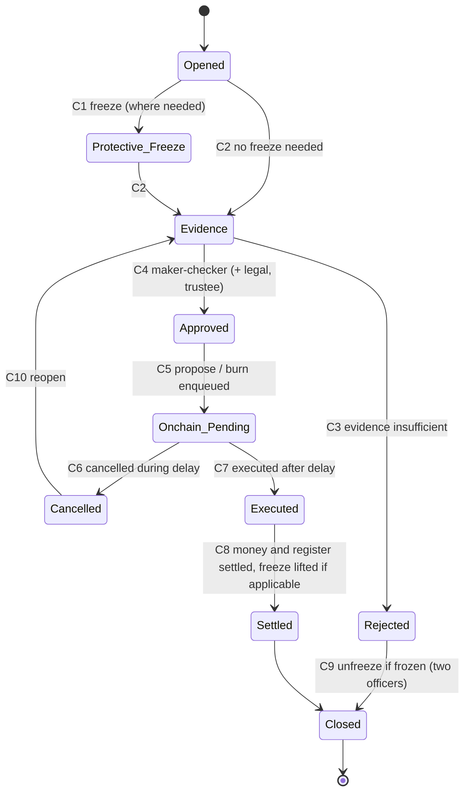

# S-06: Lost wallets, inheritance, payment reversals and sanctioned investors

- Status: Draft for owner review (functional specification; no code yet)
- Date: 2026-10-13
- Lifecycle: cross-cutting cases after (or during) issuance
- Exceptions covered: lost wallet, deceased investor, payment reversal after allocation, sanctioned investor or wallet
- Builds on: contract-spec §4.2 (offboarding order, never `updateIdentity` on a holding wallet), §5.3 FreezeGuard, §5.4 RecoveryGuard (48 h, evidence hash, cancel), §5.1 burn, findings F-01/F-02, I-13, I-17, threats SC-5, KYC-4, KYC-5, M-6, migration `0011_integration.sql` (automatic freeze on lost verification), ADR 0009 (held payouts, sanctions review)

## 1. Purpose and scope

Handle the cases where units must move or be stopped without the holder's ordinary action: a lost wallet, a deceased holder, a payment taken back after units were issued, and a sanctioned holder. Every case is a **compliance case** with maker-checker, a trustee decision where units move, an evidence file whose hash is anchored, and the on-chain delay of RecoveryGuard.

## 2. Actors and roles

| Role | Does |
|---|---|
| Investor / claimant (heir, administrator, payer's bank) | Opens a request, provides evidence |
| Case maker (compliance or operations) | Builds the case file, runs checks |
| Compliance checker (different person) | Approves; decides STRs |
| Legal reviewer | Validates court documents, succession certificates |
| Trustee officer / Trustee Safe | Proposes and executes RecoveryGuard requests; updates the register |
| Ops Safe | Freezes and unfreezes (FreezeGuard) |
| Admin Safe / Trustee Safe | Cancel pending recovery requests |
| Issuance Safe | Burns in a reversal or redemption |

**SoD.** RC-SOD-1 maker ≠ checker ≠ trustee approver for every case. RC-SOD-2 unfreezing is always two compliance officers (as in 0011 I-3) and never the officer who froze. RC-SOD-3 nobody handles a case of a relative or of themselves.

## 3. Case state machine (common)

| # | Guard | Actor | Maker-checker | Audit event |
|---|---|---|---|---|
| C1 | Risk of loss or legal duty; `FreezeGuard.freezeAddress(wallet, caseId)` or `freezePartial` | Compliance (protective, single officer) via Ops Safe | No (protective) | `case.frozen` |
| C2 | Case type known, claimant identified | Case maker | No | `case.evidence_started` |
| C3 | Reason | Compliance checker | **Yes** | `case.rejected` |
| C4 | Type-specific rules (§4) | Compliance checker + legal + trustee | **Yes** | `case.approved` |
| C5 | Evidence pack hashed and anchored (`CourtOrder` or `Other`, no personal data in the uri) | Trustee Safe / Issuance Safe via outbox | Safe threshold | `case.onchain_proposed` |
| C6 | Objection received or error found | Admin or Trustee Safe | Safe threshold | `case.cancelled` |
| C7 | `RECOVERY_DELAY` (48 h) passed; checks re-run | Trustee Safe | Safe threshold | `case.executed` |
| C8 | Read model shows the movement; ledger and register updated | Case maker + checker | **Yes** | `case.settled` |
| C9 | Two officers, neither the one who froze | Compliance ×2 via Ops Safe | **Yes** | `case.unfrozen` |

`caseId` on chain = `0x` + SHA-256 of `pt-case-v1:<caseUuid>` (same style as the KYC offboarding case id in 0011). The evidence hash on RecoveryGuard is the SHA-256 of the evidence pack stored in the document vault.

## 4. Case types and rules

### 4.1 Lost wallet

- **RC-1** Depends on the wallet custody model (open question Q-1). Custodial (key held by the platform's HSM per investor): a lost phone is an **account recovery** (re-verify identity, new device binding), no chain action. Self-custody: a lost key needs `RecoveryGuard.propose(WalletRecovery, oldWallet, newWallet, onchainId, balance, evidenceHash)`.
- **RC-2** Re-verification before approval: NADRA + liveness again (fresh, ADR 0009 Y-3), match to the same KYC subject (CNIC hash), the old contact details notified with 48 h to object, step-up by a branch or video call for holdings above a threshold.
- **RC-3** Protective freeze of the old wallet (C1) as soon as the request is credible.
- **RC-4** The new wallet must be added as a management key on the investor's ONCHAINID before execution; the token re-registers it and moves the full balance including frozen amounts and frozen status (contract-spec §5.4). Never `updateIdentity` on a holding wallet (F-02).
- **RC-5** After execution the new wallet is frozen if the old one was (status carries over); unfreeze is C9.
- **RC-6** Pending distributions: entitlements already published for the old wallet stay with the old wallet's leaf; payout is to the investor's bank account (not the wallet), so nothing changes.

### 4.2 Deceased investor

- **RC-10** Opened on notice of death (heir, bank, NADRA record). Immediate protective freeze (C1); distributions to the deceased are **held** (payout account of the deceased is retired; S-03 OP-53).
- **RC-11** Evidence: death certificate (NADRA), succession certificate or letters of administration from the competent court, or NADRA succession certificate where available, stating heirs and shares; legal reviewer verifies with the issuing authority. LEGAL TO CONFIRM accepted instruments.
- **RC-12** Every heir who will receive units completes KYC (`verified`) and registers a wallet and a payout account. Heirs who will not hold units (minors without a guardian, non-residents outside the allowed countries, heirs who do not want units) are paid in cash instead (RC-14).
- **RC-13** **Whole units:** shares from the certificate rarely divide into whole units. Units are allocated by the largest-remainder method only if all adult heirs sign a family settlement accepting it; otherwise the units that cannot be split exactly are redeemed or sold (RC-14) and the cash is split exactly per the certificate. Each heir's allocation must fit their `maxBalance` headroom.
- **RC-14** Cash-out options for heirs: an off-market transfer to a buyer (S-04) or, if the trust deed allows, a redemption by the trust (burn with a refId `keccak256("property-token:succession:<caseUuid>:<wallet>")`, paid from a source the trust deed permits; LEGAL TO CONFIRM). Until then the units stay frozen in the deceased's wallet.
- **RC-15** Transfers to heirs are `RecoveryGuard.propose(ForcedTransfer, deceasedWallet, heirWallet, …)` one per heir, 48 h each, executed by the Trustee Safe. Held distributions are paid to the heirs per the certificate shares (follow-up batch lines to the heirs' accounts; ledger moves the payable from the deceased's subject to the heirs').
- **RC-16** After the balance is zero: identity deleted through the timelock (offboarding order, F-01/F-02).

### 4.3 Payment reversal after allocation

- **RC-20** Raast credits are normally final. A reversal arises from a bank recall (fraud on the payer's account), a court order, or a mistaken payment. Opened by the bank's notice or an order; compliance assesses an STR.
- **RC-21** Before completion (S-02 Payment Confirmed or Allocation Pending): no token exists; the subscription goes Disputed; if the reversal is legally required the credit is returned (`sub:<refId>:reversed`, same original reference), units released; else the case is rejected.
- **RC-22** After issuance: protective freeze of the investor's wallet for the subscribed units (`freezePartial`). If the reversal is legally required: (a) the units are cancelled by `IssuanceGuard.burn(wallet, units, refId)` with `refId = keccak256("property-token:reversal:<subscriptionId>")`, and (b) the money is returned from a source permitted by the trust deed (the subscription money was spent at completion), typically by selling the units to a new subscriber through S-04 and returning those proceeds instead of burning. Which applies is a trustee decision with legal advice (open question Q-3).
- **RC-23** Distributions on disputed units are held until the case ends; then paid to whoever the decision names.
- **RC-24** Never refund money for units that still exist on chain; never burn units without a decided case (reconciliation `issuance.orphan_burn`, S-05).

### 4.4 Sanctioned investor or wallet

- **RC-30** A sanctions hit (ADR 0009 Y-3: final) removes verification; `kyc.enqueue_offboarding` (0011 I-3) enqueues `compliance.freeze` for every bound wallet automatically. Freezing must happen without delay. LEGAL TO CONFIRM the reporting duties to SECP/NACTA/FMU and the time limits.
- **RC-31** Units are **not** moved, redeemed or refunded; distributions are computed and **held** (ledger payable stays); subscription money not yet applied is not refunded (Blocked). Everything stays frozen until delisting or a competent authority's order.
- **RC-32** The investor is not told the reason (tipping-off); notifications are generic ("your account is under review").
- **RC-33** On delisting: two compliance officers unfreeze (C9), KYC re-verified, held payouts released by follow-up batches. On an order to transfer or confiscate: forced transfer or burn per the order, as a C4–C8 case.
- **RC-34** A possible match (not a hit) follows ADR 0009 Y-4; while in review the wallet is frozen (0011 I-3 treats `review` as not verified).

## 5. Data to record

Case: id, type, subject ids (investor, claimant, heirs), wallets, units, freeze actions (tx, caseId), evidence documents (hashes, verification method), decisions (maker, checker, legal, trustee, reasons), STR assessment (stored in the restricted compliance area), on-chain request ids and txs, ledger journals, register updates, notifications sent, state.

## 6. Ledger journal conventions

| Journal key | Postings | `external_ref` |
|---|---|---|
| `sub:<refId>:reversed` | Dr `investor:<subjectId>:subscriptions` (before completion) or Dr `property:<token>:capital` (after, if returned from trust funds), Cr `bank:trustee-escrow` | original Raast reference or the bank's recall reference |
| `case:<caseId>:payable-transfer:<n>` | Dr `rent:payable:<deceasedSubject>`, Cr `rent:payable:<heirSubject>` | succession evidence hash |
| `case:<caseId>:cash-out:<n>` | for heirs paid in cash: Dr the source (S-04 transfer escrow or redemption payable), Cr `bank:trustee-escrow` | batch reference |

No journal for freezes or wallet recoveries (no money moves); they are matched by case records.

## 7. On-chain actions and reconciliation

| Action | Contract | Signer path | Outbox kind |
|---|---|---|---|
| Freeze / unfreeze (full or partial) | `FreezeGuard.freezeAddress / unfreezeAddress / freezePartial / unfreezePartial` | Ops Safe | `compliance.freeze` (exists, 0011 I-2: only for not-verified owners); `compliance.freeze_case` (proposed: case-based freeze of a verified holder, e.g. deceased or disputed), `compliance.unfreeze` (proposed, two officers) |
| Wallet recovery | `RecoveryGuard.propose(WalletRecovery, …)` / `execute` / `cancel` | Trustee Safe; cancel Admin or Trustee | `recovery.propose`, `recovery.execute`, `recovery.cancel` (proposed) |
| Forced transfer (heirs, court order) | `RecoveryGuard.propose(ForcedTransfer, …)` | Trustee Safe | same |
| Burn (reversal, succession redemption) | `IssuanceGuard.burn(wallet, units, refId)` | Issuance Safe | `issuance.burn` (approved case required) |
| Identity deletion | Identity registry via timelock, only at zero balance | Admin Safe | not via outbox |

Reconciliation to add: `recovery.unmatched` (blocking: a `RecoveryExecuted`/`RecoveryProposed` with no approved case), `compliance.freeze_unmatched` (warning: a freeze without a case or offboarding record), `kyc.holder_unverified_unfrozen` (blocking: a wallet with balance > 0 whose owner is not verified and which is not frozen after the SLA), `issuance.reversed_not_resolved` (blocking after SLA: a `sub:<refId>:reversed` without a burn or approved transfer of the units).

## 8. Exceptions

Objection during the 48 h delay → cancel and reopen. Claimant fraud (forged succession certificate) → cancel, STR, police report by legal. Heir sanctioned → that heir's share stays frozen (RC-31). Chain outage → requests wait; delays are on chain. Unknown execution outcome → outbox review, resolved from the chain; never propose a second request for the same units while one is pending.

## 9. Notifications and disclosures

Claimant: received, evidence needed, approved/rejected, proposed on chain, executed. Old contact details: alert on any recovery request (objection window). Heirs: allocation and cash options. Sanctions: generic only. Disclosure (offering document and portal): how recovery and succession work, timelines (48 h on chain plus review), documents needed, that the trustee may freeze units by law.

## 10. Regulatory assumptions (LEGAL TO CONFIRM)

1. Accepted succession instruments and verification channels; treatment of minors' shares.
2. Legal basis and limits of freezing (court orders, UNSC/ATA obligations) and the reporting deadlines.
3. Whether a payment reversal after completion can force cancellation of units and from which funds a return may be made.
4. Tax on inheritance transfers (none expected) and on cash-outs.

## 11. Acceptance criteria

1. No RecoveryGuard request, unfreeze or case burn can be enqueued without an approved case by distinct maker, checker and trustee.
2. A sanctioned investor's wallets are frozen automatically, units never move, distributions are held, and the investor sees no sanctions detail.
3. Heirs receive exactly the certificate shares (units by agreement, the rest in cash), within each heir's max balance.
4. Identity deletion is impossible while a balance exists (procedure + portal check, F-02).
5. Every case is reconciled: chain events ↔ case records ↔ ledger.

## 12. Test plan

- **Unit:** heir allocation (largest remainder, settlement vs cash-out), refId derivations, case transitions.
- **Property-based:** random case sequences never leave a not-verified holder unfrozen beyond the SLA; held payouts are paid exactly once to the decided beneficiaries.
- **Integration (Besu):** wallet recovery with frozen status carried over; forced transfer to heirs while paused; cancel during delay; burn of a partly frozen balance; offboarding order with identity deletion only at zero.
- **E2E:** deceased investor flow through compliance and trustee portals with mock NADRA.

## 13. Open questions

- Q-1 Wallet custody model for the pilot: custodial (HSM-held per investor, recovery = account recovery; recommended for retail) or self-custody.
- Q-2 Threshold for in-person or video verification in recoveries.
- Q-3 Payment reversal after completion: replacement sale (recommended) vs burn and return from trust funds.
- Q-4 A case-based freeze kind for verified holders (`compliance.freeze_case`) needs a signer policy change; agree before Step 6.
